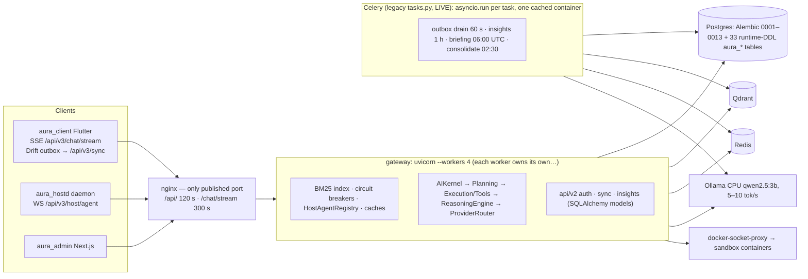

# AURA-AI System Audit — full mode

**Run ID:** `2026-10-26-full-699f27b` · **Baseline:** `699f27b` (merge of PR #181, committed 2026-10-19) on branch
`ccr-4760e151-1si7gz`, clean working tree · **Audit date:** 2026-10-26
**Objective (from invocation):** find UI/UX, business-logic, user-flow, architecture, security, performance and
reliability issues; recommend upgrades with a prioritized roadmap.
**Companion files:** [`remediation-roadmap.md`](remediation-roadmap.md) · [`audit-manifest.md`](audit-manifest.md) ·
per-lens evidence with full file:line detail in [`lens-evidence/`](lens-evidence/).

> This is a read-only audit. No product file was changed. It does not claim to have found every issue; see
> §7 Limitations. "Fixed in code" below never means "deployed" — live VPS state was not inspected.

---

## 1. Executive summary

AURA's core design is sound and much of what earlier reviews flagged has really been fixed:
- Session namespacing, refresh-token `GETDEL` and the SSRF guard are in place.
- Vector-owner isolation holds, the service-key scoping holds, and v3 resource routes are owner-scoped (no IDOR found).
- The hardcoded OAuth secret has been removed from code, and the CI `secrets.*`-in-`if:` bug is gone.
- The Alembic chain is linear with a single head.
- Prod/dev compose parity holds on network flags and the socket-proxy allowlist.

The problems that remain cluster around **five root causes**. They matter more than the individual counts.

1. **State that lives in one process while the system runs four.** The BM25 index, circuit breakers and the
   host-agent registry are per uvicorn worker, and Celery reuses one asyncpg pool across event loops.
   Results:
   - deleted documents stay searchable (**reproduced**);
   - a recovering LLM can stay locked out until restart (**reproduced**);
   - background jobs are likely failing from their second run.
2. **Approvals and identities that are not bound to what they authorize.**
   - Tool confirmation is still matched by tool name and position (CB-04, open), and resume replays the *latest*
     user message.
   - The hostd "read-only" tier can execute repository code with no approval.
   - JWT role claims feed back into role resolution, so a demotion never takes effect.
   - The dev stack holds the prod JWT key, and tokens carry no `iss`/`aud`.
3. **The sync protocol cannot survive one bad row or one slow transaction.**
   - The push has no per-mutation isolation, so one constraint violation stalls a device permanently.
   - The pull cursor comes from the app clock, so rows committed during a concurrent pull are skipped forever.
   - Memory and health rows already produce such failures in ordinary use.
4. **Deletion and sign-out don't delete.**
   - Sign-out keeps the previous user's local DB, outbox and cursor, and never revokes the refresh token.
   - The memory "forget" button hits a different id than the server holds.
   - Deleting a chat leaves the server transcript in use.
   - Admin "forget user" reports success while most stores keep the data.
5. **Timeout and degradation budgets that disagree across layers.**
   - The reasoner runs every non-streaming answer under a 60 s default.
   - nginx gives `/api/v3/chat` only 120 s.
   - SSE has no heartbeat against a 300 s read timeout.
   - Planner failures still silently become "answered directly" (CB-14, open).
   - The client has no Stop button and no idle timeout, so a stalled stream locks chat until restart.

**Counts.** 38 consolidated findings, from 88 lens-level items after deduplication:
- by severity: 0 Critical, 18 High, 19 Medium, 1 Low;
- by type: 35 defects, 3 opportunities;
- by evidence: 3 CONFIRMED by reproduction, 35 CODE-VERIFIED. Several of the CODE-VERIFIED findings carry
  sub-claims that are only PARTIALLY VERIFIED, and each says which.

One lens-level "Critical" (FL-01) was **downgraded on falsification**, see F-13.

**Why none is rated Critical.** Each top issue is either:
- conditional on an opt-in feature (the desktop hostd);
- conditional on unverified configuration (Firebase email/password provider, F-34);
- or a chain that needs a prior compromise (dev stack → prod token).

That conditionality is in the rationale, not a reassurance. Read F-01, F-02 and F-03 together: they are the
nearest thing to a live critical path.

**Top 10 to act on first** (full order in the roadmap):

| # | ID | Finding | Sev | Evidence |
|---|----|---------|-----|----------|
| 1 | F-01 | hostd "read-only" allowlist runs repo code (`npm test`, `pytest --collect-only`, `rg --pre`) + CB-05 exemption ⇒ prompt-injection → code execution on the user's machine | High | CODE-VERIFIED |
| 2 | F-03 | Dev stack mounts prod `jwt_secret` + `data_encryption_keys`; tokens lack `iss`/`aud` ⇒ dev compromise forges prod tokens | High | CODE-VERIFIED (config) |
| 3 | F-02 | Role demotion ineffective: JWT `role` claim is a candidate in `get_user_role`, re-stamped on refresh | High | CODE-VERIFIED |
| 4 | F-04 | Tool confirmation not bound to the approved call (CB-04 open) + client replays latest message + voice confirms by name | High | CODE-VERIFIED |
| 5 | F-19 | Circuit-breaker half-open probe lock: a cancelled probe locks the only provider until restart | High | **CONFIRMED** |
| 6 | F-11 | Sync push has no per-mutation isolation; health "today" rows collide ⇒ device sync stalls permanently | High | CODE-VERIFIED |
| 7 | F-14 | BM25 is per worker ⇒ deleted/superseded documents remain retrievable | High | **CONFIRMED** |
| 8 | F-15 | Memory decay compounds daily ⇒ 180-day-half-life memories deleted after ~21 days | High | CODE-VERIFIED (+ function-level repro) |
| 9 | F-20 | Celery reuses an asyncpg pool across `asyncio.run` loops ⇒ outbox drain/consolidation likely fail after first run | High | CODE-VERIFIED |
| 10 | F-05 | Sign-out leaves local data/outbox/cursor; refresh token never revoked ⇒ cross-account leak on shared devices | High | CODE-VERIFIED |

---

## 2. Scope, baseline and method

- **Scope:** the whole repository:
  - `aura_backend/`: `aura_core`, the legacy root tree, `api/v2`, Alembic;
  - `aura_client/`: Flutter app and `lib/desktop`;
  - `aura_admin/`: lightly covered;
  - `aura_hostd/`;
  - `deploy/`: compose, nginx, scripts;
  - `.github/workflows/`.

  `infra/` (Terraform), `docs/archive/`, the AP pilot fixtures and ML training code were out of scope.
- **Arguments used:**
  - `objective` as given and `mode=full`;
  - `project-paths` defaulted to the working directory;
  - no `baseline=` was passed, so `docs/roadmaps/AURA_CRITICAL_BACKLOG.md` (baseline `5db6692`, updates to
    2026-10-13) served as the prior-claims baseline and was re-verified item by item.
- **Method:** five independent read-only lenses (UX/a11y, flows/business logic, security/privacy,
  architecture/data, performance/reliability/CI) ran in parallel under the same evidence rules. The main
  auditor then:
  - re-opened the evidence for every High finding;
  - re-ran the three reproduction scripts;
  - deduplicated across lenses and resolved one cross-lens contradiction (F-13).
- **Skill resources:** `references/audit-checklist.md` and `references/report-template.md` were not available.
  Only `SKILL.md` was supplied. The severity rubric below and the report layout follow `SKILL.md` §3–§6
  directly.
- **Severity rubric used:**
  - **Critical:** a live, unconditional data-loss or exposure path.
  - **High:** a security boundary bypass, permanent data corruption or loss, or a core journey broken for
    ordinary use.
  - **Medium:** a degraded journey, a conditional exposure, or an operational risk with a workaround.
  - **Low:** polish or hygiene.

## 3. System map (observed, not documented)

**Observed vs documented.** The architecture docs describe the container as the wiring point and adapters as lazy;
both claims **hold** (`container.py`, `PostgresPool._get_pool()` with `asyncio.Lock`). The docs do not describe
the fact that several stateful components are per-process. That fact drives F-14, F-19 and F-27.

---

## 4. Findings

Format per finding: **evidence** (file:line) · **trigger** · **actual → expected** · **impact** · **root cause** ·
**fix** · **regression test** · **depends on** · **confidence**. Full narratives, including every file:line, are in
the linked lens file.

### 4.1 Security & privacy

#### F-01 — hostd untrusted-tier allowlist executes repository code without approval; server exempts `workspace_local` tools from taint
- **Severity:** High · **Type:** defect · **State:** CODE-VERIFIED · **Lens:** SEC-01, CB-05 (still **open**) · **Confidence:** High
- **Evidence:**
  - `aura_hostd/lib/src/command_policy.dart:64-77`: the allowlist includes `rg`, `cat`, `^npm\s+(…|test)`, and `pytest … --collect-only`.
  - The `[;&|`$<>\n]` metacharacter floor at `:58` does not stop flags.
  - `aura_backend/aura_core/tools/policy.py:114-115` allows `workspace_local and side_effecting` *before* the taint check at `:117`.
- **Trigger:** prompt-injected content (a cloned README, `fetch_url` output) leads the planner to `run_command("npm test")`, `rg --pre ./x.sh .`, `pytest --collect-only`, `git log --output=/abs/path`, or `cat ~/…/control.json`.
- **Actual → expected:** the command runs as the user's OS account with no approval. It should be inspection-only, or queued for approval.
- **Impact:**
  - Arbitrary code execution and file writes on the developer's real machine.
  - `cat` can read the hostd control token. Per SEC-01 that token is written with the default umask, and it can flip trust.
- **Root cause:** commands are classified by verb prefix, but these tools have code-executing flags or semantics. The exemption is a static tool property rather than a routing decision.
- **Fix:**
  - Remove `npm test`, `pytest --collect-only` and `rg` from the untrusted tier.
  - Reject `--pre`, `--output`, `--ext-diff` and `--textconv`.
  - Contain the path arguments of `cat`, `head`, `tail` and `grep`.
  - Write `control.json` with mode 0600.
  - Make the server exemption routing-aware: host-routed plus tainted means `needs_confirmation`.
- **Test:** `command_policy_test.dart` asserts `!= allow` for each payload above. A backend test asserts a tainted, desktop-routed `run_command` returns `needs_confirmation`.
- **Depends on:** none. ADR-014 needs amending for the routing-aware exemption.

#### F-02 — Role demotion never takes effect (the token's own role claim is trusted)
- **Severity:** High · **Type:** defect · **State:** CODE-VERIFIED (main auditor re-read) · **Lens:** SEC-02, FL-14 · **Confidence:** High
- **Evidence:**
  - `aura_backend/services/rbac.py:85-87`: `claimed = user_info.get("role")` is appended to the candidates, and the max wins.
  - `services/jwt_auth.py:233-235`: refresh re-stamps from the stored `user_info`.
  - `rbac.py:82`: `db_role`/`persisted_role` is never populated anywhere.
  - `infrastructure/db/user_repo.py:26-34`: writes a higher incoming role back to the DB.
- **Trigger:** a SuperAdmin demotes an Admin, or an operator removes an email from `ADMIN_EMAILS`. The user then keeps refreshing.
- **Actual → expected:** the old role survives every rotation (30-day rolling window), and `/sync` re-promotes the DB row. It should be resolved from authoritative sources on every refresh.
- **Impact:** a removed admin keeps admin and super-admin capabilities indefinitely, and the last-SuperAdmin guard is moot.
- **Root cause:** circular trust in a server-minted claim.
- **Fix:**
  - Drop `role` before `stamp_resolved_role` on refresh, and read the DB role by subject.
  - Stop the claim from upgrading the DB row.
  - Revoke sessions and device tokens on demote.
- **Test:** admin login, remove from the env list, refresh, assert `role=="User"` and `/admin/status`→403.
- **Depends on:** none.

#### F-03 — Dev stack holds prod signing and encryption keys; JWTs are not environment-bound
- **Severity:** High · **Type:** defect · **State:** CODE-VERIFIED (config). That the live VPS uses these paths is UNVERIFIED. · **Lens:** SEC-03, CB-08 (**open**) · **Confidence:** High (code), Medium (deployment)
- **Evidence:**
  - `deploy/docker-compose.dev.yml:170-181` mounts `./secrets/jwt_secret` and `./secrets/data_encryption_keys`, the same paths as prod at `deploy/docker-compose.prod.yml:208,240`.
  - `jwt.decode` in `services/jwt_auth.py` verifies neither `iss` nor `aud`.
  - The backup container mounts the whole `./secrets` directory (`docker-compose.prod.yml:1157`).
- **Trigger:** a dev-gateway token, or any compromise of a dev container (dev runs less-reviewed code and has mock attestation by default).
- **Actual → expected:** the dev token is valid in prod, and with F-02 its `role` claim is honored. The keys should be separate per stack, and `iss`/`aud` should be bound and verified.
- **Impact:** a dev compromise yields prod SuperAdmin for any user id, plus the prod encryption-at-rest key.
- **Root cause:** both compose files resolve `./secrets/*` in the same `deploy/` directory.
- **Fix:**
  - Give dev its own `./secrets-dev/`, generated by `bootstrap-secrets.sh`.
  - Add `iss=AURA_ENVIRONMENT` and `aud=aura-api`, and verify both.
  - Mount secrets into the backup container per file.
  - Add a parity test asserting the dev and prod secret sources differ.
- **Test:** `verify_access_token` rejects a token with the wrong `iss`. A compose test, next to `test_hosted_provider_compose_plumbing.py`, checks the secret sources.
- **Depends on:** a coordinated key rotation on the VPS (M2 procedure).

#### F-04 — Tool confirmation is not bound to the approved call; resume replays the wrong turn
- **Severity:** High · **Type:** defect · **State:** CODE-VERIFIED · **Lens:** CB-04 (**open**), FL-10, UX-04, UX-05, SEC-07 · **Confidence:** High
- **Evidence:**
  - `aura_core/execution/engine.py:475-489`: `confirmed = call_id in confirmed_call_ids or step.tool in confirmed_tools`, with positional ids `s{index+1}` (`planning/engine.py:313`).
  - Resume re-plans from scratch (`kernel.py:1250-1256`, `:1384-1400`).
  - Client `chat_repository.dart:253-282` replays `userMessages.last.content` and removes pending entries before sending. `chat_view_model.dart:136-146` sends both names and ids.
  - Voice confirms by name only and re-runs with `"continue"` (`aura_core/voice/session.py:162-168`). Voice and chat share one pending list (`live_voice_view_model.dart:74-86,128-139`).
  - `${sN.output}` substitutes raw untrusted output into later tool arguments (`execution/engine.py:60-83`).
- **Triggers:**
  - (a) Approve `delete_task(A)`; the re-plan yields `delete_task(B)`, which runs.
  - (b) The user sends turn 2, then approves turn 1's card; turn 2's text is replayed with turn 1's approvals.
  - (c) The user approves while another stream is in flight; the approval is silently dropped.
  - (d) Steps auto-allowed on the first run (`create_task`) run again on resume and produce duplicates.
- **Impact:** an approval can authorize a different, injection-steerable action. This is the ADR-006 guarantee the product claims.
- **Root cause:** a stateless confirmation design.
- **Fix:**
  - Store pending approvals server-side, keyed by `(turn_id, call_id, argument digest)`.
  - Resume executes the stored step rather than re-planning.
  - Drop `confirmedTools` names from client and voice.
  - Bind the client confirmation to the bubble's own turn, and disable it while streaming.
  - Treat a resolved `${sN.output}` from an `untrusted_content` tool as taint.
- **Test:** approve `delete_task(A)`, force a re-plan to `delete_task(B)`, and assert it is refused. Turn 1 = [create_task (auto), send_x (confirm)]; after confirming, `create_task` has executed exactly once.
- **Depends on:** none. This blocks M8.5a desktop AI coding.

#### F-05 — Sign-out keeps the previous user's local data, outbox and cursor, and never revokes the refresh token
- **Severity:** High · **Type:** defect · **State:** CODE-VERIFIED for the path (main auditor re-read). The cross-account effect is PARTIALLY VERIFIED. · **Lens:** UX-03 · **Confidence:** High
- **Evidence:**
  - `aura_client/lib/features/auth/presentation/auth_provider.dart:283-299` clears secure storage and the token cache only.
  - `POST /api/v3/auth/revoke` exists (`api/v2/auth.py:186-189`) and has no client caller.
  - Drift tables have no user column, and the outbox and cursor are global (`core/database/database.dart:228-243`).
  - The server creates rows that don't exist yet under the caller (`api/v2/sync.py:187-190`).
- **Trigger:** user A signs out and user B signs in on the same device.
- **Actual → expected:**
  - B sees A's tasks, finance, health, chats and memories.
  - A's unsynced rows are pushed as B's.
  - B's first pull uses A's cursor.
  - A's refresh token stays live.

  Sign-out should wipe the user-scoped tables, the outbox and the cursor, and revoke the refresh token.
- **Impact:** a privacy leak between accounts and misattributed data.
- **Fix:** best-effort `/auth/revoke`, plus `AppDatabase.wipeUserData()`. Alternatively, wipe when a different uid signs in.
- **Test:** an in-memory Drift DB: seed a task and an outbox row, sign out, assert both are empty and that revoke was called.

#### F-06 — Admin "forget user" (erasure) is partial and reports success
- **Severity:** High · **Type:** defect · **State:** CODE-VERIFIED · **Lens:** FL-07 · **Confidence:** High
- **Evidence:** `aura_backend/api/admin_platform.py:158-212` soft-deletes six v2 tables, revokes refresh tokens and returns `{"forgotten": true}`.
- **Data left in place:**
  - Project and Goal rows;
  - aura_core memory and vectors, knowledge documents, chunks and graph;
  - Redis session transcripts (30-day TTL);
  - the PersonalOsStore, feedback, telemetry and caches;
  - 30-day device tokens;
  - the soft-deleted ciphertext itself.
- **User-facing deletion:** no user-facing account deletion exists.
- **Impact:** an erasure request is not honored, while the operator is told it was.
- **Fix:** an erasure orchestrator in `container.py` that calls each port's owner-scoped purge, hard-deletes sync rows, revokes devices, and returns per-store counts and failures.
- **Test:** seed every store for U, call forget, assert every port returns nothing and that U's device token gets 401.

#### F-07 — User-level deletes don't reach the server (memory forget id mismatch; chat delete keeps transcript)
- **Severity:** High · **Type:** defect · **State:** CODE-VERIFIED · **Lens:** FL-05, FL-11, UX-08 · **Confidence:** High
- **Evidence:**
  - The client memory id is `getDeterministicId(fact)` (`memory_repository.dart:171`), while the server id is `MemoryId.new()` (`aura_core/memory/engine.py:147`).
  - `DELETE /memory/{localId}` returns 404 and is only `debugPrint`ed (`memory_repository.dart:145-163`). `GET /memory` ignores `offset`.
  - Chat delete makes no server call (`chat_repository.dart:546-552`). `episodic.clear` exists (`memory/session.py:234-243`) but has no route.
- **Actual → expected:** forgotten memories keep being recalled in every turn, and a deleted chat's history is re-injected into `default_session`. The user's delete should take effect server-side.
- **Fix:**
  - Adopt the server id from the POST response.
  - Surface and retry failed deletes.
  - Add `DELETE /api/v3/sessions/{id}` and call it, and mint a new session id after a delete.
- **Test:** save and then delete; assert DELETE carries the server-returned id. For sessions: append, delete through the API, and assert `history()` is empty.

#### F-08 — GitHub OAuth account-linking CSRF
- **Severity:** Medium (Medium-High in the lens) · **Type:** defect · **State:** CODE-VERIFIED for the flow. GitHub's silent re-authorization is PARTIALLY VERIFIED. · **Lens:** SEC-04
- **Evidence:** `aura_backend/api/v2/github_integration.py:72-150`. The callback takes the subject purely from `state` (`:108`).
- **Trigger:** the attacker initiates `/connect` and sends the authorize URL to a victim.
- **Impact:** the victim's GitHub token is stored on the attacker's AURA account.
- **Fix:** PKCE, with completion through an authenticated POST. Enforce a unique `github_user_id` across users.
- **Test:** completing `/callback` without an authenticated completion attaches nothing.

#### F-09 — Device tokens are full-power, 30-day and unattested; live WebSockets outlive expiry and revocation
- **Severity:** Medium · **Type:** defect · **State:** CODE-VERIFIED · **Lens:** SEC-05, SEC-06, FL-17, AR-15
- **Evidence:**
  - `api/v2/auth.py:238-262` and `services/jwt_auth.py:169-185`: the claims match a session token, and nothing narrows them by `platform` or `device_id`.
  - `/desktop/login` skips the Play Integrity and App Attest checks.
  - `aura_core/api/host_agent.py:61-119` and `api/voice_live.py:116-235` authenticate once and never apply an `exp` deadline.
  - Pairing approve and poll are get-then-set, not atomic.
- **Impact:** a lost or compromised daemon keeps receiving write and `run_command` calls after "revoke this device". A phished pairing code yields the whole account for 30 days.
- **Fix:**
  - Add a `scope` claim, enforced in `_build_authenticator`.
  - Give each connection a deadline equal to `exp`, closing with 4401 when no reauth arrives.
  - Have `revoke_device` signal the registry.
  - Make poll and approve atomic with GETDEL or Lua.
- **Test:** a device token gets 403 on `/api/v3/memory`. With a 2 s `exp` and no reauth, the socket closes with 4401.

#### F-10 — Auth and HTTP-limit hardening still open (CB-10, CB-12 partial)
- **Severity:** Medium · **Type:** defect · **State:** CODE-VERIFIED · **Lens:** security table
- **Evidence:**
  - `services/jwt_auth.py:53-66` falls back to a random secret per process. With `--workers 4` the workers sign with four different keys, and no startup refusal exists.
  - `infrastructure/http_limits.py:89-104` trusts only `Content-Length`, so a chunked body bypasses it.
  - nginx allows 20 MB (`aura.conf.template:125`) against the gateway's 5 MB.
  - `--forwarded-allow-ips='*'` trusts any container on the network, not "exactly one proxy" as the template comment says.
- **Fix:**
  - Refuse to start in staging and production without a JWT secret of at least 32 bytes.
  - Enforce the body limit on the stream.
  - Align nginx with the gateway, per route.
  - Set `forwarded-allow-ips` to the nginx address.

### 4.2 Data correctness & sync

#### F-11 — Sync push has no per-mutation fault isolation; health "today" rows collide across devices
- **Severity:** High · **Type:** defect · **State:** CODE-VERIFIED (main auditor re-read `api/v2/sync.py:161-205`) · **Lens:** FL-02, FL-03 · **Confidence:** High
- **Evidence:**
  - The only per-row error paths are unknown table, non-UUID id, and not owned.
  - A `_coerce_value` `ValueError` or an `IntegrityError` at flush or commit fails the whole request.
  - `UniqueConstraint("user_id","record_date")` (`infrastructure/db/models.py:126-131`), while each device mints a `uuid.v4` for "today" (`health_repository.dart:21-56`).
  - The client keeps the outbox and skips the pull on any non-200 (`sync_client.dart:90-94,126-129`).
- **Trigger:** two devices, or a reinstall, log water on the same day; or any malformed date.
- **Actual → expected:** an HTTP 500 for the batch; the device never pushes *or pulls* again. Each row should report its own `error` or `conflict`.
- **Impact:** permanent loss of multi-device sync from ordinary use.
- **Fix:**
  - Run each mutation in a SAVEPOINT (`begin_nested`) with try/except.
  - Merge HealthRecord on `(user_id, record_date)`.
  - Store `record_date` as a DATE.
  - Client: let pull run even when push fails, and cap retries per row.
- **Test:** a batch of [valid, bad-date, valid] returns [applied, error, applied]. Two ids with the same `record_date` produce `conflict`, not 500.

#### F-12 — Pull cursor from the app clock skips rows committed during a concurrent pull; client-clock LWW is unbounded
- **Severity:** High · **Type:** defect · **State:** CODE-VERIFIED. The race itself is not demonstrated. · **Lens:** FL-04, FL-15 · **Confidence:** Medium-High
- **Evidence:**
  - The cursor is `datetime.now(timezone.utc)` taken after the reads (`api/v2/sync.py:136-143`).
  - Rows carry Postgres `now()`, the transaction-start time (`models.py:79`).
  - `client_updated_at` accepts any datetime (`sync.py:109`).
  - Conflicts are dropped client-side (`outbox_ack.dart:17`), and the pull has no pagination.
- **Trigger:** device B pulls while device A's push transaction is open. Separately, a device clock runs a day ahead.
- **Impact:** silent, permanent divergence between devices. A fast clock locks rows against every other device.
- **Fix:**
  - Take the cursor from the DB (the max `updated_at` returned, or `statement_timestamp()` minus a lag window), or use a change-sequence column.
  - Use `clock_timestamp()` for `updated_at`.
  - Clamp `client_updated_at` to at most server time plus ε.
  - Return the server row inside conflict results.
  - Paginate the pull.
- **Test (needs testcontainers Postgres):** open a push transaction, pull, commit, then pull from the cursor and assert the row is delivered.

#### F-13 — Saved memories leave a permanently rejected row in the outbox (and a latent column-name bug)
- **Severity:** Medium · **Type:** defect · **State:** CODE-VERIFIED (main auditor re-read both sides) · **Lens:** UX-07, FL-01 (downgraded) · **Confidence:** High
- **Evidence:**
  - Memory ids are decimal uint64 strings (`core/security/deterministic_id.dart:5-16`).
  - `uuid.UUID()` rejects them with `status:"error"` (`api/v2/sync.py:167-171`).
  - `outbox_ack.dart:13-19` drops only `applied` and `conflict` results, so the row is re-sent every 60 s forever and the UI says "synced".
  - Separately, the payload key is `content_enc` (`sync_payloads.dart:81-83`) while the column is `fact_enc NOT NULL` (`models.py:216`).
- **Falsification note:** the flows lens rated FL-01 Critical, on the grounds that the NOT NULL violation would 500 every push. That cannot happen today, because the UUID check rejects the row first. It **would** happen the moment someone "fixes" the id to a UUID without also fixing the key. The two must be fixed together.
- **Fix:** use a UUID v5 id from the fact, rename the key to `fact_enc`, and dead-letter permanent per-row errors with a visible count.
- **Test:** `saveMemory`'s id parses as a UUID, and a push returning `error / id must be a UUID` does not leave the row pending.

#### F-14 — Deleted or superseded documents stay searchable on other gateway workers
- **Severity:** High · **Type:** defect · **State:** **CONFIRMED** (`lens-evidence/repro_lexical.py`, re-run by the main auditor: worker B still returned the chunk deleted via A) · **Lens:** AR-03, FL-06
- **Evidence:**
  - `aura_core/knowledge/engine.py:176` (`BM25Index()` per process), `:483-502` and `:439-452` (removal is local only).
  - `adapters/postgres_store.py:442-457`: `chunks_for` has no `status='active'` filter.
  - `--workers 4` (`docker-compose.prod.yml:359`).
- **Impact:**
  - "Deleted" text is returned in search and fed into chat context until restart.
  - New uploads are lexical-invisible on 3 of 4 workers.
  - The tenant boundary holds.
- **Fix:**
  - Immediately: join `status='active'` in `chunks_for` and the content resolution.
  - Then: propagate lexical add and remove through Redis pub/sub or the event bus, or move lexical search to Postgres FTS (see F-30).
- **Test:** two engines on one store: ingest and delete through A, retrieve through B, and assert empty.

#### F-15 — Memory confidence decay compounds on every nightly consolidation
- **Severity:** High · **Type:** defect (algorithm) · **State:** CODE-VERIFIED. The main auditor confirmed that `memory/engine.py:356-362` persists `decayed()` output, and that `domain/memory.py:257-264` multiplies the *current* confidence by a factor of *total* age. The lens reproduced it at function level. · **Lens:** AR-04 · **Confidence:** High
- **Trigger:** a memory goes unused while daily consolidation runs (`celery_app.py:75-76`, 02:30).
- **Actual → expected:** a semantic memory with a 180-day half-life, starting at 0.9, falls below `min_confidence` and is deleted around day 21. A single application at that age gives 0.865. Decay should follow the configured half-life.
- **Impact:** silent loss of user memories at roughly 10× the designed rate, in the product's core value proposition.
- **Root cause:** a multiplicative update keyed on absolute age, with no "decayed-at" anchor.
- **Fix:** persist `base_confidence` and compute the effective value without storing it. Alternatively, decay by `f(Δ since decayed_at)`.
- **Test:** 30 `consolidate` runs on a FrozenClock advancing one day each. The semantic memory survives, and its confidence equals the single-shot value within 1e-6.
- **Note:** F-20 means consolidation may currently be failing after its first run in each worker. That would *mask* F-15 in production. Fix F-15 before or with F-20.

#### F-16 — Memory write races: stale-snapshot reinforcement, two stores and two id spaces, lost session appends
- **Severity:** Medium · **Type:** defect · **State:** CODE-VERIFIED · **Lens:** AR-06, AR-12, FL-16
- **Evidence:**
  - Recall reinforcement rewrites whole rows from a stale copy and can resurrect superseded memories (`lens-arch.md` AR-06).
  - Memories exist in the v2 `memories` table and in `aura_memories`, under different ids (AR-12).
  - `memory/session.py:197-228` does load → LLM summarise → set with no lock.
- **Fix:**
  - Make reinforcement a field-level `UPDATE … SET access_count = access_count+1`.
  - Decide on one memory store, in an ADR.
  - Take a per-(owner, session) lease, and summarise outside the critical section.

#### F-17 — Insights job deletes the daily briefing; "today" is the UTC day
- **Severity:** Medium · **Type:** defect · **State:** CODE-VERIFIED · **Lens:** FL-08, FL-09
- **Evidence:**
  - `services/insights.py:117-123` deletes all undismissed insights with no `kind` filter, and the briefing is `kind="daily_briefing"` (`services/daily_briefing.py:92-99`).
  - UTC day and hour in `insights.py:72-82` and `daily_briefing.py:38-60`, while the client stores local midnight.
- **Impact:** the 06:00 briefing lives at most an hour, and dismiss ids rotate hourly. A UTC+3 user gets "0 ml water logged today" every evening.
- **Fix:** filter by kind, or upsert per `(user_id, kind)`. Persist the user's IANA timezone and compute day boundaries in it.

#### F-18 — Agent-created personal-OS records are invisible in the app (CB-28 open)
- **Severity:** Medium · **Type:** defect · **State:** CODE-VERIFIED · **Lens:** FL-19
- **Evidence:** `aura_core/tools/records.py:69-140` writes `PersonalOsStore`, and no client or route reads it.
- **Impact:** "Create a task" in chat produces a task the Tasks tab never shows, and the agent cannot see the user's real tasks.
- **Fix:** the store-decision ADR (M11), then implementation.

### 4.3 Reliability & performance

#### F-19 — Half-open circuit probe that ends without a verdict locks the provider until restart
- **Severity:** High · **Type:** defect · **State:** **CONFIRMED** (`lens-evidence/repro_breaker.py`, re-run: `circuit_open` at +1h and +24h after recovery) · **Lens:** AR-01, AR-07, PR-05
- **Evidence:**
  - `aura_core/llm/circuit.py:80-93`: `allows_request` sets `_half_open_inflight=True`, and only success or failure clears it.
  - Exits that leave the flag set: cancel, `GeneratorExit`, 429, quota `continue` and `OverloadedError` (`router.py:619-630,676,742-756,820-827`).
  - Client-fault and background timeouts also trip the breaker (AR-07, PR-05).
- **Impact:** prod runs a single `local` provider (compose `:380`). One client disconnect during a probe means that worker serves no LLM at all until restart. With 4 workers, users see intermittent "all providers failed".
- **Fix:**
  - Add `release_probe()` and call it in `finally` when no outcome was recorded.
  - Count only provider-fault errors toward the threshold.
  - Consider a separate breaker budget for background callers.
- **Test:** the repro script, turned into a pytest with `FrozenClock`.

#### F-20 — Celery reuses one container (asyncpg pool) across `asyncio.run` loops
- **Severity:** High · **Type:** defect · **State:** CODE-VERIFIED (main auditor re-read `tasks.py:212-233` and `postgres_store.py:99-125`, where the pool is memoised with no loop check). There is no runtime confirmation. · **Lens:** AR-05, PR-06 · **Confidence:** Medium-High
- **Trigger:** the second task in any worker process, for example the outbox drain every 60 s or the nightly consolidate.
- **Expected failure:** asyncpg raises "attached to a different loop" or "another operation is in progress". Errors are swallowed as `{"status":"error"}`.
- **Impact:** outbox-driven events, knowledge refresh and consolidation silently stop.
- **Fix:** one long-lived loop per worker process (a `worker_process_init` hook plus `loop.run_until_complete`), or build and close the container per task.
- **Verification before the fix:** grep the prod worker logs for `drain_event_outbox_task` errors. That costs nothing and settles the evidence state.

#### F-21 — Non-streaming `run` over the desktop daemon returns empty output and exit −1
- **Severity:** High (for the desktop feature) · **Type:** defect · **State:** **CONFIRMED** (`lens-evidence/repro_hostd.py`, re-run: `'' -1`) · **Lens:** AR-02
- **Evidence:** the daemon always emits `stream` frames for `run`, and `HostAgentSession.resolve()` takes the first frame as the result (`aura_core/api/host_agent.py:124-135`). The unit-test fake never sends stream frames.
- **Impact:** git diff, commit and checkout, and workspace listing, all break on a paired desktop.
- **Fix:** have `resolve()` accumulate `stream` frames until the terminal `result`/`done`.
- **Test:** a fake daemon that emits `stream` frames, used in the backend tests.

#### F-22 — Timeout budgets disagree across layers (reasoner, auxiliaries, nginx, SSE)
- **Severity:** High · **Type:** defect · **State:** CODE-VERIFIED (the main auditor re-read `domain/llm.py:542`, where the default is `timeout_s=60.0`, and confirmed `reasoning/engine.py` never sets `timeout_s`). Latency figures are computed from token caps at 5–10 tok/s, not measured. · **Lens:** PR-01…PR-04, PR-15
- **The mismatches:**
  - The always-wired ReasoningEngine runs every non-streaming answer (1024 tokens means 102–205 s) under 60 s.
  - The summariser, entity extraction and RAG expansion fall back to 60 s as well.
  - nginx `location /api/` gives 120 s (`aura.conf.template:185-191`), against plan (180 s) plus generation (180 s) plus admission (90 s).
  - SSE emits nothing during planning and TTFT, which can last 360–540 s, against nginx's 300 s. There is no heartbeat.
  - The "fire-and-forget" shadow is awaited inline before `done`.
- **Impact:**
  - Long answers time out.
  - Idempotent retries return 409.
  - Streams are cut silently.
  - Timeouts feed F-19.
- **Fix:**
  - Thread the kernel's completion deadline into every reasoner call.
  - Size the auxiliary token caps per CLAUDE.md's rule.
  - Emit an SSE comment heartbeat every 15 s.
  - Raise `/api/v3/chat` to at least the summed budget, or document it as a non-interactive surface.
  - Make shadow evaluation truly background.
- **Measure:** p95/p99 turn latency and timeout rate per stage, after F-24's metrics land.

#### F-23 — Blocking synchronous I/O on the event loop
- **Severity:** Medium · **Type:** defect · **State:** CODE-VERIFIED · **Lens:** FL-13, PR-07
- **Evidence:**
  - `api/automation.py:25-61`: `async def` handlers call sync `httpx.Client().post(timeout=60)` (`services/ollama.py:271-275`). On failure they return the fallback with HTTP 200, and they bypass ProviderRouter and the sensitivity checks.
  - `infrastructure/http_limits.py:34-40,64-66`: sync Redis `INCR` on every request, with no `socket_timeout` (`redis_client.py:60-68`).
- **Impact:** one email analysis freezes a quarter of the gateway, including live SSE streams. A slow Redis stalls every request.
- **Fix:**
  - Route analysis through `container.router` with sized caps, and return 503 on failure.
  - Use `redis.asyncio` with timeouts, or move the check to the v3 async limiter.

#### F-24 — Degraded turns and the main chat path are invisible (CB-14, CB-15 open; stream path skips telemetry)
- **Severity:** Medium · **Type:** defect · **State:** CODE-VERIFIED · **Lens:** FL-12, FL-18, PR-10
- **Evidence:**
  - Planner and execution exceptions are swallowed at `kernel.py:1401-1403` (`run`) and `:642-644` (`stream`). The backlog's line numbers are stale.
  - `kernel.stream` records no turn, publishes no lifecycle events, applies no `TurnBudget` and reports `cost_usd: 0.0`. It is the client's only chat path (`sse_agent_client.dart:118`).
  - Histogram buckets stop at 60 s and 12 s (`observability/metrics.py:45-46`). There are no HTTP request metrics and no worker or outbox gauges.
- **Impact:**
  - "Create a task" can answer as if it succeeded while nothing ran.
  - Admin quality dashboards see none of the real users' turns.
  - p95 is unmeasurable above 60 s, which is exactly where the system lives.
- **Fix:**
  - A typed degraded outcome, plus `degraded=true` in `done`, plus a counter.
  - Wrap `stream` in the same start/record/budget wrapper as `run`.
  - Widen the buckets, add an HTTP middleware histogram, and add an outbox depth/age gauge.

#### F-25 — Deploy and runtime robustness gaps
- **Severity:** Medium · **Type:** defect · **State:** CODE-VERIFIED. The nginx 301 behaviour comes from nginx semantics and was not reproduced. · **Lens:** PR-08, PR-09, PR-12, PR-13
- **Evidence:**
  - nginx `depends_on: gateway: service_healthy`, while gateway health requires an LLM provider (`container.py:1586-1588`). An Ollama outage plus an nginx recreate therefore takes down the whole edge.
  - The deploy liveness check (`ci-deploy.sh:25-28`, `curl -f https://$domain/health`) is likely satisfied by nginx's 301, and readiness is "not fatal" (`vps-update.sh:462-469`).
  - There is no `stop_grace_period`, so in-flight streams are SIGKILLed after 10 s on every deploy.
  - Celery has no time limits, no `acks_late` and no worker healthchecks.
- **Fix:**
  - Make nginx depend on `service_started`, with gateway liveness separate from LLM readiness.
  - Gate the deploy on `/health/ready`.
  - Set `stop_grace_period` to at least the turn budget.
  - Add Celery limits and acks, and worker healthchecks.

#### F-26 — hostd reconnects at 1 Hz forever when the server rejects its token
- **Severity:** Medium · **Type:** defect · **State:** CODE-VERIFIED · **Lens:** PR-11
- **Evidence:** `aura_hostd/lib/src/rpc_client.dart:78-91` resets the backoff after a server-initiated close, and no close-code handling exists.
- **Fix:** treat close 4401 or 4403 as terminal (stop and surface "re-pair"), and keep the backoff for other closes.

### 4.4 Architecture & maintainability

#### F-27 — Schema ownership split: 16 runtime-DDL tables exist nowhere in Alembic (CB-20, corrected)
- **Severity:** High · **Type:** defect · **State:** CODE-VERIFIED · **Lens:** AR-08
- **Evidence:** 33 tables are created at runtime by adapters. 16 of them, including `aura_documents`, `aura_chunks` and `aura_memories`, appear in no migration. Migration 0001 tells developers to use `--autogenerate`, which would emit DROPs for them. The chain is 0001→0013 with a single head (main auditor confirmed).
- **Impact:** one routine migration can drop the knowledge and memory tables. Readiness checks Alembic only.
- **Fix:**
  - Add an Alembic baseline migration for every runtime table.
  - Add `include_object` filtering until then.
  - Add a fitness test forbidding runtime `CREATE TABLE`.

#### F-28 — The layering fitness tests are narrower than CLAUDE.md claims
- **Severity:** Medium · **Type:** defect (verification gap) · **State:** CODE-VERIFIED · **Lens:** AR-09
- **Evidence:** the tests miss absolute imports and vendor-SDK imports, and the package list omits `llm` and others (see `lens-arch.md` AR-09).
- **Fix:** an AST walk over all `aura_core` subpackages, with an explicit vendor-module denylist.

#### F-29 — Dead code, a live legacy tree with import side effects, and tracked binaries (CB-13 open)
- **Severity:** Low · **Type:** defect (hygiene) · **State:** CODE-VERIFIED (the main auditor ran `git ls-files`) · **Lens:** AR-10, AR-11, PR-16, PR-17
- **Evidence:**
  - Tracked binaries: `aura_client/releases/aura-copilot-release.apk` (72 MB), `aura_hostd/aura_hostd` (7.3 MB Windows exe), `aura_hostd/build/aura_hostd.log`.
  - `engineering2`, `proactive` and `continuous_intelligence` still have zero importers (per AR-10).
  - The legacy `tasks.py` builds a Qdrant client at import time.
- **Fix:**
  - Untrack the binaries, and publish releases as GitHub Release assets.
  - Delete the unimported packages in a reviewed PR, and add a guard test.

#### F-30 — Retrieval does O(corpus) lexical work per query; the rank pseudo-score defeats the relevance threshold
- **Severity:** Medium · **Type:** opportunity (algorithm) · **State:** CODE-VERIFIED. 48 ms per query at 50k chunks was measured by the lens on its synthetic corpus. · **Lens:** AR-13, AR-14
- **Current approach:** an in-process BM25 full scan per query, plus N+1 chunk fetches. When the reranker is off or fails, rank-derived pseudo-scores pass any relevance threshold.
- **Alternative:** Postgres FTS (`tsvector` + GIN, `ts_rank_cd`), or Qdrant sparse vectors, fused with dense results by RRF.
- **What it buys:**
  - It also fixes F-14 structurally, because the index is shared.
  - Cost is O(log n) per term and O(1) memory per worker.
  - A batched `chunks_for(ids)` removes the N+1.
- **When not better:** below about 10k chunks per owner the scan is cheap. FTS also needs language configuration for Arabic, where `simple` dictionaries lose stemming.
- **Validate:** recall@k / nDCG on `phase-a3` retrieval corpus before and after, plus p95 latency at 10k, 50k and 200k chunks. Ship only if nDCG does not regress by more than 1 point.

### 4.5 UI/UX & accessibility (all code-inferred; nothing rendered)

#### F-31 — Chat stream cannot be stopped and has no idle timeout; one stall locks chat globally
- **Severity:** High · **Type:** defect · **State:** CODE-VERIFIED · **Lens:** UX-01, UX-16
- **Evidence:**
  - `sse_agent_client.dart:162-183`: `.timeout()` wraps only `send`.
  - `chat_repository.dart:151-154,195-220`: a global in-flight lock.
  - There is no Stop control.
  - A mid-stream failure overwrites the partial answer (`:211-216`).
- **Fix:**
  - Add `response.stream.timeout(idle)`, set above the F-22 heartbeat interval.
  - Keep the subscription so the stream can be cancelled, and add a Stop button.
  - Keep the partial text and mark it "interrupted".
- **Test:** a fake client with headers, one token, then silence: the lock clears within the idle timeout.

#### F-32 — Light theme (the default) renders Life Hub task titles and the health card near-white on white
- **Severity:** High · **Type:** defect · **State:** CODE-VERIFIED for the colours (main auditor re-read `task_item_card.dart:60` and `theme.dart:11`). The visual result is inferred. · **Lens:** UX-02
- **Evidence:** legacy `AuraTheme.textPrimary=0xFFF8FAFC` on a theme `Card` surface of `0xFFFFFFFF`, a contrast of about 1.05:1. `health_daily_dashboard.dart` uses `Colors.white`. This is a worse case of the still-open F-04 in `docs/ux/UX_BASELINE_AUDIT.md`.
- **Fix:** move these widgets to `AuraPalette.of(context)`, and add a ratchet test against legacy constants under `lib/features/`.
- **Test:** a widget-level contrast assertion of at least 4.5 under the light theme.

#### F-33 — Error and session-expiry dead ends; failures hidden or shown raw
- **Severity:** Medium · **Type:** defect · **State:** CODE-VERIFIED · **Lens:** UX-06, UX-08, UX-15
- **Evidence:**
  - An expired backend session shows "Sign in again" with no sign-in action, and the user is still "logged in" (`aura_failure.dart:228-235`, `auth_provider.dart:137-150`).
  - The memory page hides failed deletes and never renders its error state.
  - Raw `Text('Error: $e')` appears in goals, projects, life hub and login.
- **Fix:** route a 401 after refresh failure to sign-out plus the login route. Render `AuraFailure` everywhere.

#### F-34 — Navigation and destructive-action UX
- **Severity:** Medium · **Type:** defect · **State:** CODE-VERIFIED · **Lens:** UX-09, UX-11, UX-12, UX-17
- **Evidence:**
  - With the Desktop IDE on, "Today" always redirects to the IDE (`router.dart:256-263`), contrary to ADR-015's "no forced redirect".
  - Settings sub-pages use `go` (no back arrow; Android back exits).
  - Deleting a conversation or task, and signing out, are one tap with no confirmation or undo.
- **Fix:**
  - Remove the redirect, and add a "Leave IDE" command.
  - Use `push` for sub-pages.
  - Add undo snackbars (`AuraSnackbar`) for deletes and a confirm for sign-out.

#### F-35 — aura_admin: concurrent refresh with a single-use token logs the admin out
- **Severity:** Medium · **Type:** defect · **State:** CODE-VERIFIED · **Lens:** UX-10
- **Evidence:** `aura_admin` `[...path]/route.ts` and `api.ts:43-46`. Each parallel request refreshes with the same rotating token, and only the first succeeds.
- **Fix:** single-flight refresh (a shared promise).

#### F-36 — Accessibility and localisation gaps
- **Severity:** Medium · **Type:** opportunity (a11y defect for unlabeled controls) · **State:** CODE-VERIFIED counts · **Lens:** UX-13, UX-14
- **Evidence:**
  - 21 of 64 `IconButton`s have no tooltip or semantic label, including chat Send (`chat_composer.dart:91`).
  - l10n has 34 English keys, about 198 hardcoded strings, and no RTL-aware layout, while Arabic TTS ships (GAP-020).
- **Fix:**
  - A lint or test requiring `tooltip` on `IconButton`.
  - Extract strings feature by feature.
  - Add `Directionality`/`EdgeInsetsDirectional` sweeps before an Arabic UI.

### 4.6 CI/CD & supply chain

#### F-37 — CI coverage and hygiene gaps (CB-30 open)
- **Severity:** Medium · **Type:** defect · **State:** CODE-VERIFIED · **Lens:** PR-14
- **Evidence:**
  - `release-apk.yml:30-32,78-81` uses floating Flutter `stable`, while `client-ci.yml` pins 3.44.6.
  - Actions are pinned by tag, not SHA. There is no actionlint, even though CB-07's remedy names it.
  - `admin-ci.yml` never runs on `pull_request`.
  - There is no CI Postgres service, so the Postgres adapter tests always skip, against CLAUDE.md's own rule.
  - There is no `--cov-fail-under`.
- **Fix:**
  - Pin Flutter in the release workflow.
  - Add an actionlint job and an admin PR trigger.
  - Add a `postgres:16` service job for the `*_postgres` tests.
  - Pin third-party actions by SHA.

#### F-38 — Supply-chain and deploy-trigger hardening
- **Severity:** Medium · **Type:** opportunity · **State:** CODE-VERIFIED · **Lens:** SEC-10, SEC-11, SEC-13, SEC-14, SEC-08
- **Items:**
  - `requirements.lock` has no hashes and is compiled with `--index-strategy unsafe-best-match` plus an extra PyTorch index. That is a dependency-confusion pattern.
  - `workflow_run` deploys don't check `event=='push'` or the head repository.
  - `torch.load(weights_only=False)`.
  - The secret-scan test covers `aura_client/**/*.dart` only.
  - **SEC-08:** email-list role grants never check `email_verified`. This is **Critical if** the Firebase email/password provider is enabled, which needs a console check (UNVERIFIED).
- **Fix:**
  - `--generate-hashes` plus `--require-hashes`.
  - Make the torch index explicit.
  - Add the two `workflow_run` conditions.
  - Use `weights_only=True`.
  - Widen the scan to `aura_hostd/`, `aura_admin/` and non-Dart files.
  - Require `email_verified` and `sign_in_provider=="google.com"` before role grants. **Do the console check first; it is 2 minutes.**

---

## 5. Backlog re-verification (claims vs current code)

| Item | Backlog says | Current code at 699f27b |
|------|--------------|-------------------------|
| CB-03 | security fixes not deployed | Fixed **in code**: session namespacing, refresh `GETDEL`, ingest owner check, WS reauth user check. Deployment: UNKNOWN |
| CB-04 | confirmation not bound | **OPEN**, and wider (F-04) |
| CB-05 | workspace_local exemption on hostd | **OPEN**, and the untrusted tier is itself exploitable (F-01) |
| CB-06 | hardcoded OAuth secret | Fixed in code; guard test exists but is narrow; rotation UNVERIFIABLE; value remains in history (`cad6e7a`) |
| CB-07 | `secrets.*` in job `if:` | **Fixed** |
| CB-08 | backup mounts all secrets; dev shares keys | **OPEN**, and an escalation path via JWT (F-03) |
| CB-10 | no JWT secret refusal | **OPEN** (F-10) |
| CB-11 | owner-less Qdrant points | Fixed in code (backlog 2026-10-12); not re-probed |
| CB-12 | IP / Content-Length / limit mismatch | **PARTIAL**: IP OK behind nginx; length and mismatch open (F-10) |
| CB-13 | dead code, tracked binaries | **OPEN**; the hostd exe moved path, and a 72 MB APK is also tracked (F-29) |
| CB-14 | silent planning fallback | **OPEN**; moved to `kernel.py:1401-1403`, with a stream twin at `:642-644` (F-24) |
| CB-15 | no HTTP metrics, short buckets | **OPEN** (F-24) |
| CB-20 | runtime DDL outside Alembic | **OPEN**; corrected to 33 runtime tables, 16 with no migration (F-27) |
| CB-28 | two personal-OS stores | **OPEN** (F-18) |
| CB-30 | floating Flutter, admin CI not on PRs | **OPEN** (F-37) |
| GAP-048 SSRF | — | Holds; DNS-rebinding TOCTOU and unbounded `response.text` remain (documented residual) |

Not re-verified, because they need live infrastructure or the GitHub API: CB-01, CB-02, CB-09, CB-16…CB-19,
CB-21…CB-27, and Track AP items CB-32…CB-42.

## 6. Verification record

| Check | Command / method | Result |
|-------|------------------|--------|
| Baseline | `git status -sb`, `git log -1` | clean tree, `699f27b` |
| Migration chain | grep `revision`/`down_revision` in `alembic/versions` | linear 0001→0013, single head |
| Tracked binaries | `git ls-files \| grep -Ei '\.(exe\|log\|apk\|db)$'`, `du -h` | APK (72 MB) + hostd log tracked |
| Secret pattern | `git grep -n GOCSPX` (values redacted) | only comments, docs, test regex |
| Breaker lockout | `python3 -B lens-evidence/repro_breaker.py aura_backend` | exit 0; `circuit_open` at +1h, +24h → **F-19 CONFIRMED** |
| hostd run result | `python3 -B lens-evidence/repro_hostd.py aura_backend` | exit 0; `'' -1` → **F-21 CONFIRMED** |
| Lexical divergence | `python3 -B lens-evidence/repro_lexical.py aura_backend` | exit 0; worker B returns deleted chunk → **F-14 CONFIRMED** |
| Backend `pytest` / `unittest` | — | **NOT RUN**: dependencies not installed; the skill forbids installing packages |
| `flutter analyze` / `flutter test` | — | **NOT RUN**: no SDK; the skill forbids altering setup for the audit |
| `dart test` (hostd), admin lint/e2e | — | **NOT RUN**: same reason |
| Live VPS / CI run status / GitHub settings | — | **NOT RUN**: out of read-only scope |
| UI rendering, screen reader, contrast on device | — | **NOT RUN**: every UX claim is code-inferred |

The repro scripts import only stdlib plus repo code and ran with `-B`, so no bytecode was written. `git status`
stayed clean.

## 7. Limitations and residual risk

- **No automated suite ran.** The 3 CONFIRMED findings are the only runtime-demonstrated ones. Every
  CODE-VERIFIED item could still be guarded somewhere the lenses missed, although each High one was re-read by
  the main auditor.
- **Not inspected, or only lightly:**
  - most of `aura_admin/`;
  - `api/automation.py` and `api/learning.py` beyond F-23;
  - `adapters/host_git.py` and hostd's containment implementation;
  - MCP client trust;
  - connector credential crypto;
  - planner internals;
  - Qdrant delete semantics;
  - calendar and finance client repositories in depth;
  - Track AP subsystems (adaptation, blueprints, connectors);
  - Terraform.
- **Deployment-dependent claims:** F-03 (secret paths on the VPS), F-38/SEC-08 (Firebase providers) and
  F-25 (nginx 301 on `/health`) each need a one-off live check before the severity can be finalised.
- **Performance figures are derived from token caps and the documented 5–10 tok/s**, except the 48 ms BM25
  figure, which is a synthetic microbenchmark. Treat them as hypotheses until F-24's metrics exist.
- **This audit does not establish that the system is production-ready, secure, or bug-free** in any scope.
