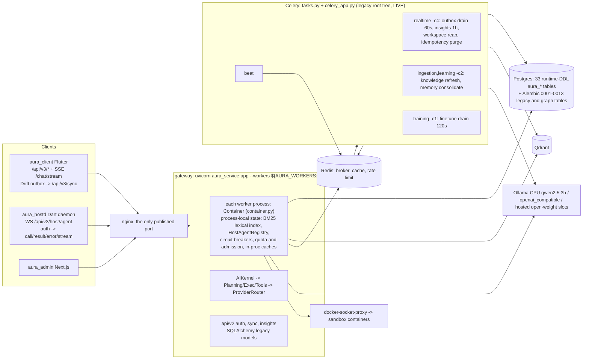

# Lens: Architecture, contracts, persistence, algorithms (aura_backend + hostd protocol)

Baseline: `699f27b`. Read-only. Line numbers were checked with `grep -n` / `sed -n` at this commit.
"Reproduced" means a stdlib-only Python script in the scratchpad ran the repo's real code paths
(no pytest, no Postgres, no network). Scripts: `scratchpad/audit/repro_breaker.py`,
`repro_hostd.py`, `repro_lexical.py`. The bytecode caches a first run left in the repo were removed,
and `git status` is clean.

## System map (observed runtime)

## Findings

### AR-01: A half-open circuit probe that ends without a recorded outcome locks the provider forever
- **Type:** Defect (availability). **Severity:** High. Critical when there is one local provider, which is the prod default.
- **Evidence state:** Reproduced (`repro_breaker.py`).
- **Files:** `aura_core/llm/circuit.py:80-93` (`allows_request` sets `_half_open_inflight = True`); `aura_core/llm/router.py:619-630` and `:676-678` (complete); `:742-756`, `:820-827` (stream).
- **Trigger:** The breaker is HALF_OPEN and the single probe is admitted. The probe then ends in one of these ways:
  - it is cancelled (client disconnect; the `CancelledError` at :676 or :820);
  - the SSE consumer closes it (`GeneratorExit` at :823);
  - it hits a 429 (`_record_rate_limited`, which never touches the breaker);
  - the quota reservation fails (`continue` at :626/:752);
  - `_admit` raises `OverloadedError` after `allows_request()` has already run.
- **Actual:** `_half_open_inflight` stays `True`. Every later call is refused as `circuit_open`, and nothing ever clears the flag: `state` only transitions OPEN to HALF_OPEN. The repro shows the provider fully recovered, yet the router still raised `AllProvidersFailedError (local:circuit_open)` at +1h and at +24h with `breaker=half_open`.
- **Expected:** Any probe that ends without a verdict releases the probe slot.
- **Impact:** A total LLM outage in that worker process until restart or `reset_circuit`. With `--workers 4`, each worker locks independently, so users see intermittent "all providers failed".
- **Root cause:** Probe admission is a side effect of `allows_request()`, but release happens only in `record_success` and `record_failure`.
- **Minimal fix:** Add `CircuitBreaker.release_probe()`, which sets `_half_open_inflight = False` without a transition. Call it in the router's `finally` whenever no success or failure was recorded. Alternatively, take the probe only after admission and reservation succeed.
- **Regression test:** `FrozenClock`, threshold 2, open 30s. Fail twice, advance 31s, start `complete()` on a hanging provider, cancel it, then switch the provider to healthy. The next `complete()` must succeed. Repeat with a 429 probe and with `GeneratorExit` on `stream()`.
- **Confidence:** High.

### AR-02: Non-streaming `run` over the desktop daemon returns empty output and exit -1 whenever the command prints anything
- **Type:** Defect (cross-component contract, backend vs hostd). **Severity:** High for the desktop Engineer.
- **Evidence state:** Reproduced. The fake daemon mirrors `aura_hostd/lib/src/rpc_client.dart:150-161`.
- **Files:**
  - `aura_hostd/lib/src/rpc_client.dart:152-162`: `run` always passes `onChunk`, which sends `{"type":"stream"}` frames before `result`.
  - `aura_hostd/lib/src/task_handler.dart` (`capture` calls `onChunk` for every stdout and stderr piece).
  - `aura_core/adapters/host_agent.py:124-135`: `resolve()` sends a non-error frame for a `_pending` id to `future.set_result(frame.get("result"))`.
  - `aura_core/adapters/host_agent.py:232-251`: `run()` uses `session.call("run")`.
  - Callers: `aura_core/tools/coding.py:605,623,641-642,660,692,760` (`git diff`, `git add`, `git commit`, `git checkout`, workspace listing, …) and `aura_core/adapters/host_agent.py:414,432` (composite runner).
- **Actual:** The first `stream` frame resolves the future with `None`, so the call returns `SandboxResult(stdout="", stderr="", exit_code=-1)`. The real `result` frame is dropped as "late". Repro output: `non-streaming run -> '' -1`, while the streaming path gets `('done', 0)`.
- **Expected:** Single-shot calls ignore `stream` frames, or the daemon sends chunks only for streaming calls.
- **Impact:** On a paired desktop the following break: `git_diff` shows nothing, `git_commit` and `git_checkout` report failure, and workspace listings come back empty.
- **Why the suite misses it:** The unit-test fake (`tests/unit/test_host_agent.py:320-332`) replies to `run` with `result` only, which the real daemon never does.
- **Minimal fix:** In `resolve()`, `if frame.get("type") == "stream": return` for `_pending` ids. Optionally add a `"stream": true` param so the daemon emits chunks only when they were asked for.
- **Regression test:** A fake daemon that sends `stream` and then `result` for `run`; assert that `runner.run()` returns the result's stdout and `exit_code == 0`.
- **Confidence:** High.

### AR-03: The process-local BM25 index diverges across gateway workers, so deleted documents stay searchable
- **Type:** Defect (data correctness / deletion). **Severity:** High.
- **Evidence state:** Reproduced (`repro_lexical.py`). Two `KnowledgeEngine`s shared one document and vector store, standing in for two uvicorn workers.
- **Files:**
  - `aura_core/knowledge/engine.py:176-177` (per-process `BM25Index` and owner map)
  - `:352` (ingest adds locally only), `:451` and `:495` (deletes remove locally only)
  - `:775-792` (rebuilt only at startup, from `container.py:1502`)
  - `:658-672` and `:765-771` (`chunks_for` fallback)
  - `aura_core/adapters/postgres_store.py:442-457` (`chunks_for` has no `status` filter) and `:628-660` (tombstone only flips `aura_documents.status`)
  - `deploy/docker-compose.prod.yml:359` (`--workers ${AURA_WORKERS:-4}`)
- **Trigger:** A user deletes or re-versions a document. The request lands on worker A; a later search lands on worker B.
- **Actual:** In the repro, after A's `delete_document`, A returned `[]` and B returned the deleted chunk's content. Newly ingested documents are invisible to lexical search on the other N-1 workers until restart. Old-version chunks keep resolving because `chunks_for(doc, old_version)` ignores status.
- **Expected:** A deleted document never appears in retrieval on any worker.
- **Impact:** A broken "delete my data" guarantee, and results that differ depending on which worker serves the request.
- **Root cause:** In-process index with no cross-process invalidation, plus a status-blind chunk read.
- **Minimal fix:**
  1. `chunks_for` (or a new `active_chunks_for`) joins `aura_documents` and filters `status='active'`. This closes the leak on its own.
  2. Move lexical search to Postgres FTS (`tsvector` + GIN on `aura_chunks`, ADR-005's stated "Stage 2"), or invalidate via a Redis pub/sub / event-outbox subscription.
- **Regression test:** Two engines over one store. Ingest on A, rebuild B, delete on A, then assert B's `retrieve` is empty. Also add a Postgres-backed variant in `tests/load`.
- **Confidence:** High for the mechanism. Production verification is still pending.

### AR-04: Memory confidence decay compounds on every consolidation run
- **Type:** Defect (algorithm). **Severity:** High (silent data loss).
- **Evidence state:** Reproduced by calling the real `MemoryRecord.decayed()` once per simulated day.
- **Files:** `aura_core/domain/memory.py:251-265` (`new_confidence = self.confidence * (0.5 + 0.5*factor)`, where factor is computed from total time since `last_accessed_at`); `aura_core/memory/engine.py:344-364` (`consolidate` persists the decayed confidence); `celery_app.py:75-76` (daily at 02:30).
- **Actual:** Each run multiplies the already-decayed confidence by a factor based on the cumulative age, so decay is applied again and again. Starting from confidence 0.9:

  | Kind | Half-life | Forgotten after day | One-shot decay at that age would be |
  |---|---|---|---|
  | semantic | 180d | 21 | 0.865 |
  | entity | 120d | 20 | 0.851 |
  | procedural | 60d | 14 | 0.833 |
  | reflection | 90d | 18 | 0.842 |

  `_forget` deletes the memory once confidence falls below `min_confidence` (0.6 / 0.5).
- **Expected:** Behaviour matches the configured half-life, so a semantic fact unused for 21 days stays near 0.86.
- **Impact:** User memories disappear about 10x faster than designed. `retrieval_score` also multiplies recency by confidence, which double-counts staleness.
- **Root cause:** A stateful, multiplicative update keyed on absolute age, with no "last decayed at" anchor.
- **Minimal fix:** Store `base_confidence` and compute `effective = base*(0.5+0.5*f(age))` without persisting it. Alternatively, decay by the elapsed interval since `metadata["decayed_at"]`, using `f(Δ)`.
- **Regression test:** Run `consolidate` 30 times with a `FrozenClock` advancing 1 day. Assert a semantic memory survives, and that its confidence equals the single-shot value within 1e-6.
- **Confidence:** High.

### AR-05: Celery tasks reuse one container (asyncpg pool, tasks) across separate `asyncio.run` event loops
- **Type:** Defect (runtime). **Severity:** High.
- **Evidence state:** Static. Not reproduced because no Postgres was available.
- **Files:**
  - `tasks.py:212-233`: the global `_worker_container` and `_worker_started`.
  - Each task calls `asyncio.run(...)`: `tasks.py:284,295,317,342,371`.
  - `aura_core/adapters/postgres_store.py:82-127`: pool memoised with no loop check.
  - `aura_core/container.py:1531`: `create_task` on the first loop.
  - `deploy/docker-compose.prod.yml:693` (`-c 4 --max-tasks-per-child=200`).
- **Trigger:** The second task in the same worker child. `drain_event_outbox_task` runs every 60s (`celery_app.py:81-82`).
- **Actual (expected by asyncpg semantics):**
  - The pool and its connections were created on loop #1, which `asyncio.run` closes.
  - Loop #2 reuses them. asyncpg connections are bound to their loop, so the expected result is "attached to a different loop" or "Event loop is closed" errors.
  - Each wrapper catches these and returns `{"status":"error"}`.
  - `_worker_started=True` means `startup()` never re-runs.
- **Impact:** These jobs may silently fail after the first run in each child: outbox delivery (the durable trigger events), idempotency purge, workspace reaper, and the memory and knowledge jobs.
- **Root cause:** Process-global async resources combined with a new loop per task.
- **Minimal fix:** Keep one long-lived loop per worker process (`worker_process_init` creating a loop, then `loop.run_until_complete` per task). Alternatively, build and `shutdown()` a container per task.
- **Regression test:** A unit test with a fake pool that records `asyncio.get_running_loop()` at creation and asserts it matches at use. Call two tasks in sequence. Add a load-suite test against real Postgres.
- **Confidence:** Medium-high. Check worker logs for `drain_event_outbox_task` errors to confirm.

### AR-06: Memory reinforcement writes the full row from a stale snapshot
- **Type:** Defect (concurrency) plus performance. **Severity:** Medium.
- **Evidence state:** Static.
- **Files:** `aura_core/memory/engine.py:317-326` (`gather(store.update(r.touched()))` on every recall); `aura_core/adapters/postgres_store.py:787-822` (`update` = `put` = full UPSERT that overwrites `content`, `confidence`, `superseded_by`, `expires_at` and `metadata`, and re-encrypts content).
- **Trigger:** A recall overlaps with consolidation, an edit, or another recall.
- **Actual:**
  - A lost update can resurrect a superseded memory (`superseded_by` is reset to NULL), undo decay, or revert a write.
  - Concurrent recalls also lose `access_count` increments.
  - Each recall issues up to `limit` parallel UPSERTs, each with encryption, and can take 10 pool connections at once.
- **Expected:** Atomic touch: `UPDATE aura_memories SET access_count = access_count+1, last_accessed_at = $2 WHERE id = ANY($1)`.
- **Minimal fix:** A `touch_many(ids, now)` port method (in-memory adapter plus Postgres adapter).
- **Regression test:** Recall returns record R. Then supersede R, then let the reinforce finish (inject an ordering). Assert `superseded_by` is preserved.
- **Confidence:** High for the mechanism. Medium for how often it happens.

### AR-07: Non-retryable (client-fault) provider errors still trip the circuit breaker
- **Type:** Defect. **Severity:** Medium.
- **Evidence state:** Static.
- **Files:** `aura_core/llm/router.py:666-672` (`_record_failure` runs before `if not exc.retryable: break`); stream path `:836`.
- **Actual:** Five malformed or oversized requests in a row open the breaker for a healthy provider, for every user in that worker. With AR-01 this can become permanent.
- **Expected:** Only provider-health failures count: timeouts, 5xx, transport errors.
- **Minimal fix:** Skip `breaker.record_failure()` when `not exc.retryable`, but still count the metric.
- **Regression test:** Five non-retryable errors leave the breaker CLOSED.
- **Confidence:** Medium. Depends on which adapter errors are marked non-retryable.

### AR-08 (CB-20, corrected numbers): Schema ownership is split three ways, and Alembic autogenerate would drop it
- **Type:** Defect (persistence). **Severity:** High.
- **Evidence state:** Static (counted by grep).
- **Files:**
  - Runtime `CREATE TABLE IF NOT EXISTS` lives in 20 adapter files under `aura_core/adapters/postgres_*.py`.
  - `alembic/versions/0001…0013`.
  - `alembic/env.py:19,58,67` (`target_metadata = Base.metadata`, with no `include_object`).
  - `alembic/versions/0001_initial_schema.py:7-12` instructs "regenerate with autogenerate".
- **Actual:**
  - 33 distinct `aura_*` tables are created at runtime.
  - 16 of them exist **only** in runtime DDL: `aura_documents`, `aura_chunks`, `aura_memories`, `aura_audit_events`, `aura_event_outbox`, `aura_approvals`, `aura_agent_workspaces`, `aura_engineer_runs`, `aura_experiments`, `aura_experiment_runs`, `aura_feedback`, `aura_finetune_jobs`, `aura_knowledge_sources`, `aura_model_versions`, `aura_personal_os_records`, `aura_turn_telemetry`.
  - The other 17 (graph, agent_runs, adaptation, idempotency, service_keys) are defined twice: Alembic raw SQL and runtime DDL.
  - Runtime `ALTER TABLE` also exists: `postgres_store.py:174`, `postgres_graph.py:103-119`.
  - No `aura_*` table is in `Base.metadata` (0 matches in `infrastructure/db/models.py`). `alembic revision --autogenerate` would therefore emit `drop_table` for all 33.
  - Readiness checks only `alembic_version` (`services/schema_readiness.py:59-69`).
  - The `ADD COLUMN IF NOT EXISTS` at first use in every process takes an ACCESS EXCLUSIVE lock even when the column exists.
  - The comment at `postgres_store.py:96-98` says concurrent `CREATE … IF NOT EXISTS` "converge". That is not guaranteed in PostgreSQL: a concurrent catalog insert can raise a unique violation. It self-heals on retry, but the first request fails.
- **Impact:** No reviewed migration history for the core tables, two definitions that can drift, a destructive autogenerate trap, and lock contention at startup.
- **Minimal fix:**
  1. Alembic 0014 baselines all 16 runtime-only tables (idempotent SQL).
  2. Add `include_object` in env.py that excludes `aura_*` until the tables are modelled.
  3. Change runtime `_ensure_schema` to verify-only.
  4. Add a fitness test forbidding `CREATE TABLE` or `ALTER TABLE` strings under `aura_core/adapters`.
- **Regression test:** That fitness test, plus a `tests/load` check that `alembic upgrade head` on an empty database yields every table the adapters query.
- **Confidence:** High.
- **Note:** The migration chain itself is clean: linear 0001 to 0013, single head, no `down_revision` gaps.

### AR-09: The layering fitness test is narrower than CLAUDE.md claims
- **Type:** Defect (guardrail gap). **Severity:** Medium.
- **Evidence state:** Static, plus an AST scan of the whole `aura_core` tree.
- **Files:** `tests/architecture/test_dependency_rules.py:31-35` (ENGINE_PACKAGES), `:87-105`.
- **Gaps:**
  - (1) It checks only relative imports (`node.level > 0`). `from aura_core.adapters… import` is invisible to it.
  - (2) It only checks `col_offset == 0`, so a module-scope `try:` or `if:` import escapes.
  - (3) Engines are never checked for **vendor SDK** imports; only the `domain`/`ports` stdlib rule exists.
  - (4) `llm`, `agents`, `triggers`, `ml`, `observability`, `engineering2`, `proactive` and `continuous_intelligence` are not in ENGINE_PACKAGES, although CLAUDE.md lists `llm` as an engine.
- **Current violations found:** One, `aura_core/engineering2/pipeline.py:25` (`from aura_core.adapters.coding_fakes import …`, absolute, at module scope). The package is dead (AR-10).
- **Not violations:** The only module-scope third-party imports outside adapters/api are `observability/metrics.py:25` and `observability/tracing.py:21`, both optional and guarded by try/except.
- **Minimal fix:**
  - Normalise absolute `aura_core.X` imports to X.
  - Walk module scope with the existing `_imports` helper instead of using `col_offset`.
  - Derive the engine list as "every package except domain, ports, adapters, api, config and observability".
  - Add a vendor-SDK denylist for engines.
- **Regression test:** The amended test fails on engineering2 until that package is deleted.
- **Confidence:** High.

### AR-10 (CB-13 current state): Dead code and tracked binaries
- **Type:** Maintainability. **Severity:** Low-Medium.
- **Evidence state:** Static (grep, `git ls-files`, `file`).
- **Dead packages:**
  - `engineering2` (916 lines) and `proactive` (899 lines) have **zero importers** outside themselves.
  - `continuous_intelligence/__init__.py` is a 17-line stub: `__all__` names 4 symbols but 0 are defined, so `from … import *` raises.
- **`security/{authenticator,policy,rate_limiter,secret_manager}`:** Their only importer is `security/__init__.py:11-20`. That is **not** zero-cost: the live gateway imports the package (`aura_service.py:28`), so all four load in production. The `__init__` docstring admits nothing uses them.
  - `secret_manager` has a unit test (`tests/unit/test_secret_manager_crypto.py:13`).
  - `security/rate_limiter.RateLimiter` shadows the name of the port `ports/runtime.py:253 RateLimiter(Protocol)` alongside the live `rate_limit.SlidingWindowRateLimiter`. That is two rate limiters plus a name collision.
- **Tracked binaries (CB-13 is partly stale):**
  - `aura_hostd/build/aura_hostd.exe` is no longer tracked.
  - `aura_hostd/aura_hostd` **is**: a 7.3 MB PE32+ Windows executable, last touched in #107.
  - Also tracked: `aura_client/releases/aura-copilot-release.apk` (73 MB), three 4.8 MB `aura_client/scratch_test_*.tmp`, and `aura_hostd/build/aura_hostd.log{,.err}`.
- **Fix:** One reviewed deletion PR, plus a fitness test that every `aura_core` subpackage has at least one importer outside itself, and a `.gitattributes`/size guard.
- **Confidence:** High.

### AR-11: The legacy root tree is live, and its imports have side effects outside the TD-01 guard
- **Type:** Defect (lazy-construction rule violated) / Maintainability. **Severity:** Medium.
- **Evidence state:** Static.
- **Files:**
  - `deploy/docker-compose.prod.yml:693,782,816,843`: three worker services plus beat run `celery -A tasks` / `celery_app`.
  - `tasks.py:6-7` imports `services.rag.rag_service` and `services.learning_pipeline` at module scope.
  - `services/rag.py:26-57,374`: `RAGService()` is built at import.
- **What happens at import:**
  - If `QDRANT_HOST` is set, it calls `QdrantClient(...).get_collections()`, a synchronous network call.
  - Otherwise it opens an embedded `QdrantClient(path="local_qdrant_storage")`. That is the prod case, since only `AURA_QDRANT_URL` is set.
- **Why it is not caught:** `test_no_import_time_network_connections` scans only `aura_core`.
- **Dead ends:** `ingest_document_task` and `ingest_pdf_task` are reachable only via `services/agent.py:131` → `services/drive.py:164`, and no live module imports `services.agent`, `services.ai`, `services.agent_router` or `services.sentiment` (grep outside `services/` and tests returned nothing).
- **Fix:**
  - Delete the two ingest tasks and the `services.rag` import from `tasks.py`.
  - Move v3 job wrappers to `aura_core`-side entry points.
  - Extend the TD-01 test to `tasks.py`, `celery_app.py` and `services/`.
- **Confidence:** High.

### AR-12: Memories have two stores and two id spaces
- **Type:** Defect (data contract). **Severity:** Medium.
- **Evidence state:** Static.
- **Files:**
  - `aura_client/lib/features/chat/data/memory_repository.dart:145-147` (delete: Drift, then outbox `memories` delete with the server id, then `DELETE /api/v3/memory/{id}`).
  - `:171-186` (save: `getDeterministicId(fact)`, then outbox `memories` upsert, then `POST /api/v3/memory`).
  - `infrastructure/db/models.py:211-219,262-271` (legacy `memories` is in `SYNCABLE_MODELS`).
  - `api/admin_platform.py:198` (reads legacy `memories`).
  - The kernel reads only `aura_memories`.
- **Actual:**
  - Every manual memory is written twice, with different ids: client hash vs server `MemoryId`.
  - A delete issued with the server id never matches the legacy row.
  - Legacy rows are never read by the AI, yet they persist and are counted by admin, which is a "delete my data" gap.
- **Fix:** Drop `memories` from the client outbox and `SYNCABLE_MODELS` (the sync_client.dart:23-26 comment already says memories go through v3), then migrate or purge the legacy table.
- **Confidence:** Medium. The legacy upsert path was not executed.

### AR-13: Retrieval does O(corpus) work per query on the event loop, plus N+1 chunk fetches
- **Type:** Opportunity (performance and scale). **Severity:** Medium.
- **Evidence state:** Measured (micro-benchmark with the real `BM25Index`).
- **Files:**
  - `aura_core/knowledge/engine.py:645-656`: the `allowed` set is built by scanning every chunk of every tenant.
  - `aura_core/knowledge/retrieval.py:131-147`: for each query term it scans **all** documents' Counters. This is a forward index, not the "inverted index" the docstring at :62 claims.
  - `engine.py:658-672` and `:765-771`: each lexical-only candidate fetches the full chunk list of its document twice (contents, then `_chunk_from`). That is up to 2×24 queries per retrieve.
- **Measured:** 8.0 ms/query at 10k chunks and 48.4 ms/query at 50k (8-term query, tenant owns 10%). This is synchronous CPU work inside a coroutine, so it blocks the worker's loop. Every worker (and every Celery child that calls `startup()`) also holds the whole tokenised corpus in RAM.
- **Algorithm recommendation:**
  - *Current:* forward-index BM25, O(|q|·N) plus O(N) for the tenant filter.
  - *Alternative A:* posting lists `term → {doc: tf}` with per-owner sharding. Cost is O(Σ postings(q) within tenant). It is about 20 lines on the same class.
  - *Alternative B:* Postgres FTS (`tsvector` GIN on `aura_chunks` with `owner_id`, `ts_rank_cd`). This also fixes AR-03 consistency.
  - *When not better:* very small corpora (under about 2k chunks), where the current approach is under 2 ms, and A still leaves AR-03 unsolved.
  - *Validate:* `tests/benchmarks -m bench` at 10k/50k/200k chunks with 10 tenants, plus the recall@k parity of the fused output against the current implementation on the eval fixtures. Add a batch `chunks_by_ids(ids)` port for the N+1.
- **Confidence:** High.

### AR-14: The rank pseudo-score defeats the relevance threshold when the reranker is off or fails
- **Type:** Defect (algorithm). **Severity:** Low-Medium.
- **Evidence state:** Static.
- **Files:** `aura_core/knowledge/engine.py:686-703`, which assigns `1.0 - i/len(usable)`; threshold 0.35 (`config/settings.py:672`).
- **Actual:**
  - The top candidate always scores 1.0 and always passes, however irrelevant it is.
  - The bottom ~35% is always cut, however relevant.
  - `searched_but_empty` can never be true on this path.
- **Fix:** On this path, threshold on the dense cosine (when present) or skip thresholding and mark the strategy `degraded`.
- **Test:** With the reranker raising, an unrelated query against a one-document corpus returns `searched_but_empty == True`.
- **Confidence:** High.

### AR-15: The hostd session outlives its JWT, and the registry is per-process
- **Type:** Defect (contract) / known constraint. **Severity:** Medium.
- **Evidence state:** Static.
- **Files:**
  - `aura_core/api/host_agent.py:109-118` accepts a `reauth` frame, but `aura_hostd/lib` contains no `reauth` sender (grep returned 0). `rpc_client.dart:106` sends `auth` only once per connection.
  - The server never re-checks expiry or revocation during a session.
  - `adapters/host_agent.py:148-171` keeps `HostAgentRegistry` as a per-process dict. ADR-011 (`docs/architecture/011-desktop-engineer-agent.md:391-403`) documents that this needs `AURA_WORKERS=1`, yet prod defaults to 4 (`deploy/.env.example:10`).
- **Impact:** A revoked or expired token keeps file and terminal authority on the user's machine until the socket drops. Engineer turns fail intermittently in proportion to the worker count.
- **Fix:** Close the session at the token's `exp` unless a `reauth` arrives first, and implement the daemon-side reauth. Then either route host calls through Redis pub/sub or run a dedicated single host-agent process. Until then, have the gateway refuse to start host-agent support when `AURA_WORKERS>1`.
- **Confidence:** High for the code facts.

### AR-16: The v3 contract is untyped; the spot-check found no drift
- **Type:** Opportunity. **Severity:** Low.
- **Evidence state:** Static.
- **Facts:** 0 `response_model` across the 30 v3 routes (`aura_core/api/v3.py`); sync has 2. Response shapes are dict literals.
- **Spot-check results (all matched):**
  - `ChatRequest` (`v3.py:166-190`) vs the client body (`sse_agent_client.dart:149-160`): 10 keys, all accepted.
  - SSE frame types: the kernel emits {token, citations, tool_calls, step, actions, revision, done, error}, the same set the client switch handles (`sse_agent_client.dart:41-59`).
  - Knowledge ingest and search keys, including `searched_but_empty` (`v3.py:718`).
  - Memory list keys (`v3.py:1009-1018` vs `memory_repository.dart:63-68`).
  - Sync table names.
- **Minor:** `IngestRequest.content` (`v3.py:194`) has no `max_length`. Only the engine's 8 MB check bounds it, after the JSON has been parsed.
- **Opportunity:** Pydantic response models plus a generated OpenAPI snapshot test diffed in CI. `tests/architecture/test_api_reachability.py` checks only path reachability, not shape.

### AR-17: Complexity hotspots
- **Type:** Opportunity. **Severity:** Low.
- **Files by size:** `kernel/kernel.py` 1909, `config/settings.py` 1906, `container.py` 1663, `api/v3.py` 1543 (all 30 routes defined inside one factory closure), `tools/coding.py` 1361, `adapters/memory_stores.py` 967, `postgres_graph.py` 959, `postgres_store.py` 953, `llm/router.py` 946.
- **Implication:**
  - The two files that every feature touches (container and kernel) are where wiring and degradation bugs land: CB-14, and AR-01's duplicated complete/stream loops.
  - `router.complete` and `router.stream` duplicate about 150 lines of admission, quota and breaker bookkeeping. That is why AR-01 exists in both. Extract a single `_attempt()` context manager.
  - Split `v3.py` per area into APIRouters.

### AR-18: Async resources are never closed
- **Type:** Defect (minor). **Severity:** Low.
- **Evidence state:** Static.
- **Files:**
  - `aura_core/container.py:1544-1560`: `shutdown()` never closes `_pg_pool`, the Qdrant client or Redis, although `postgres_store.py:243` has `close()`.
  - `tasks.py:112-130`: `_run_finetune_job` and `_drain_finetune_queue` build a fresh container (and pool) every run, every 120s, without shutdown. This is bounded only by `--max-tasks-per-child=1` on the training worker.
- **Fix:** Close the pools in `shutdown()`, and use an `async with` container in jobs.

## Coverage
- **Read:** CLAUDE.md, `00-overview.md`, `test_dependency_rules.py`, `container.py` (pool, outbox, startup, shutdown), `postgres_store.py` (pool, DDL, chunks, memory upsert), `qdrant_store.py` init, `knowledge/{engine,retrieval}.py`, `rag/base.py` fusion, `memory/engine.py`, `domain/memory.py`, `llm/{router,circuit}.py`, `api/host_agent.py`, `adapters/host_agent.py`, hostd `rpc_client.dart` / `task_handler.dart` run, `tasks.py`, `celery_app.py` schedule, `services/{rag,drive,schema_readiness}.py`, `alembic/env.py` and the revision chain, the v3 request models, and the client chat/knowledge/memory/sync callers.
- **Executed:** An AST scan for module-scope imports, three repro scripts, a decay simulation using the real domain code, and a BM25 micro-benchmark.
- **Not covered:** kernel internals (CB-14), safety/trust channels, the Postgres graph adapter algorithms, the adaptation track, admin UI, and anything that needs live Postgres, Qdrant or Docker. AR-05 and part of AR-08 depend on PostgreSQL/asyncpg semantics and were not run against a real database.

## Cleared hypotheses
- **Lazy adapters and locks:** `PostgresPool` uses double-checked creation under an `asyncio.Lock` (`postgres_store.py:99-123`). Qdrant creates its client on first use with `check_compatibility=False` (`qdrant_store.py:82-106`). Redis is lazy (`redis_cache.py:80-88`). A grep found no synchronous HTTP, socket or sleep calls in `aura_core`.
- **No module-scope vendor SDK** in any engine package; the only hits are optional observability imports.
- **Alembic chain** is linear with a single head (0013) and no gaps.
- **RRF** is rank-based with k=60 (`retrieval.py:156-178`), correct and normalisation-free. BM25 IDF is floored at 0 (no negative weights). Empty query or corpus returns `[]`. Ties are deterministic (stable sort).
- **Stream failover** is correctly refused after the first emitted token (`router.py` `emitted` flag, partial-output error).
- **Chat, SSE, knowledge, memory and sync field contracts** match between client and server (AR-16).
- **rag/ vs knowledge/** is not a duplicate engine: `rag` is a strategy layer over `KnowledgeEngine`. Only RRF is implemented twice (`rag/base.py:186-230`), and the duplication is documented.
- **Planners:** only one execution planner (`planning/engine.py:101`). `adaptation/planner.PlanningService` is a different concept.
- **Engine-to-adapter imports:** none at module scope in live packages; the only one is in dead `engineering2`.
