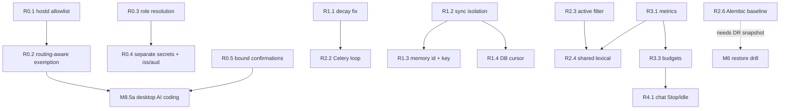

# Remediation & Upgrade Roadmap — audit `2026-10-26-full-699f27b`

**How this relates to the canonical roadmap.**
- This plan **feeds** `docs/roadmaps/AURA_MASTER_UPGRADE_ROADMAP.md` (M0–M15) and
  `AURA_CRITICAL_BACKLOG.md`. It does not replace them.
- Each item names the master-roadmap phase it belongs to, so the rows can be added there.
- The repo's standing rule applies to every exit criterion below: **built ≠ tested ≠ proven**. An item closes
  only with the named evidence, recorded in `docs/reports/` and in `gap_register.yaml`.

**Fields per item:**
- **Links:** the findings it addresses (see `audit-report.md`).
- **Effort:** S, M or L. These are relative sizes, not time promises.
- **Files:** provisional unless marked traced.

**Ordering principle.**
1. Close the boundaries that let injected content or a stale credential act (R0).
2. Stop silent data loss and corruption (R1).
3. Make the process model match the deployment, so fixes hold across 4 workers (R2).
4. Make latency and degradation honest and measurable (R3).
5. Product quality (R4).
6. Strategic work (R5).

Quick wins are flagged ⚡ inside each phase. They never jump ahead of a phase's top item.

---

## R0 — Immediate safety & authorization (do first)

### R0.1 ⚡ Close the hostd untrusted-tier execution paths — `F-01` (part 1) · M1 · **S**
- **Files (traced):** `aura_hostd/lib/src/command_policy.dart:64-77`, `control_server.dart:119-122`; tests in `aura_hostd/test/command_policy_test.dart`.
- **Approach:**
  - Remove `npm test`, `pytest --collect-only` and `rg` from `readOnlyAllowlistPatterns`.
  - Reject `--pre`, `--output`, `--ext-diff` and `--textconv` on the remaining `git` verbs.
  - Tokenize argv for `cat`, `head`, `tail` and `grep`, and run `requireContained` on each path argument.
  - Write `control.json` with mode 0600.
- **Rejected alternative:** extending the metacharacter regex. Flags are not metacharacters, so that is still a game of whack-a-mole.
- **Acceptance:**
  - `evaluateCommand(..., workspaceTrusted:false)` returns `!= allow` for every payload in F-01.
  - `dart analyze --fatal-infos` and `dart test` pass in Host Daemon CI.
- **Rollback:** revert the policy file. There is no data migration.

### R0.2 Routing-aware `workspace_local` exemption — `F-01` (part 2), CB-05 · M1 · **M**
- **Prerequisite:** R0.1.
- **Files:** `aura_core/tools/policy.py:114-117`, `tools/coding.py:369-383`, `tests/architecture/test_workspace_local_tools.py`; amend ADR-014.
- **Approach:**
  - Pass the routing decision (sandbox vs host) into the policy.
  - Host routing plus tainted context means `needs_confirmation`.
  - Add a hostd write denylist for `.git/hooks/**` and `.git/config`.
- **Acceptance:**
  - A tainted, desktop-routed `run_command` returns `needs_confirmation`.
  - A sandbox-routed one stays exempt.
  - The fitness test is updated, and `pytest tests/architecture -q` is green.

### R0.3 ⚡ Authoritative role resolution — `F-02` · M1 · **S**
- **Files (traced):** `services/rbac.py:69-98`, `services/jwt_auth.py:226-235`, `infrastructure/db/user_repo.py:26-34`, `api/admin_platform.py:95-139`.
- **Approach:**
  - Strip `role` before `stamp_resolved_role` on refresh.
  - Populate `db_role` from `users.role` by subject.
  - Stop claims from upgrading the DB row.
  - Revoke refresh and device tokens on demote.
- **Acceptance:** demote, then refresh; the new token has `role=="User"`, `/admin/status` returns 403, and `users.role` stays demoted after a `/sync`. Both the `pytest` and legacy `unittest` suites are green.

### R0.4 Separate dev secrets + environment-bound JWTs — `F-03`, CB-08 · M1→M2 · **M**
- **Files:** `deploy/docker-compose.dev.yml:170-181`, `docker-compose.prod.yml:208,240,1157`, `deploy/scripts/bootstrap-secrets.sh`, `services/jwt_auth.py`.
- **Approach:**
  - Give dev its own `./secrets-dev/`.
  - Add `iss` and `aud` claims and verify them.
  - Mount secrets into the backup container per file.
  - Add a compose parity test asserting the dev and prod secret sources differ.
  - Change both compose files in the same commit (CLAUDE.md parity rule).
- **Migration:**
  - Rotate the prod JWT secret, which logs everyone out once. Announce it.
  - Rotate the prod data-encryption key only if dev could have been compromised; follow the re-encryption procedure.
  - Accept tokens without `iss` for one access-token lifetime (15 min), then refuse them.
- **Acceptance:**
  - A token with the wrong `iss` gets 401.
  - The parity test is green.
  - A VPS report shows distinct secret files and one successful backup cycle.

### R0.5 Bind confirmations to the approved call — `F-04`, CB-04 · M1 · **L**
- **Files:**
  - `aura_core/execution/engine.py:60-83,475-489`, `kernel/kernel.py:1250-1256,1384-1400`, `voice/session.py:162-168`;
  - client `chat_repository.dart:253-282`, `chat_view_model.dart:136-146`, `live_voice_view_model.dart`.
- **Approach:**
  - **Server:** a pending-approval store (Redis, TTL), keyed by `(owner, turn_id, call_id)` and holding the tool plus an argument digest. The client receives opaque approval tokens. Resume **executes the stored step** instead of re-planning. Name-level confirmation is removed. A resolved `${sN.output}` from an `untrusted_content` step marks the call tainted.
  - **Client:** confirm the bubble's own turn, keep separate voice and chat pending lists, and disable Confirm while a stream is in flight.
- **Rejected alternative:** keep re-planning and compare digests afterwards. Re-planning on a 3B model is not deterministic, so legitimate approvals would fail at random.
- **Acceptance (tests):**
  - Approve `delete_task(A)` and force a re-plan to `B`; it is refused.
  - Approved, auto-allowed steps run exactly once.
  - A different later message cannot consume the approval.
  - The voice path cannot confirm by name.
  - Client widget tests cover the turn binding and the disabled state.
- **Unblocks:** M8.5a desktop AI coding.

### R0.6 ⚡ Sign-out hygiene — `F-05` · M1 · **S**
- **Files:** `auth_provider.dart:283-299`, `core/database/database.dart` (new `wipeUserData`), `token_manager.dart`.
- **Acceptance:**
  - A Drift test: after sign-out, the domain tables, outbox and cursor are empty and `/auth/revoke` was called.
  - A local `flutter analyze` and `flutter test` run passes with counts quoted. Client CI is not a gate (see CLAUDE.md).

### R0.7 ⚡ Firebase provider console check, then the `email_verified` gate — `F-38`/SEC-08 · M1 · **S**
- **Step 1:** check in the Firebase console whether the email/password provider is enabled. If it is, R0.7 moves to the top of R0.
- **Step 2:** require `email_verified` and `sign_in_provider=="google.com"` before any env-list role grant.
- **Acceptance:** an unverified-email token matching `SUPERADMIN_EMAILS` resolves to `User`.

### R0.8 GitHub link PKCE + device-token scope + WS deadlines — `F-08`, `F-09` · M1 · **M**
- **Approach:**
  - Complete the GitHub OAuth exchange through an authenticated POST with PKCE, and enforce a unique `github_user_id`.
  - Add a device-token `scope` claim enforced in `_build_authenticator`.
  - Give WS connections a deadline equal to `exp`, closing with 4401, and have revocation signal the registry.
  - Make pairing poll and approve atomic.
- **Acceptance:**
  - Callback-only linking attaches nothing.
  - A device token gets 403 on `/api/v3/memory`.
  - A 2 s-`exp` WS closes with 4401.
  - Concurrent polls mint exactly one token.

### R0.9 ⚡ JWT secret startup refusal + streamed body limit — `F-10` · M1 · **S**
- **Acceptance:**
  - In production, the gateway refuses to boot without a JWT secret of at least 32 bytes.
  - A chunked body over the limit gets 413.
  - nginx and the gateway limits match per route.
  - `forwarded-allow-ips` names nginx only.

---

## R1 — Stop silent data loss & corruption (correctness of core journeys)

### R1.1 ⚡ Memory decay anchored to time since the last decay — `F-15` · M7 · **S**
- **Files (traced):** `aura_core/domain/memory.py:250-264`, `memory/engine.py:344-364`.
- **Approach:** store `decayed_at` (or `base_confidence`) and apply `f(Δ)`.
- **Migration:** existing confidences are already over-decayed and the original values cannot be recovered. Do not "un-decay". Lower `min_confidence` for one cycle, or skip expiry for one run, so no further memories are lost while the fix lands.
- **Acceptance:** 30 daily runs on a FrozenClock; the semantic memory survives, and its confidence matches the single-shot value within 1e-6.
- **Ordering:** ship *with or before* R2.2. R2.2 will make consolidation actually run, and that would then amplify this bug.

### R1.2 Per-mutation sync isolation + natural-key merge for health — `F-11` · M6 · **M**
- **Files (traced):** `api/v2/sync.py:161-205`, `infrastructure/db/models.py:126-131`; client `sync_client.dart:90-94,126-129`, `health_repository.dart`.
- **Approach:**
  - A SAVEPOINT per mutation, with try/except, so the row reports `error`.
  - Merge HealthRecord on `(user_id, record_date)`, returning the server id in the result.
  - Client: run the pull even if the push failed, and dead-letter a row after N failures with a visible count.
- **Acceptance (needs real Postgres, per CLAUDE.md):**
  - A batch of [valid, bad-date, valid] returns [applied, error, applied].
  - Duplicate-day health rows produce a conflict, not a 500.
  - testcontainers evidence is recorded.

### R1.3 ⚡ Memory id + payload key, fixed together — `F-13` · M6 · **S**
- **Prerequisite:** R1.2, so a remaining mismatch fails one row and not the batch.
- **Approach:** a UUID v5 id from the fact, and the payload key renamed to `fact_enc`, in **one** change. Dead-letter permanent errors.
- **Acceptance:** `saveMemory`'s id parses as a UUID; a push of a memory row is `applied`; the outbox stops growing.

### R1.4 DB-derived sync cursor + bounded LWW + pagination — `F-12` · M6 · **M**
- **Approach:**
  - Take the cursor as the max `updated_at` of the returned rows, with an overlap window. Client apply is an idempotent upsert, so re-delivery is harmless.
  - Use `clock_timestamp()` for `updated_at`.
  - Clamp `client_updated_at` to at most server time plus 5 min.
  - Return the server row inside conflict results.
  - Paginate the pull with `limit` and `has_more`.
- **Rejected alternative:** a full `bigserial` change log now. It is more robust but a larger migration. Revisit if the overlap window proves insufficient under F-24's metrics.
- **Acceptance:** the testcontainers race test (push transaction open, pull, commit, pull) delivers the row, and a future-dated mutation is clamped.

### R1.5 Deletes that delete — `F-06`, `F-07` · M6 · **M–L**
- **Approach:**
  - Adopt the server memory id in the client.
  - Add `DELETE /api/v3/sessions/{id}` and call it, then mint a new session id.
  - Add an erasure orchestrator in `container.py` that calls each port's owner purge (memory store and vectors, knowledge, episodic, personal-OS, feedback, cache namespace). It hard-deletes sync rows, revokes devices, and returns per-store counts and failures.
  - Add a user-facing "delete my account" that uses it.
- **Acceptance:**
  - Seed every store for U, then forget; every port returns nothing for U, and U's device token gets 401.
  - On the client, a delete calls the server with the server id.
  - `gap_register.yaml` records an erasure-coverage entry.

### R1.6 ⚡ Briefing survives insights; per-user timezone — `F-17` · M11 · **S–M**
- **Acceptance:** the briefing persists through an insights run; a UTC+3 FrozenClock test gets no false hydration nudge.

### R1.7 Single personal-OS store — `F-18`, CB-28 · M11 · **L**
- **Approach:** write the store-decision ADR first, then implement it.
- **Acceptance:** a task created in chat appears in the Tasks tab, and `list_tasks` sees app-created tasks.

### R1.8 Memory write races — `F-16` · M7 · **M**
- **Approach:**
  - Make reinforcement a field-level `UPDATE`.
  - Take a session-append lease, and summarise outside the critical section.
  - Write an ADR choosing one memory store and one id space.
- **Acceptance:** a concurrent-append test keeps both exchanges, and reinforcement does not resurrect a superseded record.

---

## R2 — Make the process model match the deployment (architecture & reliability)

### R2.1 ⚡ Breaker probe release + fault classification — `F-19` · M3 · **S**
- **Files (traced):** `aura_core/llm/circuit.py:80-93`, `llm/router.py:619-630,676,742-756,820-827`.
- **Approach:**
  - Add `release_probe()` and call it in `finally` when no outcome was recorded.
  - Count only provider-fault errors toward the threshold.
  - Optionally give background callers a separate breaker.
- **Acceptance:** `repro_breaker.py`, ported to pytest with FrozenClock, shows a successful call after recovery.

### R2.2 One event loop per Celery worker process — `F-20` · M3 · **S–M**
- **Prerequisite (zero-cost evidence first):** check the prod worker logs for `drain_event_outbox_task` and `memory_consolidate` errors. Record the result to settle F-20's evidence state.
- **Approach:**
  - Create the loop in `worker_process_init`.
  - Replace the task wrappers' `asyncio.run` with `loop.run_until_complete`.
  - Close it in `worker_process_shutdown`.
- **Acceptance:**
  - In a load test, two consecutive outbox drains in one worker succeed against real Postgres.
  - Error logs show no "attached to a different loop".
- **Ordering:** after R1.1.

### R2.3 ⚡ Shared-truth retrieval, step 1: active-status filter — `F-14` · M6 · **S**
- **Approach:** `chunks_for` and the content resolution join `aura_documents.status='active'`.
- **Acceptance:** `repro_lexical.py`, ported to pytest, shows deleted content absent on the second worker. Superseded-version text is also absent.

### R2.4 Shared-truth retrieval, step 2: cross-process lexical index — `F-14`, `F-30` · M6/M7 · **M–L**
- **Option A:** Redis pub/sub invalidation of the per-worker BM25. Smallest change.
- **Option B, recommended if R2.4's benchmark passes:** Postgres FTS (`tsvector` + GIN), or Qdrant sparse vectors, fused with dense results via RRF. This removes per-worker state entirely.
- **Measure:** recall@k and nDCG on the phase-a3 corpus, plus p95 at 10k, 50k and 200k chunks per owner.
- **Decision rule:** B only if nDCG drops by no more than 1 point and the Arabic tokenization configuration is settled. Otherwise A.
- **Acceptance:** new uploads are retrievable lexically from every worker within 1 s, and the benchmark report is committed.

### R2.5 hostd result protocol + terminal close codes — `F-21`, `F-26` · M8 · **S**
- **Approach:**
  - `HostAgentSession.resolve()` accumulates `stream` frames until the terminal frame.
  - The daemon treats 4401 and 4403 as terminal.
  - The test fake emits stream frames.
- **Acceptance:** `repro_hostd.py` ported to pytest returns real output with exit 0, and a hostd test shows no reconnect loop after 4401.

### R2.6 Alembic owns all schema — `F-27`, CB-20 · M6 · **M**
- **Approach:**
  - A baseline migration for the 33 runtime tables, idempotent with `IF NOT EXISTS` for existing deployments.
  - `include_object` until then.
  - A fitness test forbidding runtime `CREATE TABLE`.
  - Downgrade tests.
- **Migration risk:** prod already has these tables, so the migration must be a no-op there. Verify on a restored prod snapshot (the M6 DR drill) before deploying.
- **Acceptance:** `alembic revision --autogenerate` on a fresh DB built from migrations emits **no** DROPs, and the restored-snapshot upgrade succeeds.

### R2.7 Deploy robustness — `F-25` · M2/M3 · **S–M**
- **Approach:**
  - nginx depends on `service_started`, with gateway liveness separate from LLM readiness.
  - The deploy gate curls `/health/ready` with failure being fatal.
  - `stop_grace_period` is at least the turn budget.
  - Celery gets `task_time_limit`, `acks_late` and worker healthchecks.
  - `container.shutdown()` closes the PG, Redis and Qdrant clients.
  - Apply the same edits to both compose files.
- **Acceptance:**
  - A drill: stop Ollama, recreate nginx, and the edge still serves `/health/live`.
  - A deploy with a broken readiness check fails the workflow.
  - A report is filed in `docs/reports/`.

### R2.8 ⚡ Remove blocking I/O from the event loop — `F-23` · M3 · **S**
- **Acceptance:** an ASGI test shows a slow fake Ollama on `/automation/analyze-email` does not delay a concurrent `/health/live`, and a failure returns 503.

### R2.9 Fitness tests that match the claims — `F-28` · M0 · **S**
- **Acceptance:** a planted absolute vendor import in an engine fails `pytest tests/architecture`.

---

## R3 — Honest latency & degradation (performance, measured)

### R3.1 Metrics first — `F-24` (CB-15) · M3 · **S–M**
- **Approach:**
  - Widen the buckets to 600 s, and to 300 s for TTFT.
  - Add an HTTP middleware histogram and status counter.
  - Add outbox depth/age and worker gauges.
  - Wrap `kernel.stream` in the same record/budget/lifecycle wrapper as `run`.
- **Acceptance:** Grafana shows p95 per route matching a load-test p95 within 10%, and streamed turns appear in the admin quality summary.
- **Why first in R3:** every later R3 item needs these numbers to prove itself.

### R3.2 Degraded-turn honesty — `F-24` (CB-14) · M1 · **S**
- **Acceptance:** a forced planner timeout yields `done.degraded=true` with a reason, the counter increments, and a "create a task" turn does not claim success.

### R3.3 Coherent timeout budgets — `F-22` · M3 · **M**
- **Approach:**
  - Thread the kernel deadline into every reasoner and auxiliary call.
  - Size each `max_output_tokens` to its deadline at 5 tok/s, per CLAUDE.md's PlanningEngine rule.
  - Emit an SSE heartbeat (`: ping`) every 15 s.
  - Raise nginx `/api/v3/chat` to at least the summed budget, or document it as non-interactive.
  - Move the shadow evaluation to the background.
- **Acceptance:**
  - With R3.1 in place, the 1024-token non-streaming answer completes on the prod model.
  - No stream is cut at 300 s in a soak test.
  - The timeout rate per stage is reported.

### R3.4 Lexical retrieval at scale — `F-30` · M7
- This is the measurement half of R2.4. Do not ship the algorithm change without its benchmark report.

---

## R4 — UX, accessibility & product quality

### R4.1 Stop / idle-timeout for chat — `F-31` · M14 · **S**
- **Prerequisite:** R3.3's heartbeat, so the idle timeout does not fire during planning.
- **Acceptance:**
  - A fake-client test: the lock clears within the idle timeout.
  - The Stop control unlocks immediately and keeps the partial text.

### R4.2 ⚡ Light-theme contrast fix + ratchet — `F-32` · M14 · **S**
- **Acceptance:** the widget contrast test is at least 4.5 under `AuraThemeV2.light`, and a ratchet test blocks new legacy-color usage under `lib/features/`.

### R4.3 Session-expiry and error-state UX — `F-33` · M14 · **S–M**
- **Acceptance:** a 401 after a failed refresh routes to login, and no raw exception string remains in release builds (a grep test).

### R4.4 Navigation and destructive actions — `F-34` · M14 · **S**
- **Approach:** remove the forced IDE redirect (ADR-015), use `push` for settings sub-pages, add undo snackbars, and confirm sign-out.

### R4.5 ⚡ Admin single-flight refresh — `F-35` · M9/M14 · **S**
- **Acceptance:** a Playwright test with a 3-request page after token expiry stays logged in.

### R4.6 Accessibility and l10n program — `F-36` · M12/M14 · **M–L**
- **Order:**
  1. Tooltips and semantics, with a lint test.
  2. String extraction, feature by feature.
  3. An RTL sweep.
  4. An Arabic locale.
- **Acceptance:** screen-reader pass notes on a real device. These are runtime checks this audit could not do.

---

## R5 — CI, supply chain & strategic

### R5.1 ⚡ CI hygiene — `F-37` · M0 · **S–M**
- **Approach:**
  - Pin Flutter in `release-apk.yml`.
  - Add an actionlint job and an admin PR trigger.
  - Add a Postgres service job for the `*_postgres` tests.
  - Add `--cov-fail-under` at the current level as a ratchet.
  - SHA-pin third-party actions.
- **Acceptance:** the PR checks list includes these jobs, and a deliberately broken workflow file fails actionlint.

### R5.2 Supply chain and deploy triggers — `F-38` · M4 · **S**
- **Approach:**
  - Run `uv pip compile --generate-hashes` and install with `--require-hashes`.
  - Make the PyTorch index explicit.
  - Add `workflow_run.event=='push'` and head-repository checks.
  - Use `torch.load(weights_only=True)`.
  - Widen the secret-scan scope.

### R5.3 ⚡ Repository hygiene — `F-29`, CB-13 · M1 · **S**
- **Approach:**
  - Untrack the APK, the hostd exe and the log, and add them to `.gitignore`.
  - Publish releases as GitHub Release assets.
  - Delete the zero-importer packages in a reviewed PR, with a guard test.
  - Make `tasks.py` imports side-effect-free.
- History rewrite to purge the binaries is a separate decision for the repo owner.

### R5.4 Strategic opportunities (not defects; each needs its own ADR)
These are listed so they are not lost. Do not start any of them before R0–R2.
- **Shared state service for per-process components:** circuit breaker state and the host-agent registry in Redis, so `--workers N` scales without divergence. This generalizes R2.1, R2.4 and F-09/AR-15.
  - **Trigger to start:** R3.1 metrics show cross-worker inconsistency costs.
- **Change-sequence sync (logical clock):** replaces the timestamp cursor entirely, if R1.4's overlap window proves insufficient.
- **Eval-gated memory policy:** decay and consolidation thresholds tuned against an EV corpus (CB-23), not hand-picked. This depends on R1.1.

---

## Dependency graph (critical path)

## Quick-win batch (all S, independent, low risk)
- **Batch 1:** R0.1, R0.3, R0.6, R0.7 (console check), R0.9, R1.1, R1.6.
- **Batch 2:** R2.1, R2.3, R2.5, R2.8, R2.9, R4.2, R4.5, R5.1, R5.3.

Each is one reviewed PR with its own regression test. Batch 1 first: those items close security boundaries or stop
data loss.
