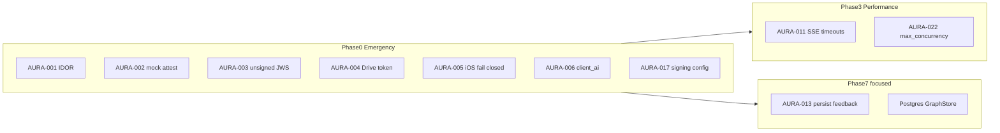

# Plan: Phase 0 Emergency, Phase 3 Performance, Phase 7 AI/RAG (focused)

Work in this order: **0 → 3 and 7 in parallel**. Do not start v1 deletion, stream/run tool unification, OCR, or a durable model registry (out of this scope).

---

## Phase 0 — Emergency

### AURA-001: Memory delete IDOR

[`aura_backend/main.py`](aura_backend/main.py) `delete_memory` (lines 507–517) calls [`memory_service.delete_memory(point_id)`](aura_backend/services/memory.py) with **no owner**. [`list_all_memories`](aura_backend/services/memory.py) already filters by `user_id`.

- Change `delete_memory` to require `user_id`; Qdrant delete must include a `must` filter on `user_id` (and memory type if payloads use one), matching list.
- Return 404 when the point is missing **or** not owned (do not leak existence).
- Tests: new unittest next to [`aura_backend/test_security.py`](aura_backend/test_security.py) or a focused `test_memory_delete_owner.py` with a fake client asserting the filter. Mirror v3’s existing owner check in [`test_memory_lifecycle.py`](aura_backend/tests/unit/test_memory_lifecycle.py).

### AURA-002: Mock attestation fail-closed in production

Legacy flag lives only on [`config.py`](aura_backend/config.py) (`allow_mock_attestation`). [`AuraSettings.validate()`](aura_backend/aura_core/config/settings.py) does **not** refuse `ALLOW_MOCK_ATTESTATION`.

- Add `allow_mock_attestation` to `SecuritySettings` (env `ALLOW_MOCK_ATTESTATION` / `AURA_ALLOW_MOCK_ATTESTATION`).
- In `validate()`, if `environment.is_production_like` and the flag is true → `ConfigurationError` (same pattern as `allow_mock_auth`).
- Include it in [`container.py` `set_insecure_modes`](aura_backend/aura_core/container.py) (`mock_attestation`).
- Set [`deploy/.env.example`](deploy/.env.example) to `false`. Debug APKs talk to **local** compose with the flag on, not prod.
- Extend [`tests/unit/test_settings_validation.py`](aura_backend/tests/unit/test_settings_validation.py).

### AURA-003 + AURA-005: Attestation fail-closed

[`verify_device_integrity`](aura_backend/services/security.py):

- **Android:** if Play Integrity API fails or is unavailable, **return False**. Delete the unsigned JWS decode block (lines ~120–135).
- **iOS:** stop treating “bytes don’t contain `invalid_device`” as success. Return False except `TESTING` / `debug_mode`.
- Update [`aura_backend/test_security.py`](aura_backend/test_security.py) so production-mode tests expect rejection of crafted JWS and iOS placeholders.

No Play Integrity / App Attest SDK in this phase.

### AURA-004: Google token must not enter Celery

[`ingest_google_drive_pdf`](aura_backend/services/agent.py) currently `delay(..., google_access_token, ...)`.

- In the API process: `download_drive_file(token, file_id)` (existing [`services/drive.py`](aura_backend/services/drive.py)).
- Write bytes under the shared workspace (`settings.data_dir` / compose `aura_workspace`), then `delay(file_id, file_name, local_path, user_id)`.
- Change [`ingest_pdf_task`](aura_backend/tasks.py) to read the path, ingest, then delete the temp file in `finally`.
- Cap download size; do not put token or PDF bytes on the Redis broker.
- Unit-test the task signature and that `.delay` is not called with a token-like argument (spy/fake).

### AURA-006: Broken v1 fact extraction

[`MemoryService.extract_memories`](aura_backend/services/memory.py) gates on undefined `self.client_ai`, then already calls `ollama_service.generate_json`.

- Remove the `client_ai` branch and Gemini log. Keep Ollama JSON + Pydantic `ExtractedFacts` validation.
- Fix [`aura_backend/test_agents.py`](aura_backend/test_agents.py) assignment of `client_ai`.

### AURA-017: Release signing (config only)

Do **not** generate a keystore.

- [`aura_client/android/app/build.gradle.kts`](aura_client/android/app/build.gradle.kts): add a `release` signingConfig from `AURA_RELEASE_STORE_FILE` / passwords / alias env (or `key.properties` gitignored).
- If store file is absent, keep current debug signing for local `flutter run --release` (documented).
- [`/.github/workflows/release-apk.yml`](.github/workflows/release-apk.yml): smoke build stays unsigned; add a comment that store artifacts require the secrets. No CI break if secrets are missing.

---

## Phase 3 — Performance

### AURA-011: Client TTFT vs server 180s

`http.Client.send(...).timeout(60)` is **headers/TTFT**, not full stream. Cold CPU 3B can exceed 60s while nginx/LLM allow 180s.

- Raise timeout in [`sse_agent_client.dart`](aura_client/lib/core/ai/online_agents/sse_agent_client.dart) **and** v1 fallback [`online_agent_manager.dart`](aura_client/lib/core/ai/online_agents/online_agent_manager.dart) to **180s**, matching [`AURA_LLM_TIMEOUT_S`](deploy/.env.example).
- Prefer a named constant (e.g. `kLlmConnectTimeout`) so the two clients cannot drift.
- Tests: [`chat_connection_error_test.dart`](aura_client/test/chat_connection_error_test.dart) still treats `TimeoutException` as connection failure; no behavior change besides duration.

### AURA-022: Concurrency mismatch (cheap, high value)

Compose sets `OLLAMA_NUM_PARALLEL=1` but `AURA_PROVIDER_LOCAL_MAX_CONCURRENCY=2` ([`deploy/docker-compose.prod.yml`](deploy/docker-compose.prod.yml)). Router already has per-provider semaphores ([`aura_core/llm/router.py`](aura_backend/aura_core/llm/router.py)).

- Set compose (and `.env.example` if present) **max_concurrency = 1** to match Ollama. Do **not** raise `OLLAMA_NUM_PARALLEL` on this CPU box.
- No inference queue product; the semaphore is the queue.

### Measurement (no fake “4.6 ms” claims)

- Add a short note to [`docs/reports/performance-report.md`](docs/reports/performance-report.md) (or a 10-line section in the existing bench README): how to run `pytest tests/benchmarks -m bench` vs a **manual** timed `/api/v3/chat/stream` against compose (Ollama in path). Do not add a CI job that needs GPU/weights.

---

## Phase 7 — AI/RAG (focused)

Out of scope: OCR/vision, labelled eval corpus, durable MLOps registry, scheduling 02:00 refresh (Phase 2).

### AURA-013: Persist `/api/v3/feedback`

Today [`submit_feedback`](aura_backend/aura_core/api/v3.py) only increments a metric. [`FeedbackRecord`](aura_backend/aura_core/learning/curation.py) already exists; Loop B never receives rows. The Flutter client does **not** call this endpoint yet — persist on the server first.

- New small store (do **not** grow [`postgres_store.py`](aura_backend/aura_core/adapters/postgres_store.py) further): e.g. [`aura_core/adapters/postgres_feedback.py`](aura_backend/aura_core/adapters/postgres_feedback.py) + in-memory adapter for tests.
- Table `aura_feedback`: `id`, `owner_id`, `turn_id`, `rating`, `correction`, `comment`, `prompt`, `response`, `created_at`. Tenant filter on all reads.
- Expand `FeedbackRequest` with optional `prompt` / `response` (curation needs them; `turn_id` alone is not enough because kernel telemetry is metrics-only).
- `submit_feedback` writes the store, then keeps the metric.
- Wire store from [`container.py`](aura_backend/aura_core/container.py) using the existing Postgres pool when `document_backend`/`memory_backend` is postgres; otherwise in-memory.
- Tests: persist + owner isolation + curator can `curate()` loaded records ([`test_session_and_sources.py`](aura_backend/tests/unit/test_session_and_sources.py) / new `test_feedback_store.py`).

### Durable GraphRAG

[`container.py`](aura_backend/aura_core/container.py) always does `self.graph = InMemoryGraphStore()` — lost on restart and split across 4 uvicorn workers.

- New [`aura_core/adapters/postgres_graph.py`](aura_backend/aura_core/adapters/postgres_graph.py) implementing [`GraphStore`](aura_backend/aura_core/ports/storage.py): `apply`, `get_entity`, `find_entities`, `neighbours` (bounded depth), `revert`.
- Schema `IF NOT EXISTS`: `aura_graph_entities`, `aura_graph_relations`, unique `(owner_id, key)` / `(owner_id, subject, predicate, object)`, indexes on `owner_id`. Shared pool via existing `PostgresPool`.
- `_build_graph_store()`: postgres when document backend is postgres; else `InMemoryGraphStore`. Production already forbids in-memory document backend.
- Port contract tests equivalent to [`TestGraphStore`](aura_backend/tests/unit/test_in_memory_adapters.py) (SQL via fake connection or the same in-process pattern used by postgres document tests in [`test_storage_adapter_queries.py`](aura_backend/tests/unit/test_storage_adapter_queries.py)). Keep GraphRAG strategy tests on in-memory store.

---

## Tests and verification

- Backend: `pytest tests/unit/test_settings_validation.py tests/unit/test_memory_lifecycle.py` plus new tests; `TESTING=True python -m unittest` for legacy security/memory.
- Client: `flutter test` for SSE/timeout-related tests; `flutter analyze` on touched Dart.
- Do not run full compose/Ollama in CI for this work.

## Explicitly not in this plan

- v1 route removal, `AIKernel.stream` tool execution, refresh-token mutex, Celery beat 02:00 job, Alertmanager, Dockerfile `CMD`, pip-audit, Play Integrity SDK.