# Plan: Phase 1 Security/Bugs, Phase 2 Integrity, Phase 6 Scale

Work order: **1 → 2 → 6**. Phase 6 is measurement-gated; do not add workers, GPUs, or queues until numbers exist.

This plan does **not** redo the in-flight Phase 0 / 3 / 7 work ([p0_p3_p7_fixes_e39faa40.plan.md](.cursor/plans/p0_p3_p7_fixes_e39faa40.plan.md)). Treat those as prerequisites:

- **P0 already owns:** AURA-001 IDOR, AURA-002/003/005 attestation, AURA-004 Celery token, AURA-006 `client_ai`, AURA-017 signing.
- **P7 already owns:** Postgres `GraphStore` (half of AURA-009).
- **P3 already owns:** SSE 180s timeout, Ollama `max_concurrency=1`.

If P0/P7 has not landed when this work starts, finish those items first; do not duplicate them here.

```mermaid
flowchart LR
  subgraph p1 [Phase1 SecurityBugs]
    Leak[AURA-018 no str e]
    MockAuth[legacy debug_mode gate]
    Token[AURA-010 refresh mutex]
  end
  subgraph p2 [Phase2 Integrity]
    Audit[Postgres AuditSink]
    Graph[GraphStore if missing]
    Beat[AURA-008 02:00 refresh]
    Chat[AURA-014 chat sync]
    DualWrite[knowledge UI to v3]
  end
  subgraph p6 [Phase6 Scale]
    Measure[real p95 SSE Ollama]
    Pool[verify Postgres pool math]
    Queue[backpressure only if measured]
  end
  p1 --> p2
  p2 --> p6
```

Preserve: hexagonal `aura_core`, v2 cursor sync clocks, hybrid RAG score floor, self-hosted inference, prod compose topology, Riverpod MVVM. No v1 route deletion (Phase 4). No Play Integrity SDK (Phase 8).

---

## Phase 1 — Security + critical bugs

Audit objective: `client_ai`, 500 leakage, mock-auth/attestation metric, iOS fail-closed. After P0, the **remaining** work is AURA-018, the **legacy** mock-auth path, and AURA-010 (ranked #10 in the audit; excluded from the P0 plan).

### AURA-018: stop leaking `str(e)` on v1 500s

[`aura_backend/main.py`](aura_backend/main.py) has ~12 handlers of `raise HTTPException(status_code=500, detail=str(e))` (ingest, query, email/issue analyze, agent chat, memory, telemetry, learning).

- Catch, log the exception with correlation id, return a generic `"internal_error"` detail (same pattern as v3 stream in [`aura_core/api/v3.py`](aura_backend/aura_core/api/v3.py) which already yields `type(exc).__name__` not `str(e)`).
- Keep explicit `HTTPException` 4xx unchanged.
- Tests: force a fake service to raise `RuntimeError("secret path /tmp/foo")`; assert response body does **not** contain that string; status 500.

### Legacy mock-auth gate (canvas Phase 1)

v3 already refuses `allow_mock_auth` in production ([`AuraSettings.validate()`](aura_backend/aura_core/config/settings.py)). v1 does not: [`verify_token`](aura_backend/services/security.py) returns a mock user when `settings.debug_mode` is true and no `Authorization` header is present (lines 243–253). Compose only *comments* “Do not set DEBUG_MODE” ([`deploy/docker-compose.prod.yml`](deploy/docker-compose.prod.yml) ~173).

- In [`config.py`](aura_backend/config.py) / `verify_token` / `verify_device_integrity`: treat `debug_mode` as allowed only when `TESTING=True` or environment is local/dev. If `AURA_ENVIRONMENT` is staging/production (same helper v3 uses), refuse boot or force `debug_mode=False`.
- Do not rely on the comment. Mirror v3’s `ConfigurationError` fail-closed.
- Confirm [`container.py` `set_insecure_modes`](aura_backend/aura_core/container.py) still exposes `mock_auth` / `mock_attestation` (P0 may add the latter). Alert rule already depends on `aura_insecure_mode != 0`.
- Tests: extend [`tests/unit/test_settings_validation.py`](aura_backend/tests/unit/test_settings_validation.py) and [`test_security.py`](aura_backend/test_security.py) so production-like env + `DEBUG_MODE=true` cannot mint `mock_user_123`.

### AURA-010: TokenManager single-flight refresh

[`TokenManager.getValidAccessToken()`](aura_client/lib/core/auth/token_manager.dart) has no mutex. SyncEngine + SSE + Insights can all call `_tryRefresh()` with the same refresh token; server rotation in `jwt_auth.refresh_token_pair` invalidates the second call → spurious logout.

- Hold a single in-flight `Future<String?>` on the manager; concurrent callers await it.
- On 401 from v2/v3, keep existing `invalidateAccessToken()`; do not clear the refresh token until refresh itself fails.
- Tests: two parallel `getValidAccessToken()` calls with an HTTP fake that counts `/refresh` — expect **one** refresh request.

Skip here (already P0): AURA-006 `client_ai`, AURA-005 iOS fail-closed, unsigned JWS.

---

## Phase 2 — Integrity

Audit objective: durable graph/audit; schedule refresh + consolidate; pick v3 as source of truth for **new** knowledge/memory writes; AURA-008, 009, 014.

**Out of this phase:** historical v1 Qdrant migration and v1 route removal (Phase 4 strangler). Data that already lives in v1 Qdrant stays readable on the legacy fallback until Phase 4.

### AURA-009: durable audit (and graph if P7 missed it)

[`container.py`](aura_backend/aura_core/container.py) always sets `self.audit = InMemoryAuditSink()` (line 91) and, unless P7 landed, `self.graph = InMemoryGraphStore()` (line 102). Four uvicorn workers × restart = split/lost graph and audit.

- New small adapter [`aura_core/adapters/postgres_audit.py`](aura_backend/aura_core/adapters/postgres_audit.py) implementing [`AuditSink`](aura_backend/aura_core/ports/runtime.py): `record` + `query`. Table `aura_audit_events` with `id`, `at`, `actor`, `actor_role`, `action`, `resource`, `outcome`, `correlation_id`, `source_ip`, `detail` JSONB. Indexes on `(at)`, `(actor, at)`. Append-only; no tenant column required beyond `actor` (already the user id in kernel events).
- Share the existing [`PostgresPool`](aura_backend/aura_core/adapters/postgres_store.py) (`min_size=2`, `max_size=10`). Do **not** open a second pool.
- `_build_audit_sink()`: postgres when document backend is postgres; else in-memory. Same switch P7 uses for graph.
- If P7 `PostgresGraphStore` is not on `main` yet, implement it here exactly as that plan specified (do not invent a second graph schema).
- Port tests next to [`test_in_memory_adapters.py`](aura_backend/tests/unit/test_in_memory_adapters.py) / [`test_storage_adapter_queries.py`](aura_backend/tests/unit/test_storage_adapter_queries.py).

### AURA-008: actually schedule the 02:00 refresh

[`LearningSettings.refresh_cron`](aura_backend/aura_core/config/settings.py) is already `"0 2 * * *"` and `refresh_enabled` defaults true. [`celery_app.py`](aura_backend/celery_app.py) only schedules hourly insights. Compose comment at [`docker-compose.prod.yml`](deploy/docker-compose.prod.yml) line 254 is false. [`KnowledgeRefreshPipeline`](aura_backend/aura_core/learning/knowledge_refresh.py) is constructed only in tests; [`Container`](aura_backend/aura_core/container.py) never builds it. Source registry is in-memory only ([`InMemorySourceRegistry`](aura_backend/aura_core/learning/sources.py)).

- Postgres `SourceRegistry` adapter (table `aura_knowledge_sources`: id, type, uri, owner_id, trust_tier, enabled, cursor, ceilings). Empty registry ⇒ refresh is a successful no-op (already the pipeline behavior). Without this, beat is still a no-op after restart.
- Construct `KnowledgeRefreshPipeline` + registry + `HttpSourceFetcher` on the container from `LearningSettings`.
- New Celery tasks in [`tasks.py`](aura_backend/tasks.py) (or a small `aura_core` task module imported by Celery): `knowledge_refresh_task` and `memory_consolidate_task`. Each builds/loads settings + container (workers today never call `build_container()`), runs the pipeline / `MemoryEngine.consolidate` per owner, emits existing metrics.
- `beat_schedule`: crontab 02:00 UTC for refresh (honor `AURA_LEARNING_REFRESH_CRON` / `refresh_enabled`); daily consolidate (e.g. 02:30) so it does not contend with refresh.
- Beat process must use the same secret hydration as workers (`AURA_*_FILE`). Today beat only needs Redis; refresh needs Postgres/Qdrant/Ollama — give beat the same secrets/volumes as `celery` worker **or** run the task on the `learning` queue (worker already has them) and keep beat as scheduler-only. Prefer: beat schedules, worker executes.
- Tests: `beat_schedule` contains the task name; task is a no-op with empty registry; failed generation does not promote (reuse [`test_learning_pipeline.py`](aura_backend/tests/integration/test_learning_pipeline.py) properties).

### Dual-write: new knowledge goes to v3 only

Flutter [`KnowledgeCenter`](aura_client/lib/core/ai/knowledge/knowledge_center.dart) still POSTs Google ID token to `/api/rag/ingest` (v1 Qdrant). Copilot retrieval is v3 [`/api/v3/knowledge/*`](aura_backend/aura_core/api/v3.py). Ingested docs never reach the chat RAG index.

- Point `KnowledgeCenter` at `/api/v3/knowledge/documents` and `/api/v3/knowledge/search`.
- Use `TokenManager.getValidAccessToken()` (JWT), not the raw Google ID token.
- Leave v1 `/api/rag/*` mounted (Phase 4 deletes it). Do not copy historical v1 vectors in this phase.
- Tests: Dart unit/fake HTTP for the new paths; no change to kernel retrieval tests.

### AURA-014: chat in v2 cursor sync

[`SYNCABLE_MODELS`](aura_backend/infrastructure/db/models.py) is tasks/calendar/finance/health/memories. Drift [`Messages`](aura_client/lib/core/database/database.dart) is local-only.

- Alembic migration: `messages` table with `SyncableMixin` + `conversation_id`, `role`, `content_enc`, `model_used`, `tokens_used`, `citations_enc`, `tool_calls_enc`, `persona` (match Drift columns; ciphertext in `*_enc` like other tables). Index `(user_id, updated_at)` and `(user_id, conversation_id)`.
- Add to `SYNCABLE_MODELS`. Generic sync loop in [`api/v2/sync.py`](aura_backend/api/v2/sync.py) should pick it up with no special case if the mixin contract holds.
- Client: `SyncPayloads.message(...)`, enqueue outbox on send/update/delete in [`chat_repository.dart`](aura_client/lib/features/chat/data/chat_repository.dart), apply pull rows onto Drift (same pattern as tasks). Add `updatedAt` / tombstone fields on `Messages` if missing so cursor sync can tombstone.
- Small integrity fix from the same audit section: sync client currently deletes the **entire** outbox after HTTP 200 even when some rows are `error`. Only drop rows that applied or conflicted; leave `error` rows for retry.
- Tests: backend `test_sync_server_owned_columns` still passes for the new model; Flutter widget/repo test that a sent message is enqueued.

---

## Phase 6 — Scalability (after measurement)

Audit: *only after measurement*. Connection pooling already exists — verify. Shared graph/audit (Phase 2) is the real multi-worker unlock. **Do not** add Kubernetes, Cloud Run, extra microservices, GPUs, or raise `OLLAMA_NUM_PARALLEL` on this CPU host.

Ceiling from the audit (still valid): ~10 users fine; ~100 inference-queue bound; ~1000 CPU-Ollama wall; 10k+ needs a GPU inference split (Phase 8 / later).

### 1. Verify pooling (no behavior change unless math is wrong)

Prod: `AURA_WORKERS:-4`, [`PostgresPool` max_size=10](aura_backend/aura_core/adapters/postgres_store.py), [`max_connections=120`](deploy/postgres/postgresql.conf). Architecture test already asserts document + memory share one pool ([`test_backends_are_resolvable.py`](aura_backend/tests/architecture/test_backends_are_resolvable.py)).

- After Phase 2, graph + audit + source registry **must** use that same pool. Add an assertion: `container.graph._pool is container.documents._pool` (and audit/sources).
- Budget: 4 workers × 10 = 40, plus Celery (2) + beat + headroom. Stay under 120. Do not raise `max_size` without measuring wait time.
- Redis LLM cache is already the shared cache when `CACHE_BACKEND=redis`. Confirm prod compose sets that (do not switch it to memory).

### 2. Measure real p95 (required gate)

Docs today cite in-memory echo (~4.6 ms). That is not production.

- Manual timed `POST /api/v3/chat/stream` against compose with Ollama in path: TTFT, full-turn, concurrent 1 vs 2 vs 4 SSE clients (expect serialization at `OLLAMA_NUM_PARALLEL=1`).
- Record: Ollama queue wait, Qdrant retrieve p95, Postgres sync payload bytes, LLM cache hit rate (`aura_llm_cache_*` metrics).
- Short section in [`docs/reports/performance-report.md`](docs/reports/performance-report.md) (or the bench README P3 already touches). No CI job that needs GPU/weights.

### 3. Only if measurement says so

- **Inference backpressure:** if clients pile up on the gateway while Ollama is busy, return 429 / Retry-After from the existing [`SlidingWindowRateLimiter`](aura_backend/aura_core/security/rate_limit.py) using Redis cache (already Cache-port-backed) with a chat-route cost — do **not** add a new queue product and do **not** raise `OLLAMA_NUM_PARALLEL` on this box.
- **Gateway workers:** do not go above 4 until pool wait and RSS are measured. Extra workers without shared graph/audit (Phase 2) make scale *worse*.
- **AURA-019 (optional, small):** Prometheus `CollectorRegistry()` is private per worker ([`metrics.py`](aura_backend/aura_core/observability/metrics.py)), so nginx scrapes one of four. If dashboards are unusable after Phase 2, enable `prometheus_client` multiprocess mode (`PROMETHEUS_MULTIPROC_DIR` on a shared volume) **or** scrape each worker. This is correctness of metrics, not more capacity. Full Alertmanager receivers stay Phase 5.

### Explicitly not in Phase 6

GPU Ollama, Terraform/Cloud Run, horizontal gateway fleet, raising `OLLAMA_NUM_PARALLEL`, new rate-limiter service, Kubernetes.

---

## Tests and verification

- Phase 1: `pytest` settings + security; `python -m unittest aura_backend/test_security.py`; `flutter test` for TokenManager.
- Phase 2: new adapter tests; beat schedule unit test; `flutter test` for knowledge client + chat outbox; Alembic upgrade on a throwaway DB.
- Phase 6: architecture pool-sharing test; no compose/Ollama in CI.

## Explicitly not in this plan

- v1 route removal, `AIKernel.stream` tool execution (Phase 4 / AURA-007 / AURA-012).
- Alertmanager receivers, pip-audit (Phase 5).
- Play Integrity SDK, offsite backups (Phase 8).
- Historical Qdrant v1 → v3 data migration.
- Durable MLOps registry, OCR, labelled RAG eval (Phase 7 remainder).
