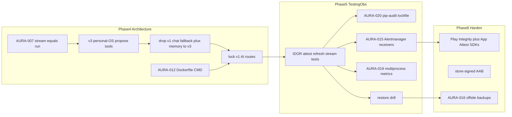

# Plan: Phase 4 Architecture, Phase 5 Testing/Obs, Phase 8 Harden

Work order: **4 → 5 → 8**. Phase 5 tests must cover the Phase 4 stream/tool cutover. Phase 8 attestation SDKs assume the P0 fail-closed server path is already live.

This plan does **not** redo [P0/P3/P7](.cursor/plans/p0_p3_p7_fixes_e39faa40.plan.md) or [P1/P2/P6](.cursor/plans/p1_p2_p6_fixes_6ab6c26a.plan.md). Treat those as prerequisites where noted.

Preserve: hexagonal `aura_core`, AST fitness tests, v2 cursor sync (do **not** delete `/api/v2/sync`), hybrid RAG score floor, safety trust-channels, prod compose topology, Riverpod MVVM, server-only inference.

---

## Prerequisites (do not duplicate here)

- **P0:** AURA-001 IDOR patch, attestation fail-closed, no unsigned JWS. Phase 8 ships real tokens into that verifier.
- **P1:** AURA-010 TokenManager single-flight. Memory cutover uses JWT, not Google ID tokens.
- **P2:** Knowledge UI already targets v3 ([`knowledge_center.dart`](aura_client/lib/core/ai/knowledge/knowledge_center.dart)). Durable graph/audit if GraphRAG tools run across workers.
- **P7:** Feedback persist is unrelated; skip labelled eval / OCR.

If P0/P1 have not landed, finish those before locking v1 or shipping store attestation.

---

## Phase 4 — Architecture (finish the strangler)

Audit objective: `stream()` executes tools; v3 personal-OS tools; client drops v1 chat fallback; Dockerfile `CMD` = `aura_service:app`; then one API / one RAG / one memory.

Issues: **AURA-007**, **AURA-012**, dual RAG/memory (rank 7), systemic “agentic UX vs non-executing stream.”

### AURA-007: `AIKernel.stream` must run the same plan/execute loop as `run`

Today [`run()`](aura_backend/aura_core/kernel/kernel.py) calls `_plan_and_execute` (lines 246–276). [`stream()`](aura_backend/aura_core/kernel/kernel.py) (378–520) gathers context, assembles a prompt, and streams tokens. It yields model `tool_calls` **without executing them**. The Flutter primary path is [`/api/v3/chat/stream`](aura_client/lib/core/ai/online_agents/sse_agent_client.dart). Copilot only gets CRUD `[ACTIONS]` when SSE fails over to v1.

[`ExecutionEngine.stream`](aura_backend/aura_core/execution/engine.py) already yields `StepEvent` then `ExecutionOutcome`. Kernel `stream()` should:

1. Reuse the same stages as `run` through planning (input guards, gather, context taint, `_should_plan` / `_plan_and_execute`).
2. Prefer `executor.stream(...)` so the client gets `{"type": "step", ...}` frames during tools.
3. Feed `tool_results` into `ContextRequest` **before** token streaming (today stream omits `tool_results=` entirely).
4. Then stream generation as today; keep post-hoc output guards + `revision` / `done.guards_complete`.
5. Do **not** execute model-emitted `tool_calls` from the token stream as a second tool loop — that bypasses taint/confirmation. Planning/execution is the only execute path (ADR-006).

Tests: extend [`test_kernel_degradation.py`](aura_backend/tests/unit/test_kernel_degradation.py) / [`test_planning_execution.py`](aura_backend/tests/unit/test_planning_execution.py) so `kernel.stream` with a stub planner+calculator yields `step` then `token` frames and the final answer can see the tool output. Add a taint case: side-effecting tool does not run without `confirmed_tools`.

### v3 personal-OS tools (so v1 `[ACTIONS]` can die)

v3 builtins are calculator / datetime / knowledge / memory / sandboxed files / HTTP ([`builtin.py`](aura_backend/aura_core/tools/builtin.py)). Task/calendar/finance/health exist only as v1 `[ACTIONS]` that [`PendingActionsExecutor`](aura_client/lib/features/chat/presentation/pending_actions_executor.dart) applies locally.

Do **not** have `aura_core` import [`infrastructure/db/models.py`](aura_backend/infrastructure/db/models.py) (architecture tests forbid `aura_core` → `services/`; keep the same direction for v2 SQLAlchemy).

New small module [`aura_core/tools/personal_os.py`](aura_backend/aura_core/tools/personal_os.py) (do not grow `builtin.py`):

- Tools: `propose_task`, `propose_event`, `propose_expense`, `propose_income`, `propose_health_log`.
- Sensitivity: confirmation-required (same as other side-effecting tools).
- Return a canonical payload matching the existing executor (`type` + `params`: `add_task`, `add_event`, `add_expense`, `add_income`, `log_health`).
- Wire via `default_tools()` / container. Kernel maps those tool reports into SSE `{"type": "actions", "actions": [...]}`.

Client: [`chat_repository.dart`](aura_client/lib/features/chat/data/chat_repository.dart) currently **deliberately** skips `pendingActionsProvider` on the SSE path (comment ~198–202). Parse `actions` frames into that provider. Keep user approval on [`PendingActionsCard`](aura_client/lib/features/chat/presentation/widgets/pending_actions_card.dart).

### Client cutover (one RAG, one memory, one chat)

Already done: KnowledgeCenter → `/api/v3/knowledge/*`.

Still v1:

- Chat fallback: `_sendViaOrchestrator` → [`/api/chat/agent`](aura_client/lib/core/ai/online_agents/online_agent_manager.dart) on `otherFailure`.
- Memory: [`MemoryRepository`](aura_client/lib/features/chat/data/memory_repository.dart) → `/api/memory` with **Google ID token**.
- Automations + learning dashboard still v1 — **leave mounted** (not chat/RAG/memory; deleting them is extra product work).

Changes:

- Point `MemoryRepository` at `GET/POST/DELETE /api/v3/memory` using `TokenManager.getValidAccessToken()` (same pattern as KnowledgeCenter). Map `{memories: [{id, content, ...}]}`. Extraction: stop calling v1 `/api/memory/extract`; v3 kernel already recalls/writes through `MemoryEngine` on the turn. If a dedicated extract is still needed, POST `/api/v3/memory` from the client after a turn, or drop extract and rely on kernel memory.
- Remove v1 chat fallback. SSE `error` / connection failure stays a retry bubble; do not call the orchestrator. Delete or stop using `OnlineAgentManager` from the send path.
- Tests: Dart fakes for v3 memory JWT paths; chat repo test that `actions` frames populate pending actions and that orchestrator is not invoked.

### AURA-012: Dockerfile must boot the hardened app

[`aura_backend/Dockerfile`](aura_backend/Dockerfile) `CMD` is `uvicorn main:app` — **no** secret hydration, **no** `/api/v3`. Compose overrides this ([`docker-compose.prod.yml`](deploy/docker-compose.prod.yml) line 122). Cloud Run [`deploy-backend.yml`](/.github/workflows/deploy-backend.yml) builds this Dockerfile with `--source` and `--allow-unauthenticated`.

- Change `CMD` to `uvicorn aura_service:app --host 0.0.0.0 --port ${PORT:-8000} --proxy-headers` (workers via `AURA_WORKERS`, same as compose).
- `aura_service` already hydrates `*_FILE` and mirrors `AURA_*` → legacy names. Image default must go through that module.
- CI: assert the Dockerfile contains `aura_service:app` (string test in backend-ci or a tiny architecture test).
- Cloud Run workflow: out of daily VPS path (Terraform never applied). In this phase only stop it from being a foot-gun: set `AURA_ENVIRONMENT=production` if the workflow stays; **do not** expand Terraform. Full unauthenticated Cloud Run lock is Phase 8 if you keep that workflow.

### Lock v1 AI routes (after the client cutover ships)

Keep `/api/v2/*` (auth, sync, insights). Keep `/api/automation/*` and `/api/learning/*` until a later cut.

After Flutter no longer calls them:

- Return **410** (or env-gated 404) on `/api/chat/*`, `/api/rag/*`, `/api/memory/*`, `/api/telemetry/*`.
- Do **not** `git rm` `services/` in this phase — `_build_authenticator` still lazy-imports `services.jwt_auth` ([migration guide](docs/guides/migration-guide.md)). Full tree deletion waits for the 30-day no-traffic checklist.
- Architecture/API tests: v3 chat/memory/knowledge still 200; locked v1 paths 410.

Update the leftover Gemini provider list in [`docs/architecture/00-overview.md`](docs/architecture/00-overview.md) while touching strangler docs (audit §34).

---

## Phase 5 — Testing + observability

Audit objective: IDOR/attestation/refresh tests; pip-audit; Alertmanager receiver; restore drill; multiprocess metrics.

Issues: **AURA-015**, **AURA-019**, **AURA-020**. Testing gaps §42.

### Tests that must exist (add only what earlier phases did not)

Security/regression (pytest + legacy unittest as appropriate):

- Owner-scoped memory delete (v1 if still mounted; v3 `forget` already 404s other tenants) — [`test_memory_delete_owner.py`](aura_backend/tests/unit/test_memory_delete_owner.py) if P0 landed.
- Production settings refuse mock attestation / mock auth.
- Integrity fail-closed (unsigned JWS rejected).
- TokenManager single-flight (Flutter).
- **New for Phase 4:** `kernel.stream` executes tools; confirmation/taint; Dockerfile/CMD assertion.
- Beat schedule includes refresh task name (P2) — if missing, add here so ops tests match compose comments.

Do not add a CI job that needs GPU/Ollama weights.

### AURA-020: pip-audit, lockfile, testcontainers out of runtime

- Move `testcontainers[postgres]` from [`requirements.txt`](aura_backend/requirements.txt) to [`requirements-dev.txt`](aura_backend/requirements-dev.txt). Rebuild image must shrink; unittest discover in CI already installs both files.
- Add a lockfile (`uv.lock` or `pip-compile` `requirements.lock`) generated from the two requirement files. Pin in CI with `pip install -r requirements.lock` **or** `uv sync --frozen` — pick one toolchain and use it in backend-ci + Dockerfile.
- New CI job/step: `pip-audit` (or `uv pip audit`) on the lockfile. Fail on known CVEs; do **not** drive a mass upgrade in this phase (audit: scan first, upgrade with tests later).
- Client: optional `dart pub outdated` is out of scope unless already trivial.

### AURA-015: Alertmanager must notify a human

Rules already exist ([`deploy/monitoring/alerts/aura.yml`](deploy/monitoring/alerts/aura.yml): gateway down, insecure mode, retrieval empty, etc.). [`alertmanager.yml`](deploy/monitoring/alertmanager.yml) receivers are **empty by design**.

- Drive receivers from env/secrets, not committed webhook URLs: e.g. `ALERTMANAGER_WEBHOOK_URL` (Discord/Slack/generic) and optional SMTP. Template `alertmanager.yml` or a small `alertmanager.receivers.yml` mounted from `deploy/secrets/` (gitignored), documented in [`deploy/.env.example`](deploy/.env.example).
- Critical route (`AuraGatewayDown`, `AuraInsecureModeActive`, `AuraAllProvidersUnhealthy`) → `critical` receiver; the rest → `default`.
- Keep inhibit rules. Do not add a fake webhook that 404s.
- Verify: `amtool config routes` / compose config test, plus a docs one-liner for sending a test alert.

### AURA-019: Prometheus across 4 uvicorn workers

[`Metrics`](aura_backend/aura_core/observability/metrics.py) uses a **private** `CollectorRegistry()` per process. Prometheus scrapes `gateway:8000` once ([`prometheus.yml`](deploy/monitoring/prometheus.yml)) — nginx/uvicorn will hit **one** of four workers.

- If `PROMETHEUS_MULTIPROC_DIR` is set: use `prometheus_client.multiprocess.MultiProcessCollector` on `/metrics`; workers write to a shared volume; `mark_process_dead` on worker exit.
- Compose: shared volume on `gateway`, env set. Gauges that are per-process (`turns_in_flight`) must use the multiprocess mode the library supports (usually livesum/all).
- Tests: unit test that when the env dir is set, `generate_latest` includes a counter incremented from a second registry/process simulation; default (unset) stays private-registry for pytest isolation.

### Restore drill (AURA-016 starts here; offsite copy is Phase 8)

[`backup.sh`](deploy/scripts/backup.sh) dumps Postgres (verified) and **creates Qdrant snapshots on the Qdrant volume** (not copied to `$BACKUP_DIR`). Redis is omitted. [`restore.sh`](deploy/scripts/restore.sh) exists but is interactive (`read` confirmation) and Postgres-only. Docs already say practise restore monthly ([`maintenance-guide.md`](docs/guides/maintenance-guide.md)).

Phase 5 (make it runnable without prod):

- Non-interactive restore path for **staging**: `RESTORE_CONFIRM=$PGDATABASE restore.sh` (or `--yes` only when that env matches), so a drill can run in CI-like compose.
- Copy Qdrant snapshot files into `$BACKUP_DIR/qdrant-<stamp>/` after snapshot create (still local volume; offsite is Phase 8).
- Redis: `redis-cli --rdb` / `BGSAVE` copy into `$BACKUP_DIR` (refresh tokens + cache; document that users re-login if RDB is stale).
- Add [`deploy/scripts/restore-drill.sh`](deploy/scripts/restore-drill.sh): bring up a throwaway Postgres, `pg_restore --list` + restore into empty DB, assert table count ≥ 1, exit 0. Do **not** point this at prod. Document the manual Qdrant/Redis half in the maintenance guide as a checklist the operator ticks once.

---

## Phase 8 — Final production hardening

Audit objective: Play Integrity SDK, store signing, offsite backups, mock attestation **false** in every prod env. Launch checklist green. Not ready for Play Store until this lands.

Issues: **AURA-016** remainder, **AURA-003/005/017/021** product close-out (server fail-closed is P0; this phase produces real tokens).

### Real attestation on the client (and iOS verify on the server)

Today [`DeviceValidationService`](aura_client/lib/core/security/device_validation_service.dart) is honest: debug `aura_dev_attestation`, release `aura_attestation_unsupported`. Release APK **cannot** satisfy production attestation once mock is off (AURA-021).

Android:

- Integrate Play Integrity API (official Flutter/Android plugin or platform channel in `android/`). Request integrity token in release; send it as `X-Device-Attestation`.
- Backend already calls Play Integrity Standard API when credentials exist ([`services/security.py`](aura_backend/services/security.py)). After P0 it must **fail closed** if that call fails — no unsigned JWS.
- Operator setup (document, do not invent keys): Play Console app, Cloud project, service account with Play Integrity, JSON via Docker secret.

iOS:

- Integrate App Attest / DeviceCheck; send real attestation object.
- Replace the P0 fail-closed placeholder in `verify_device_integrity` for iOS with cryptographic verify (Apple attestation). Debug/TEST still allow mock only when not production-like.
- Tests: fake tokens rejected in production-like env; valid-shaped fixtures with mocked Apple/Google clients accepted.

Keep debug marker **only** for local compose with `ALLOW_MOCK_ATTESTATION=true` and non-production `AURA_ENVIRONMENT`.

### Store signing (close AURA-017 / AURA-021)

P0 added optional `signingConfig` from env / gitignored `key.properties`. Phase 8 is **using** it:

- Document Play upload: AAB, real keystore, Play App Signing.
- [`release-apk.yml`](.github/workflows/release-apk.yml): optional signed AAB job when secrets exist; unsigned smoke remains. Never generate a keystore in-repo.
- Confirm `applicationId` / Play packageName match what Integrity verifies.

### Offsite backups (finish AURA-016)

Local sidecar stays. Add a second step after a successful cycle:

- `rclone copy` (or `aws s3 cp`) `$BACKUP_DIR` to an S3-compatible remote from env (`BACKUP_S3_URI`, keys via secrets). Include Postgres dumps, Qdrant snapshot copies, Redis RDB.
- Retention offsite ≥ local (`BACKUP_RETENTION_DAYS`).
- Alert if `.last_success` age or rclone exit ≠ 0 (extend `aura.yml` if a node-exporter textfile or a `backup_last_success` metric is easy; otherwise document `AuraBackupStale` from `time() - file mtime`).
- Confirm `ALLOW_MOCK_ATTESTATION=false` in prod compose / `.env.example` production block.

### Launch checklist (short doc, not a new product)

Add a one-page checklist to [`docs/guides/deployment-guide.md`](docs/guides/deployment-guide.md) (or a small `docs/guides/launch-checklist.md`): mock flags off, Integrity credentials present, signed AAB, alert test received, restore drill dated, offsite object listed, v1 AI routes 410, `/health/ready` green. This is the audit’s “launch checklist green.”

---

## Explicitly not in this plan

- Kubernetes, extra microservices, GPU Ollama, Terraform apply, raising `OLLAMA_NUM_PARALLEL`.
- Deleting `services/` or v2 sync.
- Migrating automations/learning to v3.
- Full i18n (audit “should improve”, not Phase 8).
- Labelled RAG eval, OCR, durable MLOps registry (Phase 7 remainder).
- Mass dependency upgrades beyond audit-driven pip-audit failures.
