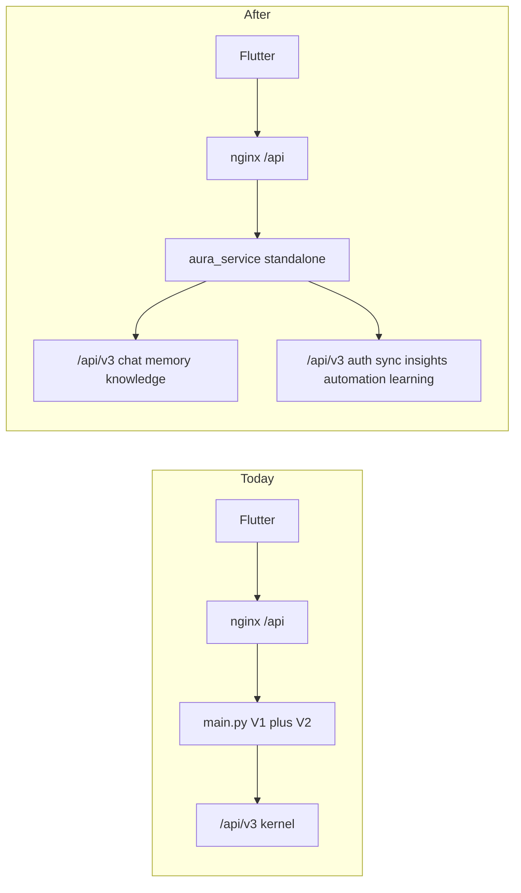

# Run V3 only

The process today is still the strangler stack: [`aura_service.create_app()`](aura_backend/aura_service.py) imports [`main.py`](aura_backend/main.py) and mounts `/api/v3` on top of V1 + V2.

This cutover **does not rewrite** auth/sync into `aura_core` (ADR-002 still forbids that). It changes the **served surface** to `/api/v3` only, then updates the Flutter client.

## Target surface

Mounted on `aura_service:app` (already the Dockerfile / prod compose entry):

- Kernel (already exists): `/api/v3/chat`, `/memory`, `/knowledge`, `/agents`, `/admin`, `/feedback`
- Rehomed platform adapters (same handlers, new prefix):
  - [`api/v2/auth.py`](aura_backend/api/v2/auth.py) → `/api/v3/auth`
  - [`api/v2/sync.py`](aura_backend/api/v2/sync.py) → `/api/v3/sync`
  - [`api/v2/insights.py`](aura_backend/api/v2/insights.py) → `/api/v3/insights`
  - Extract from `main.py`: `/api/v3/automation/{analyze-email,analyze-issue}`
  - Extract from `main.py`: `/api/v3/learning/{log,export,build_dataset,evaluate}`

**Not mounted** (404, not 410):

- All locked V1 AI stubs (`/api/chat/*`, `/api/rag/*`, `/api/memory/*`, `/api/telemetry/log`)
- V2 chat ([`api/v2/chat.py`](aura_backend/api/v2/chat.py) — unused by the client, old orchestrator)

JWT token format stays the same. Only paths change. Existing refresh tokens keep working.

Old APKs that still call `/api/v2/*` or `/api/automation/*` will break. That is the cutover you chose.

## Backend

**1. Extract shared HTTP limits out of `main.py`**

Move `RateLimitMiddleware` and `PayloadSizeLimitMiddleware` to something like [`aura_backend/infrastructure/http_limits.py`](aura_backend/infrastructure/http_limits.py) so the gateway can apply them without importing `main`.

**2. Extract leftover live routes**

New small routers (do not grow [`aura_core/api/v3.py`](aura_backend/aura_core/api/v3.py)):

- `aura_backend/api/automation.py` — current email/issue handlers + budget exception behavior
- `aura_backend/api/learning.py` — current learning log/export/build/evaluate handlers

**3. Make `create_app()` V3-only**

In [`aura_service.py`](aura_backend/aura_service.py):

- Always `build_app(...)` (today’s `standalone=True` path)
- `include_router` the five platform routers
- Apply CORS from [`config.Settings.allowed_origins`](aura_backend/config.py) (today this only exists on `main.py`; Flutter web needs it)
- Apply payload-size + IP rate-limit middleware
- Register the `InferenceBudgetExceededException` handler used by automation
- Delete the `from main import app as legacy_app` branch

**4. Prefix / message updates**

- Change the three V2 router prefixes
- Update the expired-token hint in [`services/jwt_auth.py`](aura_backend/services/jwt_auth.py) from `/api/v2/auth/refresh` to `/api/v3/auth/refresh`

**5. Leave `main.py` on disk, unused**

Do not delete `services/`, `main.py`, or V2 chat in this pass. Production simply never loads them. Deleting the legacy tree is a later cleanup after this surface is stable.

**6. Fitness test**

Add a small architecture test on `aura_service.app.routes`: every `/api/` path starts with `/api/v3/`; no `/api/v2/` and no unversioned `/api/chat`, `/api/rag`, `/api/memory`, `/api/automation`, `/api/learning`.

## Flutter client

URL-only updates in existing clients (MVVM, no new feature work):

- [`token_manager.dart`](aura_client/lib/core/auth/token_manager.dart) → `/api/v3/auth`
- [`sync_client.dart`](aura_client/lib/core/sync/sync_client.dart) → `/api/v3/sync`
- [`insights_client.dart`](aura_client/lib/core/insights/insights_client.dart) → `/api/v3/insights`
- [`automation_repository.dart`](aura_client/lib/features/automations/data/automation_repository.dart) → `/api/v3/automation/...`
- [`learning_dashboard.dart`](aura_client/lib/features/learning/presentation/learning_dashboard.dart) → `/api/v3/learning/...`

Chat/knowledge/memory already use V3.

`OnlineAgentManager` still points at `/api/chat/agent` (now 404). Chat send already goes through `SseAgentClient`. Leave that dead path unused; do not rewire it to V3 in this pass.

Update client tests that assert paths: [`sync_client_outbox_test.dart`](aura_client/test/sync_client_outbox_test.dart), [`token_manager_test.dart`](aura_client/test/token_manager_test.dart) if it hard-codes `/api/v2`.

## Tests to retarget

- [`test_v1_locked_routes.py`](aura_backend/tests/unit/test_v1_locked_routes.py) → old paths are **404** (unmounted), platform routes are **not** 410
- [`test_v1_internal_error_bodies.py`](aura_backend/tests/unit/test_v1_internal_error_bodies.py) → drop 410 assertions; keep “no leak” coverage on a live V3/platform route if still needed
- [`test_security.py`](aura_backend/test_security.py) and [`test_sync_integration.py`](aura_backend/test_sync_integration.py) → import `aura_service.app`, hit `/api/v3/...` instead of `/api/memory/*` and `/api/v2/sync`
- Nginx / Dockerfile: no change. [`deploy/nginx`](deploy/nginx/templates/aura.conf.template) already proxies all `/api/`; prod healthcheck already uses `/health/ready`

## Out of scope

- Hexagonal rewrite of sync/auth into `aura_core`
- Deleting `main.py` / `services/`
- Temporary dual-path aliases (`/api/v2` → `/api/v3`)
- Docs rewrite (migration guide will be stale until a later docs pass)
