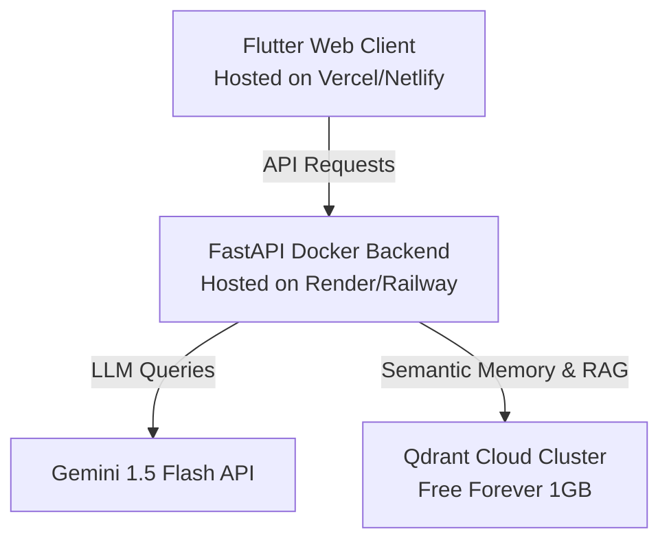

# AURA AI Deployment Guide (Alternative Free-Tier Platforms)

> **Historical.** Production deploys on the VPS stack in
> [`docs/guides/deployment-guide.md`](../docs/guides/deployment-guide.md). The Flutter client's
> `BACKEND_URL` is `https://$AURA_DOMAIN` from `deploy/.env`, injected by `./deploy_client.sh`
> (or `.\deploy_client.ps1`). Do not point a release APK at Railway, Render, Hugging Face, or
> a bare IP. With no owned domain, `AURA_DOMAIN` is `169.58.188.43.nip.io`.

This guide walks you through deploying the AURA AI backend and frontend using free-tier alternative cloud platforms to bypass the Google Cloud billing requirement.

---

## Architecture Overview



---

## Step 1: Set Up Qdrant Cloud (Free Vector Database)

Since local disk storage (`local_qdrant_storage`) is ephemeral on free-tier containers (lost when the app sleeps or restarts), we will use Qdrant's official free cloud service to persist memories and knowledge documents.

1. Go to [Qdrant Cloud Console](https://cloud.qdrant.io/) and create a free account.
2. Create a new **Free Cluster** (1GB capacity, free forever, no credit card required).
3. Once the cluster is active, copy the **Cluster URL (Endpoint)** (looks like `https://xxxxxx.gcp.qdrant.io:6333`).
4. Generate an **API Key** (Read/Write) and save it securely.

---

## Step 2: Deploy the FastAPI Backend

You can choose either **Render** or **Railway**. Both will build your backend automatically using the provided `Dockerfile`.

### Option A: Deploying on Render (Free Web Service - No Credit Card Required)

> [!TIP]
> Render's Free tier does **not** require any credit card details to sign up or host your FastAPI web service.

1. Push your project to a GitHub repository (it can be private).
2. Sign in to the [Render Dashboard](https://dashboard.render.com/) with GitHub.
3. Click **New +** and select **Web Service**.
4. Connect your AURA AI GitHub repository.
5. Configure the service settings:
   - **Name**: `aura-backend`
   - **Region**: Select a region close to you (e.g., Frankfurt for Egypt/Europe).
   - **Branch**: `main` (or your active branch)
   - **Root Directory**: `aura_backend` _(Crucial: This points Render to the folder containing the Dockerfile)_
   - **Language**: `Docker` _(Render will auto-detect the Dockerfile)_
   - **Instance Type**: `Free`
6. Click **Advanced** and add the following **Environment Variables**:
   - `GEMINI_API_KEY`: _Your Google AI Studio Gemini API Key (Get it for free from [Google AI Studio](https://aistudio.google.com/))_
   - `QDRANT_HOST`: _Your Qdrant Cloud URL (from Step 1)_
   - `QDRANT_API_KEY`: _Your Qdrant Cloud API Key (from Step 1)_
   - `ALLOWED_ORIGINS`: `https://your-frontend-domain.vercel.app,http://localhost:8080` _(Update with your actual Vercel/Netlify domain later to allow browser access)_
7. Click **Create Web Service**.
   - _Note: On Render's Free tier, the service will spin down after 15 minutes of inactivity and spin back up (which takes ~1-2 mins) when it receives a new request._

### Option B: Deploying on Railway (Hobby Plan)

1. Sign in to [Railway](https://railway.app/) using your GitHub account.
2. Click **New Project** -> **Deploy from GitHub repo**.
3. Select your AURA AI repository.
4. Once the service is added, click on it and choose **Settings**:
   - Change the **Root Directory** to `/aura_backend`.
5. Go to the **Variables** tab and click **New Variable** to add:
   - `PORT`: `8000`
   - `GEMINI_API_KEY`: _Your Gemini API Key_
   - `QDRANT_HOST`: _Your Qdrant Cloud URL_
   - `QDRANT_API_KEY`: _Your Qdrant Cloud API Key_
   - `ALLOWED_ORIGINS`: _Your frontend domain_
6. Railway will trigger a build and deploy the container automatically.

---

## Step 3: Deploy the Flutter Web Client

Since the client is built using Flutter, we compile it into static HTML, JS, and CSS files, then upload them to a fast, global CDN like **Vercel** or **Netlify** for free.

### 1. Compile the Web Assets Locally

Before deploying, compile your Flutter web client on your development machine:

```powershell
cd aura_client
flutter build web --release --dart-define=BACKEND_URL=https://$AURA_DOMAIN
```

This command compiles the app and saves the output in `aura_client/build/web`.

### 2. Deploy to Vercel (Recommended & Easiest)

#### Method A: Vercel CLI (Super Fast)

1. Install Vercel globally:
   ```powershell
   npm install -g vercel
   ```
2. Navigate to the compiled folder:
   ```powershell
   cd aura_client/build/web
   ```
3. Run the deployment command:
   ```powershell
   vercel --prod
   ```
4. Follow the prompts (login if needed, link to a new project, name it `aura-client`).
5. Copy the production URL provided by Vercel (e.g., `https://aura-client.vercel.app`).

#### Method B: Deploy from GitHub (Automatic Updates)

1. In Vercel dashboard, click **Add New** -> **Project**.
2. Connect your GitHub repository.
3. In the Build & Development settings:
   - Set **Framework Preset**: `Other`
   - Set **Root Directory**: `aura_client`
   - Set **Build Command**: `flutter/bin/flutter build web --release` _(Note: This requires Vercel's build environment to have Flutter, which can be tricky. Hence, **Method A (Vercel CLI)** deploying pre-compiled files is much faster and simpler!)_

---

## Step 4: Link Frontend and Backend

Once both are deployed:

1. **Configure Client to use the VPS backend:**
   Rebuild with `--dart-define=BACKEND_URL=https://$AURA_DOMAIN` (or run `./deploy_client.sh`). There is no runtime URL setting.
2. **Update Backend CORS Configuration:**
   Set `ALLOWED_ORIGINS` in `deploy/.env` to include `https://$AURA_DOMAIN` and the origin that hosts the Flutter web bundle (Vercel/Netlify if used). Native Android/iOS ignore CORS.

## Build the APK

From the repo root, with `AURA_DOMAIN` set in `deploy/.env`:

```bash
./deploy_client.sh
```

Or:

```bash
cd aura_client
flutter build apk --release --obfuscate --split-debug-info=build/app/outputs/symbols --split-per-abi --dart-define=BACKEND_URL=https://$AURA_DOMAIN
```
