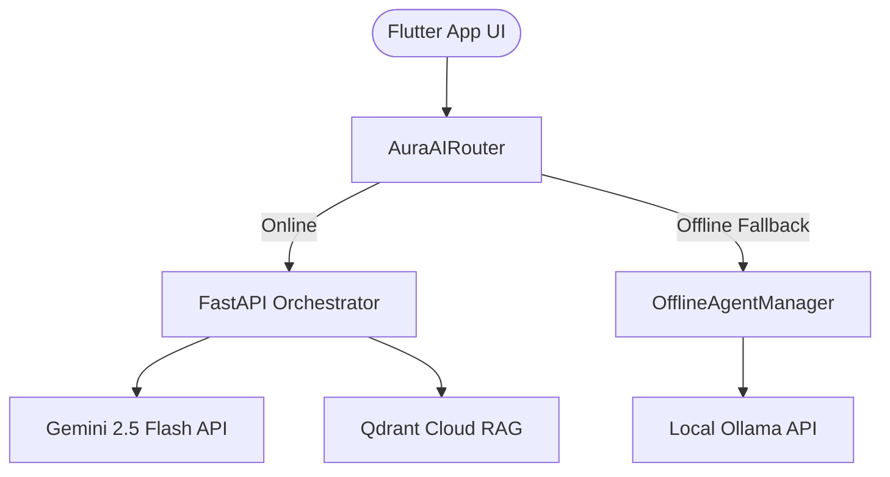

# AURA AI v2.0.0 Architecture Documentation

This document describes the high-level software architecture, data modeling, and routing orchestrations of the AURA AI platform.

---

## 1. System Topology
AURA AI operates as a decoupled hybrid client-backend application.

- **Client Shell (Flutter)**: Runs on Android, iOS, Windows, macOS, and Linux. Manages SQLite local databases, background synchronization timers, and local settings.
- **FastAPI Orchestrator (FastAPI/Python)**: Handles token verification, rate limiting, document ingestion, prompt routing, and tool execution.
- **Qdrant Vector Database**: Houses memory contexts and parsed document fragments segmented by `user_id`.

---

## 2. Local Database & Encrypted Storage
Local data persistence uses **Drift (SQLite-backed)**. Cryptographic protection is enforced on sensitive columns (e.g., text, titles, descriptions) using **AES-256 (CBC mode)** with key storage inside the device keychain (`flutter_secure_storage`).

Key tables:
- **Tasks**: Tasks list, priority, deadlines, and category tags.
- **CalendarEvents**: Appointment timings and sync references.
- **FinanceRecords**: Income and expense logs.
- **HealthRecords**: Sleep hours, water intake, workouts, and weight logs.
- **Messages**: History of conversation text.
- **UserMemories**: Cache of user profile parameters and preferences.
- **LearningLogs**: Thumbs-up/down feedback loops for dataset export.
- **OfflineModelWeights**: Paths to downloaded model parameters.

---

## 3. AuraAIRouter Orchestration Flow
When a prompt is sent, `AuraAIRouter` evaluates constraints:

1. **Internet Probe**: Checks DNS resolution (`google.com`).
2. **Settings Override**: Evaluates if a provider is explicitly forced (Auto vs. Forced Online vs. Forced Offline).
3. **Quota/Error Catch**: Streams responses. If a network outage or Gemini HTTP 429/503 occurs mid-stream, auto-failover launches the local fast agent via `OfflineAgentManager` seamlessly.
