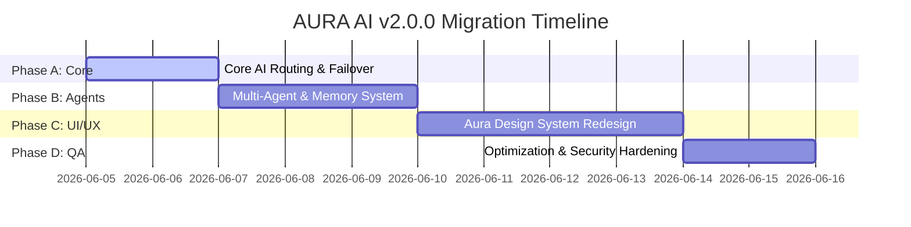

# AURA AI v2.0.0 Migration & Implementation Plan

## 1. Migration Overview
The migration to AURA AI v2.0.0 transforms the system from a client-backend chat interface into an autonomous, hybrid AI operating environment. The migration focuses on client-side routing (`AuraAIRouter`), real-time offline agent support, multi-agent frameworks, expanded memory systems (V2), and an enterprise-grade UI/UX overhaul.

---

## 2. Directory & Module Provisioning

### 2.1 Hybrid AI Core (Flutter)
We will initialize the core AI module inside the Flutter codebase:
```text
aura_client/lib/core/ai/
├── ai_router/          # AuraAIRouter (network detection, auto-failover, model selector)
├── online_agents/      # Gemini online client configuration and stream readers
├── offline_agents/     # Local/Ollama offline client wrappers (OfflineAgentManager)
├── memory/             # Memory System V2 (ShortTerm, LongTerm, Semantic, TaskMemory)
├── knowledge/          # Vector/RAG abstraction (local SQLite index & server hooks)
├── learning/           # Feedback collectors, user correction logs, and datasets builders
└── orchestrator/       # Multi-agent coordinator and session synchronizers
```

### 2.2 Schema Migrations (Drift SQLite)
To support offline agents, memory tags, and logs, the local Drift schema must be updated.
- **Migration Strategy**: 
  - Update `schemaVersion` from `3` to `4` in [database.dart](file:///e:/AURA%20AI/aura_client/lib/core/database/database.dart).
  - Add tables: `MemoryRecords` (semantic vs. episodic vs. short-term), `LearningLogs` (prompt-response-feedback pairs), and `OfflineModelWeights` (paths for downloaded model configs).
  - Register tables in `@DriftDatabase(...)` configuration.

---

## 3. Implementation Phases



### Phase 1: Hybrid AI Router & Offline Agent Managers
- Implement `AuraAIRouter` in the client with automatic connection status polling.
- Build `OfflineAgentManager` to query local model tags, and interface with Ollama or local lightweight ONNX/Lite configurations.
- Provide manual fallback providers in the Settings page (Auto, Gemini, Offline Fast/Reasoning/Premium).

### Phase 2: Multi-Agent System & Memory V2
- Refactor the agent orchestration to split into distinct task contexts (Conversation, Coding, Research, Planning, Memory, Learning).
- Store local feedback logs in `LearningLogs` for future LoRA dataset exports.
- Build hierarchical memory retrieval (merge short-term chat lists with long-term semantic embeddings).

### Phase 3: Premium UI/UX overhaul
- Define Aura Design System (Minimal dark/light theme tokens,Outfit/Inter typography).
- Build streaming indicators, skeleton loaders, and connection state banners.
- Redesign dashboard layouts (Analytics charts, memory banks management, knowledge ingestion pages).

### Phase 4: Verification & Security Hardening
- Audit database encryption. Ensure fallback plaintext file keys are deprecated or encrypted.
- Enforce strict `debug_mode` restrictions on the backend.
- Run tests verifying latency goals (Response Start < 2s).

---

## 4. Rollback and Safety Strategy
- **Backup**: Prior to Drift migration, backup `aura_db.sqlite` to `aura_db.sqlite.bak`.
- **API Versioning**: Backend endpoints will support both v1 (`/api/chat/agent`) and v2 (`/api/v2/...`) routes to prevent client disruption during deploy steps.
- **Toggle Flag**: Implement feature toggles in `AppConfig` (`enableOfflineRouter`, `forceMockForTesting`) to revert to stable v1 routing dynamically if errors occur.
