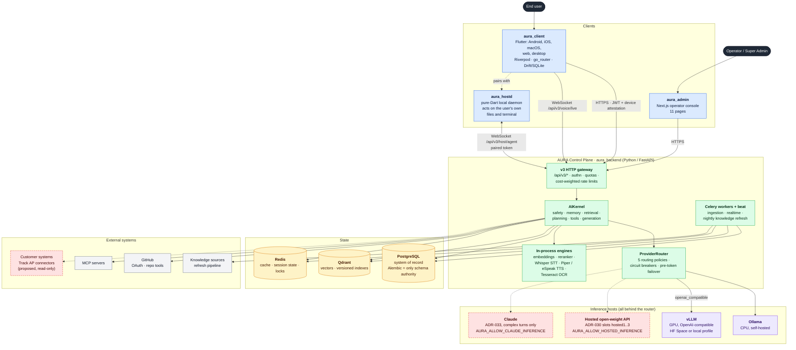

# 01 · System context

Who and what AURA talks to. One backend (the **Control Plane**), three clients, and a set of
inference hosts behind a single provider router.

**Reading the diagram**

- Solid edges are live. Dashed edges and red boxes are **opt-in, flag-gated, or proposed**; they
  are off unless an operator enables them.
- The self-hosting rule is a fitness-tested invariant: only `echo`, `openai_compatible`,
  `ollama`, and the one gated `claude` kind can be built by `llm/registry.py`
  (`tests/architecture/test_no_external_inference.py`).
- Embeddings, reranking, ASR, TTS, and OCR run **inside** the Control Plane container. Only
  chat/completion generation crosses to the inference plane
  (`docs/deployment/architecture.md` §3).
- Sync between the Flutter app and the backend uses the generic cursor protocol on
  `/api/v3/sync`; the app keeps a local Drift database and works from it first.
