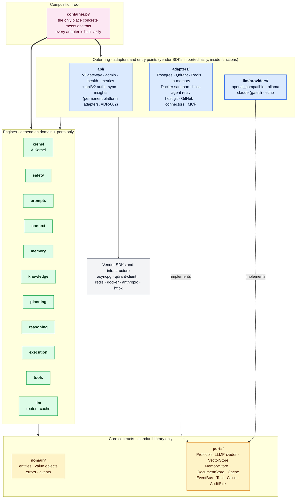

# 02 · Backend layers (hexagonal)

`aura_core` is a framework-free core with adapters plugged into ports. The dependency arrow never
reverses, and `tests/architecture/` enforces it with AST-based fitness tests.

**Rules the tests pin**

| Rule | Where it is enforced |
| --- | --- |
| `domain/` and `ports/` import only the standard library | `tests/architecture/test_dependency_rules.py` |
| Engines import domain and ports, never adapters | same |
| Vendor SDKs are imported inside functions, not at module scope | same |
| The `anthropic` SDK is importable only from `llm/providers/claude.py` | `SANCTIONED_SDK_IMPORTERS` |
| No other hosted-vendor branch in the provider registry | `test_no_external_inference.py` |
| No DDL string anywhere under `aura_core` (Alembic only) | `test_no_runtime_ddl.py` |
| An adapter's `__init__` never makes a network call; the first real use does, behind an `asyncio.Lock` when callers could race | pattern: `PostgresPool._get_pool()` |

Every storage port also has a **real in-memory adapter**, not a mock. That is why the default
`pytest` run needs no Docker, no network, and no model.
