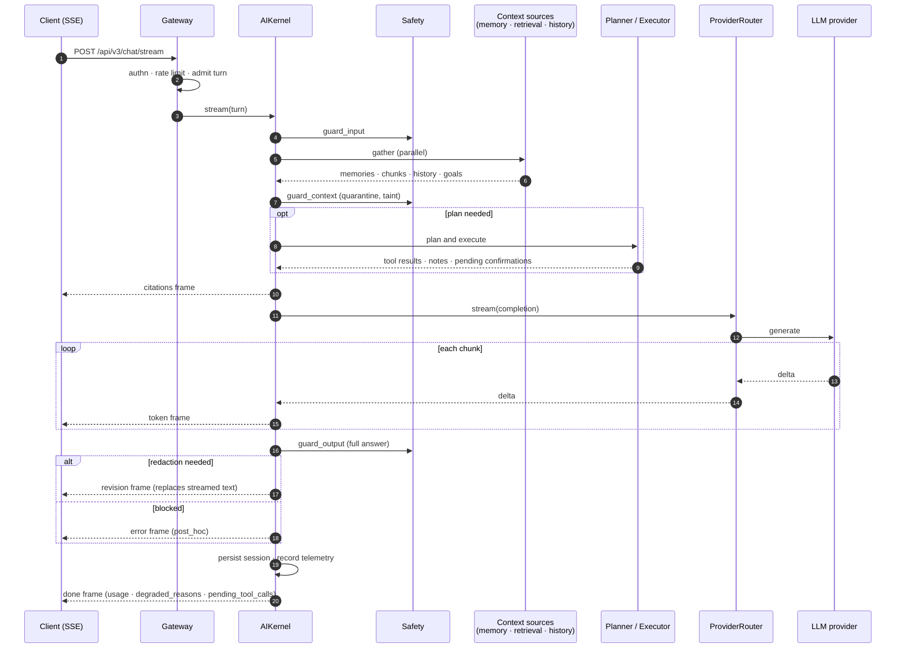
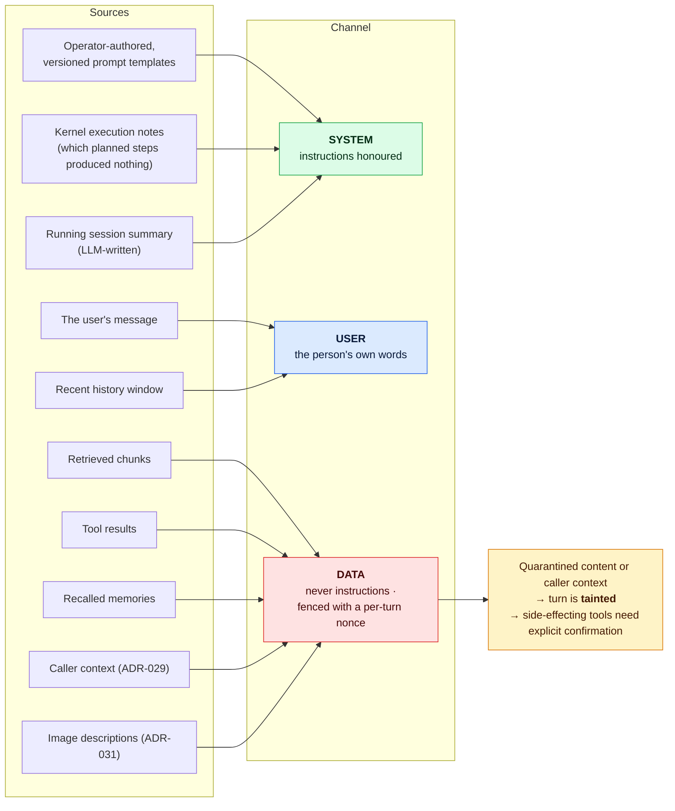

# 03 · Turn pipeline and trust channels

What happens between `POST /api/v3/chat` (or `/chat/stream`) and the reply. Stage numbers match
the comments in `aura_core/kernel/kernel.py` (`_run_turn`, `stream`).

## 3.1 Turn stages

```mermaid
flowchart TB
    classDef io fill:#dbeafe,stroke:#2563eb,color:#0b1b3a
    classDef guard fill:#fee2e2,stroke:#dc2626,color:#450a0a
    classDef ctx fill:#fef3c7,stroke:#d97706,color:#451a03
    classDef act fill:#dcfce7,stroke:#16a34a,color:#052e16
    classDef gen fill:#ede9fe,stroke:#7c3aed,color:#2e1065
    classDef out fill:#f3f4f6,stroke:#6b7280,color:#111827

    req(["Request"]):::io
    gw["<b>Gateway</b><br/>authn · rate limit · idempotency ·<br/>admission and quota"]:::io
    resume{"Resuming a held<br/>confirmation?"}:::io
    agent["Resolve persona / agent<br/>Engineer consent check"]:::io

    g1["<b>1 · Input guards</b><br/>injection · jailbreak · PII · size"]:::guard
    img["<b>1b · Image perception</b><br/>self-hosted vision model ·<br/>result enters as DATA"]:::ctx

    subgraph gather["2-4 · Gather context, concurrently"]
        direction LR
        mem["Memory recall"]:::ctx
        ret["Hybrid retrieval<br/>BM25 + dense · RRF · rerank"]:::ctx
        hist["Session history<br/>+ running summary"]:::ctx
        goals["Active goals"]:::ctx
        cag["CAG prefix<br/>pinned knowledge"]:::ctx
    end

    cls["Classify data sensitivity"]:::guard
    g5["<b>5 · Guard retrieved content and memories</b><br/>quarantine hostile chunks ·<br/>mark the turn <i>tainted</i>"]:::guard

    plan{"Plan needed?<br/>tools exist and<br/>planner says so, or<br/>agentic persona"}:::act
    pe["<b>6 · Plan and execute</b><br/>planner → step DAG → executor /<br/>bounded agentic loop"]:::act
    hold{"Side-effecting call<br/>needs confirmation?"}:::act
    pend(["Return pending_tool_calls<br/>turn waits for the human"]):::out

    asm["<b>7 · Assemble context</b><br/>rank · compress · fit token budget ·<br/>place each item on its trust channel"]:::ctx

    cache{"LLM cache hit?"}:::gen
    reas["Reasoner<br/>direct · CoT · self-consistency · ToT<br/>(non-stream, no schema)"]:::gen
    rtr["<b>8 · ProviderRouter</b><br/>policy · breaker · failover<br/>before first token"]:::gen

    g9["<b>9 · Output guards</b><br/>PII · secrets · prompt leakage ·<br/>groundedness"]:::guard
    g9b["<b>9b · Structured output</b><br/>validate · repair once · else fail closed"]:::guard
    persist["<b>10 · Persist session state</b><br/>episodic append · summary fold"]:::ctx
    tel["Telemetry · metrics · audit"]:::out
    resp(["Response<br/>text · citations · tool_calls · telemetry"]):::io

    req --> gw --> resume
    resume -- "yes: run stored plan" --> pe
    resume -- "no" --> agent --> g1 --> img --> gather --> cls --> g5 --> plan
    plan -- "yes" --> pe --> hold
    plan -- "no" --> asm
    hold -- "yes" --> pend
    hold -- "no" --> asm
    asm --> cache
    cache -- "hit" --> g9
    cache -- "miss, free text" --> reas --> g9
    cache -- "miss, direct or schema" --> rtr --> g9
    g9 --> g9b --> persist --> tel --> resp
```

Notes on the diagram:

- **Tools run only through planning and execution** (ADR-006). A model's own `tool_calls` frames
  are informational and never execute anything.
- **Failover only happens before the first streamed token.** After output has reached the caller,
  a stream failure surfaces as an error instead of silently retrying elsewhere.
- **Budget:** every generation in the turn (planning, reasoning, answer, schema repair) is charged
  to one `TurnBudget` (default 8 generations, optional cost ceiling).
- **Shadow mirroring** to registered candidate model versions is dispatched off the critical path
  after generation; its output is never shown.
- 9b applies to `/chat` only. `/chat/stream` rejects `response_schema`.

## 3.2 Streaming turn

The output guard runs **after** the tokens have streamed. That is why the protocol carries
`revision` and `post_hoc` frames, and why the client replaces rather than appends on them.

## 3.3 Trust channels

Every item in the prompt travels on one of three channels. Only `SYSTEM` may carry instructions.

> **Known gap in the current code.** The running session summary is LLM-written from earlier user
> and assistant turns, yet `context/engine.py` injects it on `SYSTEM`, and the turn's taint flag is
> not stored with session history. Content that influenced an answer on a tainted turn can
> therefore come back later as an instruction. The fix is to carry taint into session history and
> either summarise only clean turns or place the summary on `DATA`/`USER`. This diagram shows the
> code as it is, not as it should be.
