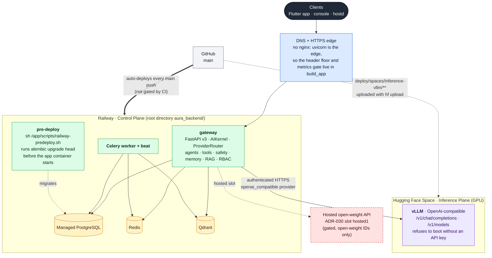
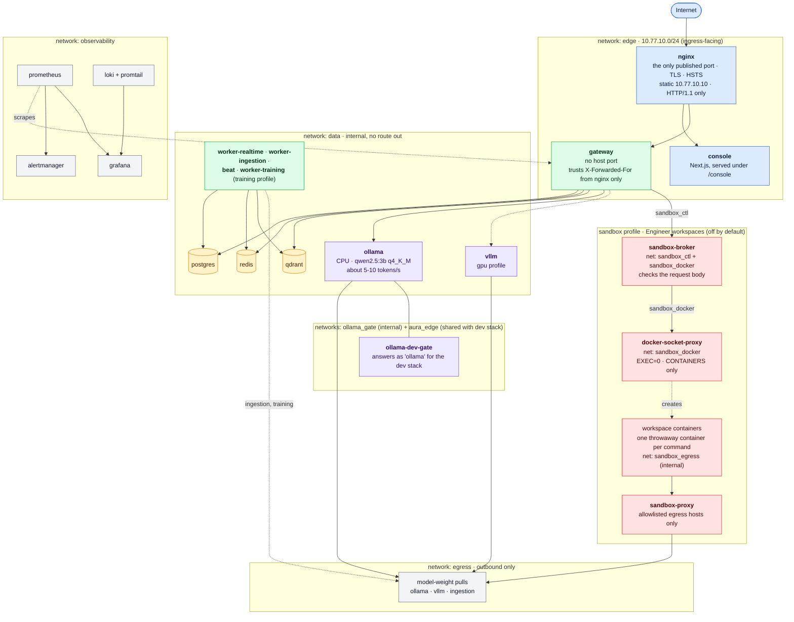

# 04 · Deployment topologies

AURA has two supported deploy targets that stay live side by side until a deliberate cutover.
Neither workflow redeploys the other (`docs/deployment/architecture.md` §1, §5).

## 4.1 Control Plane on Railway, Inference Plane on a Hugging Face Space

- Only chat/completion generation crosses to the inference plane. Embeddings, reranking, STT, TTS,
  and OCR stay in the gateway container.
- Railway's **dashboard** pre-deploy command is what runs; `railway.json` alone changes nothing
  live for this service. Never put `&&`, `||` or `;` in that field.
- The model identity the router assumes (`AURA_PROVIDER_HFSPACE_*`) and what vLLM actually serves
  (`VLLM_MODEL`, `VLLM_MAX_MODEL_LEN`) are necessarily duplicated, so
  `tests/deployment/test_inference_contract.py` pins them against each other.

## 4.2 Single-host stack (Docker Compose, `deploy/docker-compose.prod.yml`)

Isolation rules worth keeping in view:

- **Prod and dev compose files stay at parity** on network `internal:` flags, socket-proxy env
  allowlists, and which images are built rather than pulled. They share one host, so hardening one
  stack and not the other leaves the weaker one as the attack surface
  (`tests/unit/test_compose_security_parity.py`).
- **The gateway cannot reach the Docker socket.** The socket proxy filters endpoints, not request
  bodies, so a broker sits between them and checks the body. The gateway never `docker exec`s: the
  proxy refuses it, and each sandbox command is its own container over the workspace's bind mount
  (`tests/unit/test_sandbox_exec_surface.py`).
- Postgres budget: every uvicorn worker and Celery child holds connection pools sized so the worst
  case (108) stays under `max_connections = 120` (`tests/unit/test_postgres_connection_budget.py`).
