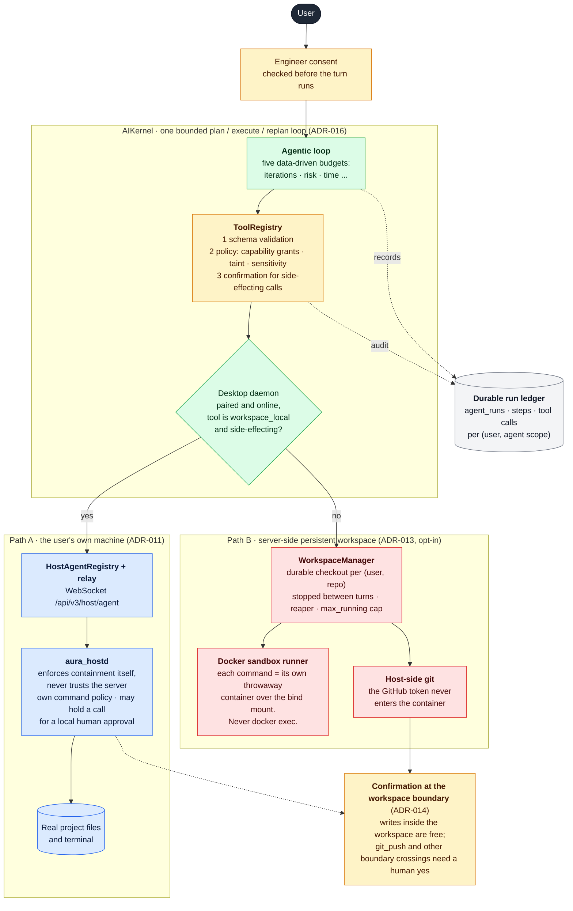

# 05 · Engineer agent: where a command actually runs

The Engineer persona acts on real code. A tool call can land in one of two places, chosen per
turn, and both sit behind the same planning, policy, and confirmation path.
See ADR-011 (desktop), ADR-013 (server workspaces), ADR-014 (confirmation boundary), and
ADR-016 (agent platform).

**What keeps this safe**

| Property | Mechanism |
| --- | --- |
| A model cannot run a tool by emitting a tool-call frame | frames are informational; only planning and execution run tools (ADR-006) |
| A poisoned document cannot trigger a write silently | a quarantined or caller-supplied context taints the turn, so a side-effecting tool needs explicit confirmation |
| The desktop daemon is not an open shell | containment and a command policy live in the daemon, which can still ask the local human |
| A workspace cannot reach the data tier or the gateway | its network is `internal: true`; only an allowlisting proxy reaches the internet |
| The gateway cannot create a privileged container | it never touches the Docker socket; a broker checks the request body before the socket proxy sees it |
| Memory does not leak between personas | memory is isolated per (user, agent scope) |

**Status.** The desktop path is built; Phase J (server workspaces) is **built, not proven**.
`deploy/scripts/verify-engineer-workspaces.sh`, run on the VPS, is what produces the evidence, and
a green `pytest` cannot stand in for it because the default suite's sandbox runner never touches
the Docker API.
