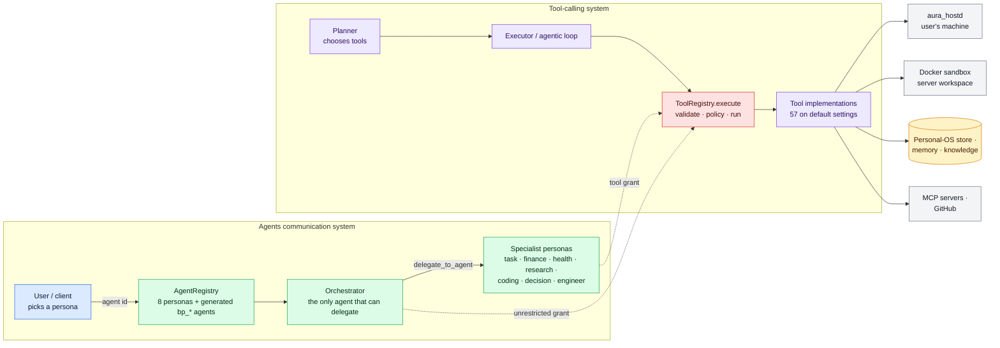
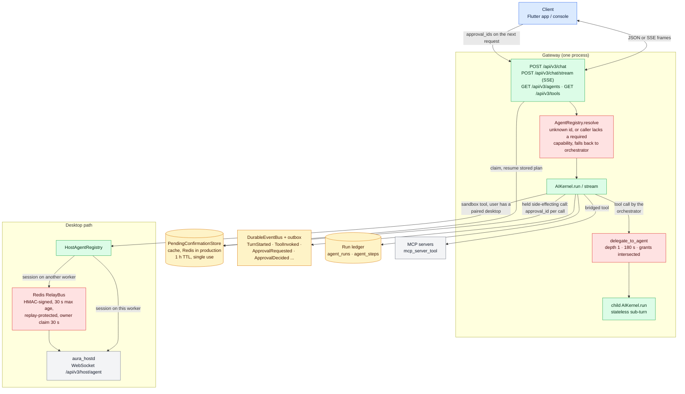
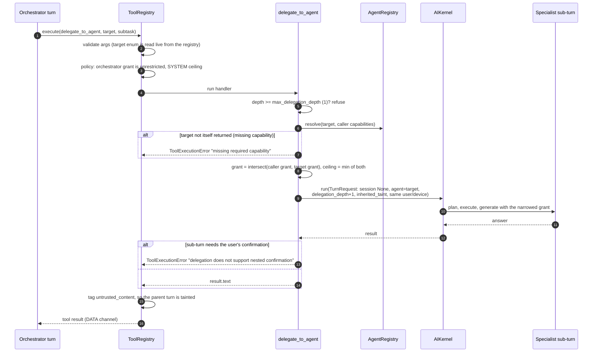
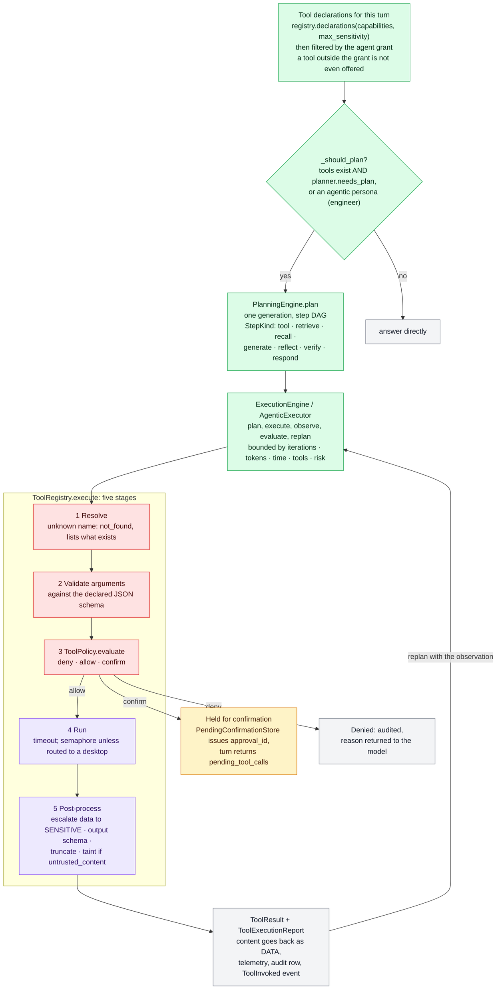
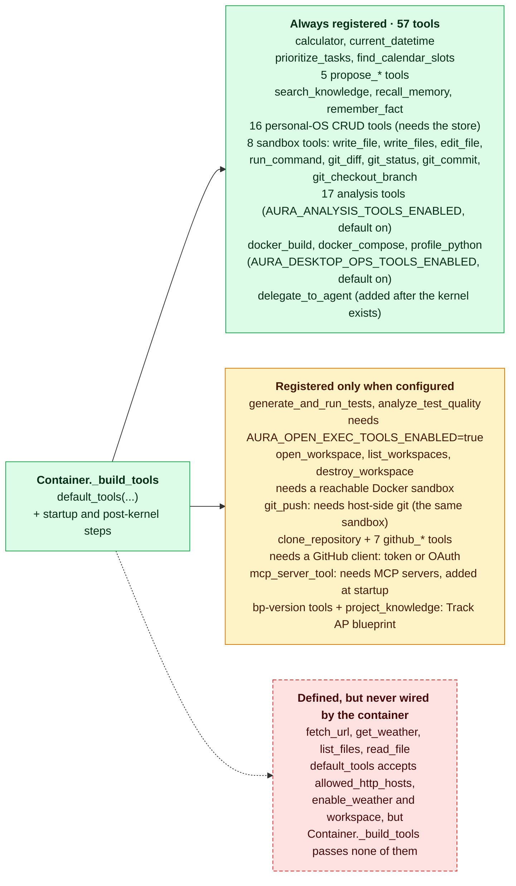
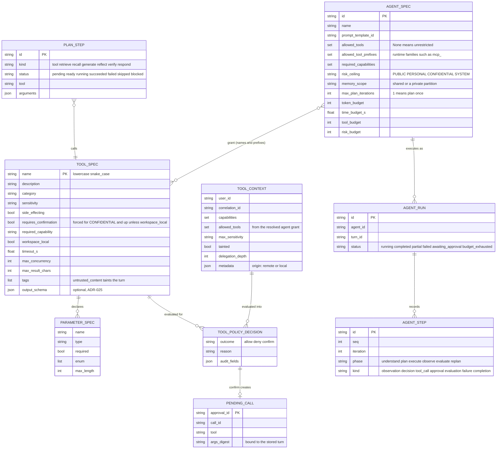

# 06 · Agents communication system and tool-calling system

Schema, flows, and a live inventory of the agents and tools, taken from `origin/main` at
`ff16cc8b` (2026-11-20).

## How the inventory was produced

The agent and tool lists below are **not read from source by eye**. They are the output of building
the real in-memory `Container` (the same one `tests/conftest.py` builds) with
`load_settings(...)` and listing `container.agents` and `container.tools`:

| Run | Settings | Result |
| --- | --- | --- |
| Default | no environment overrides | **8 agents, 57 tools** |
| Exec flag | `AURA_OPEN_EXEC_TOOLS_ENABLED=true` | 59 tools (adds `generate_and_run_tests`, `analyze_test_quality`) |

"Default" means the settings' defaults on the in-memory substrate. **A real deployment may register
more** (a GitHub token or OAuth, a sandbox runtime, MCP servers, a Track AP blueprint). Section 6
lists what each of those adds. What a given production environment actually has is not established
here.

---

## 1. The two systems at a glance

The link between them is one object: an agent's **grant** (`allowed_tools`, `risk_ceiling`) rides
into every tool call through `ToolContext` and is enforced again at dispatch by `ToolPolicy`.
There is no second permission model.

---

## 2. Agents communication system

### 2.1 Channels

An agent does not talk to other agents over a message bus. Every channel below is either an
in-process call through the kernel or a transport between the gateway and something outside it.

| Channel | Direction | Carries | Where |
| --- | --- | --- | --- |
| Request / response | client ⇄ gateway | one turn, `agent` id, `approval_ids`, `response_schema` | `api/v3.py` `ChatRequest`, `POST /chat` |
| SSE stream | gateway → client | frames `token`, `step`, `actions`, `citations`, `tool_calls`, `revision`, `done`, `error` | `kernel.stream`, `POST /chat/stream` |
| Delegation | orchestrator → specialist | `target_agent_id` + a self-contained `subtask`; returns the answer text | `tools/delegation.py` |
| Confirmation | kernel ⇄ client | `pending_tool_calls` with `approval_id`s out, `approval_ids` back | `execution/confirmations.py` |
| Host-agent socket | gateway ⇄ `aura_hostd` | RPC `call` frames; `result`, `error`, `stream` frames back | `api/host_agent.py`, `adapters/host_agent.py` |
| Cross-worker relay | worker ⇄ worker | the same RPC frames, signed | `adapters/host_agent_relay.py` |
| MCP | gateway ⇄ MCP server | tool discovery at startup, `call_tool` | `tools/coding.py` `build_mcp_bridge_tools` |
| Domain events | kernel → subscribers | turn, tool, approval, safety, budget events | `domain/events.py` |

### 2.2 Delegation: how one agent hands work to another

Rules the code enforces, redundantly on purpose:

- **Intersection, never union.** The child's grant is the intersection of the caller's and the
  target's, computed in the tool and again inside the kernel.
- **One hop in the default configuration.** `max_delegation_depth = 1`, and only the orchestrator
  holds the tool.
- **Stateless.** The target sees only `subtask`, never the conversation.
- **Taint travels.** A tainted parent produces a tainted child.
- **Writes that need confirmation fail** instead of being silently dropped.

---

## 3. Tool-calling system

### 3.1 From a model's intent to a result

A model's own emitted `tool_calls` frames are informational and never execute anything
(ADR-006). Planning and execution is the only path that runs a tool.

### 3.2 The policy decision, in order

`ToolPolicy.evaluate` returns the first rule that matches (`tools/policy.py`):

| # | Rule | Outcome |
| --- | --- | --- |
| 1 | Tool is in the configured denylist | **deny** `denied_by_configuration` |
| 2 | An allowlist is set and the tool is not on it | **deny** `not_in_allowlist` |
| 3 | Tool is outside the agent's grant (names or prefix) | **deny** `outside_agent_grant` |
| 4 | Tool's sensitivity exceeds the lower of policy and agent ceiling | **deny** `sensitivity_exceeds_policy` |
| 5 | Tool needs a capability the caller lacks | **deny** `missing_capability:<name>` |
| 6 | The user already approved this exact call | **allow** `user_confirmed` |
| 7 | `workspace_local` and side-effecting: on a desktop *and* tainted, or on a desktop from a remote device | **confirm** |
| 7b | `workspace_local` and side-effecting otherwise | **allow** `workspace_local_side_effect` |
| 8 | Turn is tainted and the tool is side-effecting | **confirm** `side_effect_in_tainted_context` |
| 9 | Tool has `requires_confirmation` | **confirm** `tool_requires_confirmation` |
| 10 | Side-effecting and sensitivity is `CONFIDENTIAL` or higher | **confirm** `confidential_side_effect` |
| 11 | none of the above | **allow** `policy_ok` |

`ToolSpec` sets `requires_confirmation = True` by itself when a tool is side-effecting, at
`CONFIDENTIAL` or above, and not `workspace_local`. A side-effecting tool at `PERSONAL` is **not**
confirmed on a clean turn. That includes `remember_fact` and every create/update/delete tool.

### 3.3 How the tool set is assembled

---

## 4. Schema

### 4.1 Desktop host-agent wire protocol (`/api/v3/host/agent`)

| Frame | Direction | Fields | Meaning |
| --- | --- | --- | --- |
| `auth` | daemon → server | `token` | first frame; the server closes with 4401 on a bad token |
| `call` | server → daemon | `id`, `method`, `params` | one RPC |
| `cancel` | server → daemon | `id` | abandon a call |
| `stream` | daemon → server | `id`, `stream` (`stdout` or `stderr`), `data` | output increment of a `run` |
| `result` | daemon → server | `id`, `result` | terminal success |
| `error` | daemon → server | `id`, `message` | terminal failure |
| `reauth` | daemon → server | `token` | renew the credential; a token for a different user ends the session |

RPC methods the daemon dispatches: `create_task`, `run`, `write_file`, `write_files`, `read_file`,
`list_roots`, `init_git`. Close codes: `4401` unauthorised (the daemon stops and asks to be paired
again), `1011` server error (the daemon reconnects with backoff), `4503` unavailable, `4400` bad
request. An unknown frame type is ignored, so a newer daemon does not break an older server.

---

## 5. Agents currently used

Eight personas are registered on `origin/main`. Seven are listed as "named personas" in
`agents/registry.py`; the orchestrator is the unrestricted default and the fallback for any unknown
or under-privileged agent id.

| Agent | Role | Tools granted → live (default) | Risk ceiling | Memory scope | Needs capability | Replans |
| --- | --- | --- | --- | --- | --- | --- |
| `orchestrator` | General persona; the only holder of `delegate_to_agent` | unrestricted → **57** | SYSTEM | shared | none | 1 |
| `task_planner` | Tasks and calendar | 16 → 16 | PERSONAL | shared | none | 1 |
| `finance_advisor` | Expenses and income | 11 → 11 | PERSONAL | `finance` | none | 1 |
| `health_companion` | Health logs | 9 → 9 | PERSONAL | `health` | none | 1 |
| `research_agent` | Research over the user's knowledge | 8 → **7** | CONFIDENTIAL | shared | none | 1 |
| `coding_agent` | Code and data analysis (no file or command tools) | 21 → 21 | PERSONAL | shared | none | 1 |
| `decision_agent` | Read-only decision support | 4 → 4 | PERSONAL | shared | none | 1 |
| `engineer` | Acts on code, in a sandbox or on the user's desktop | 46 + `mcp_` prefix → **32** | SYSTEM | `engineer` | `engineer_agent` | 8 (tool budget 216, risk 864) |

**Generated agents.** With Track AP on, a deployed blueprint adds `bp_*` agents to the registry
(`ActiveBlueprint`, `adaptation/runtime.py`), each with an explicit compiled tool list, its own
memory scope, and fewer replans. None exist on a default container.

**Not agents, despite the name:** `AgenticRAG` (`rag/agentic.py`) is a retrieval strategy. The
client's `ClientAgentOrchestrator` is a retired stub. `aura_hostd` is the desktop half of the
Engineer's tool path, not a persona.

---

## 6. Tools currently used

57 tools on default settings. **Sens** is the sensitivity ceiling needed (P = PERSONAL, C =
CONFIDENTIAL, S = SYSTEM, none = PUBLIC); **Side** means side-effecting; **Confirm** means
`ToolSpec` forces a confirmation on every call; **Cap** is a required capability; **WL** is
`workspace_local`; **Taints** is the `untrusted_content` tag.

### 6.1 Always registered

| Family | Tool | Sens | Side | Confirm | Cap | WL | Taints | Held by |
| --- | --- | --- | --- | --- | --- | --- | --- | --- |
| Utility | `calculator` | none | | | | | | finance, research, coding, decision, engineer |
| Utility | `current_datetime` | none | | | | | | task, finance, health, research, coding, decision, engineer |
| Knowledge | `search_knowledge` | P | | | | | | same seven as `current_datetime` |
| Memory | `recall_memory` | P | | | | | | same seven |
| Memory | `remember_fact` | P | ✓ | | | | | task, finance, health, research, coding, engineer (not decision) |
| Planning | `prioritize_tasks` | P | | | | | | task_planner |
| Planning | `find_calendar_slots` | P | | | | | | task_planner |
| Delegation | `delegate_to_agent` | S | | | | | ✓ | orchestrator only |
| Propose | `propose_task`, `propose_event` | P | ✓ | | | | | task_planner |
| Propose | `propose_expense`, `propose_income` | P | ✓ | | | | | finance_advisor |
| Propose | `propose_health_log` | P | ✓ | | | | | health_companion |
| Task CRUD | `create_task`, `update_task`, `delete_task` | P | ✓ | | | | | task_planner |
| Task CRUD | `list_tasks` | P | | | | | | task_planner |
| Calendar CRUD | `create_calendar_event`, `update_calendar_event`, `delete_calendar_event` | P | ✓ | | | | | task_planner |
| Calendar CRUD | `list_calendar_events` | P | | | | | | task_planner |
| Finance CRUD | `create_finance_record`, `update_finance_record`, `delete_finance_record` | P | ✓ | | | | | finance_advisor |
| Finance CRUD | `list_finance_records` | P | | | | | | finance_advisor |
| Health CRUD | `create_health_record`, `update_health_record`, `delete_health_record` | P | ✓ | | | | | health_companion |
| Health CRUD | `list_health_records` | P | | | | | | health_companion |
| Sandbox | `write_file`, `write_files`, `edit_file` | P | ✓ | | `engineer_agent` | ✓ | | engineer |
| Sandbox | `git_commit`, `git_checkout_branch` | P | ✓ | | `engineer_agent` | ✓ | | engineer |
| Sandbox | `git_diff`, `git_status` | P | | | `engineer_agent` | | | engineer |
| Sandbox | `run_command` | S | ✓ | | `engineer_agent` | ✓ | ✓ | engineer |
| Desktop ops | `docker_build`, `docker_compose`, `profile_python` | S | ✓ | ✓ | `engineer_agent` | | ✓ | engineer |

All of the sandbox rows run in the Docker sandbox or on the user's paired desktop, chosen per task
by `CompositeSandboxRunner`. A user without either gets a plain refusal at call time.

### 6.2 Analysis tools (ADR-036 group A): 17, pure text in, JSON out

None needs a capability or a confirmation, and none touches a path, a process or user code.

| Tool | Held by |
| --- | --- |
| `analyze_python_ast`, `analyze_code_complexity`, `verify_python_symbols`, `review_code_diff`, `scan_code_security`, `analyze_change_impact`, `generate_diagram`, `check_requirements`, `scan_dependency_licenses`, `compare_api_specs`, `inspect_sql`, `evaluate_quality_gate`, `plan_rollout` | coding_agent, engineer |
| `analyze_logs`, `check_model_drift` | coding_agent, engineer |
| `validate_data_records` | coding_agent, engineer, research_agent |
| `synthesize_research` | research_agent |

### 6.3 Granted to an agent, but not registered on a default container

| Tool(s) | Holder | Why it is absent | What would add it |
| --- | --- | --- | --- |
| `generate_and_run_tests`, `analyze_test_quality` | engineer | ADR-036 group B, off by default | `AURA_OPEN_EXEC_TOOLS_ENABLED=true` (confirmed per call, `engineer_agent`, tainting) |
| `open_workspace`, `list_workspaces`, `destroy_workspace` | engineer | no durable-workspace manager | a reachable Docker sandbox (`AURA_SANDBOX_ENABLED`, ADR-013) |
| `git_push` | engineer | no host-side git | the same Docker sandbox |
| `clone_repository` | engineer | no GitHub client resolver | `github.enabled` with a token, or GitHub OAuth |
| `github_list_repository_files`, `github_get_file_contents`, `github_get_issue`, `github_get_pull_request`, `github_create_branch`, `github_commit_files`, `github_create_draft_pull_request` | engineer | no GitHub client resolver | the same |
| `fetch_url` | research_agent | **never wired**, see below | nothing in the current container |

### 6.4 Registered only at runtime

| Tools | Source | Policy |
| --- | --- | --- |
| `mcp_{server}_{tool}` | MCP bridge, at startup | engineer only (prefix grant). CONFIDENTIAL, side-effecting, tainting, so confirmed, unless named in `AURA_MCP_SAFE_TOOLS` |
| `bp<version>_*` and `project_knowledge` | Track AP blueprint | capability-gated reads; granted to generated agents |

---

## 7. What the inventory shows

These come from comparing the live registry with the grants and the source. They are facts about
`origin/main` at `ff16cc8b`, not about any one deployment.

1. **`fetch_url`, `get_weather`, `list_files` and `read_file` cannot be reached through the
   container at all.** `default_tools` registers them only when it is passed `allowed_http_hosts`,
   `enable_weather` or `workspace`; `Container._build_tools` passes none of those, and no setting
   feeds them. `AURA_HTTP_ALLOWED_HOSTS` appears only in comments and docs, never in
   `settings.py`. Only tests pass these arguments. So `research_agent` has no way to fetch a URL on
   any deployment, which is stronger than the 2026-11-16 audit's "unknown on Railway" (F12).
2. **Fourteen of the Engineer's 46 granted tools are not live on a default container.** Two need
   the exec flag; twelve need a Docker sandbox or GitHub credentials. The Engineer's reach on a
   given deployment is therefore decided by configuration, and `GET /api/v3/tools` on that
   deployment is the way to see it.
3. **`remember_fact` and every CRUD tool run unconfirmed on a clean turn.** They are side-effecting
   at `PERSONAL`, and `ToolSpec` forces confirmation only from `CONFIDENTIAL`. They are confirmed
   on a tainted turn (rule 8). `remember_fact`'s "only things the user stated" rule is in its
   description, not in code.
4. **`delegate_to_agent` is held by the orchestrator alone**, and its target list excludes the
   orchestrator. Delegation is one hop, and a delegated write that needs confirmation fails.
5. **Eleven tools are reachable only through the Engineer** (the sandbox and desktop-ops tools),
   plus the orchestrator when the caller holds `engineer_agent`.
6. **The Engineer holds 16 of the 17 analysis tools, not all of them.** ADR-036 says it "gets all
   of Group A", but `synthesize_research` is granted only to `research_agent`.
