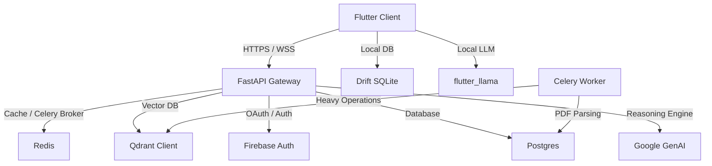

# AURA AI System Analysis

This document provides a comprehensive analysis of the AURA AI client-backend ecosystem, outlining dependencies, overall health status, and architecture components.

## 1. System Overview
AURA AI is a premium Personal AI Operating System and Executive Assistant. The ecosystem consists of:
*   **AURA Client (Flutter)**: Offline-first cross-platform application utilizing Riverpod for state management, Drift (SQLite) for encrypted local databases, and a native llama.cpp interface for offline reasoning models.
*   **AURA Backend (FastAPI)**: Asynchronous Gateway service responsible for authentication, Role-Based Access Control (RBAC), Agent Intent Routing, and background task processing.
*   **Infrastructure Services**:
    *   **PostgreSQL**: Metadata storage.
    *   **Qdrant**: High-performance vector database for RAG context and user memories.
    *   **Redis**: Key-value cache, Celery task broker, and anti-replay nonce store.
    *   **Firebase / Firestore**: Cloud data synchronization.
    *   **Gemini API**: Primary cloud-based AI reasoning and streaming service.

## 2. Dependency Map

## 3. Hidden Dependencies & Security Boundaries
*   **Native Storage Access**: The Flutter client depends on platform-specific secure storage features (Keystore on Android, Keychain on iOS/macOS, DPAPI on Windows, LibSecret on Linux). A fallback system derives keys using PBKDF2-HMAC-SHA256 from user-specific hardware identifiers in case native APIs are unavailable.
*   **Device Attestation**: API endpoints require attestation tokens signed by Play Integrity (Android) or App Attest (iOS) to verify that requests originate from legitimate, unmodified physical devices. Nonces are stored in Redis with short-lived TTLs to prevent replay attacks.
