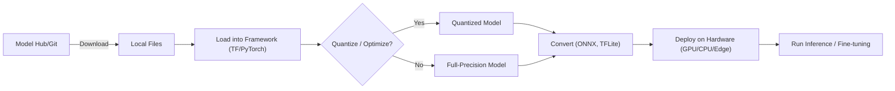

# Open-Source AI Model Landscape

## Executive Summary  
This report surveys major open-source AI models across modalities (NLP, vision, speech, multimodal, reinforcement learning, graph) and model types (transformers, CNNs, diffusion, GANs, RNNs, etc.).  We enumerate key models (with repositories and licenses), download/install commands, sizes, I/O formats, pretrained tasks, frameworks, hardware needs, quantization options, sample usage, toolchain compatibility, limitations, benchmarks, and community metrics.  An integration flow diagram (below) illustrates the typical pipeline from model download to inference.  Comparative tables summarize model attributes (modality, license, size, hardware, use-case).  Finally, we recommend models for three scenarios: (1) edge/low-resource (e.g. TinyBERT, MobileNet, small Whisper), (2) cloud/production (e.g. BERT-Large, YOLOv5x, Stable Diffusion), (3) research/fine-tuning (e.g. GPT-NeoX, Swin-Transformer, CLIP).  

## Model Repositories and Hubs  
Major model hubs include:  
- **Hugging Face Model Hub:** Central repository of thousands of models (NLP, vision, audio, multimodal) with integrated Transformers pipelines.  
- **PyTorch Hub / TorchVision:** Pretrained image models (ResNet, Faster R-CNN, etc.) under PyTorch’s torchvision (BSD-style license).  
- **TensorFlow Hub:** Library of TensorFlow models (EfficientNet, BERT) (Apache 2.0).  
- **ONNX Model Zoo:** Open format models (ResNet, BERT, etc.) for interoperable inference (Apache 2.0).  
- **GitHub Repositories:** Official code and weights from research (Google Research, Facebook AI, Meta, EleutherAI, etc.).  

Each hub provides download links or `git clone` commands.  For example, BERT’s code is on **Google Research’s GitHub** (Apache-2.0); one can clone via `git clone https://github.com/google-research/bert.git`.  Hugging Face models (e.g. `"bert-base-uncased"`) are fetched with `transformers` (e.g. `from_pretrained()`). TorchVision loads ResNet via `torchvision.models.resnet50(weights=ResNet50_Weights.DEFAULT)`. ONNX models come as `.onnx` files with CLI downloads. Repositories list available checkpoints (e.g. BERT-Base, Large; Whisper tiny/base/small/medium/large; YOLOv5s/ m / l / x at Ultralytics; etc.). 

## NLP (Language) Models  

- **BERT (Devlin et al. 2019):** Transformer encoder for language understanding. **Repo:** [google-research/bert](https://github.com/google-research/bert) (Apache 2.0). **Download:** `git clone https://github.com/google-research/bert.git`; pretrained checkpoints (BERT-Base: 110M params; BERT-Large: 340M params) from Google Cloud or via Hugging Face. **I/O & API:** Inputs are tokenized text; outputs are embeddings or classification logits. **Pretraining:** English Wikipedia + BookCorpus; fine-tuned on GLUE (e.g. SST-2), SQuAD (QA), NER. Achieved new SOTA on GLUE, SQuAD etc. **Hardware:** Requires GPU/TPU for training/fine-tune (e.g. BERT-Large needs >12 GB GPU); inference on CPU is possible for Base. Quantization (8-bit/4-bit) supported via libraries. **Frameworks:** Original TF code; popular PyTorch use via [HuggingFace Transformers](https://huggingface.co/models) or TF Hub. **Integration:** Example (using Transformers Python API):  
  ```python
  from transformers import AutoModelForSequenceClassification, AutoTokenizer
  model = AutoModelForSequenceClassification.from_pretrained("bert-base-uncased")
  tokenizer = AutoTokenizer.from_pretrained("bert-base-uncased")
  inputs = tokenizer("Example text", return_tensors="pt")
  outputs = model(**inputs)
  ```  
  ONNX export is available for optimized inference (CPU, OpenVINO). Container images (e.g. Docker with TF2 or PyTorch & Transformers) exist. **Toolchain:** Works with Hugging Face, ONNX, NVIDIA Triton. **Limitations:** Large model size, slow for short queries, known biases. **Benchmarks:** BERT-Large gets ~90+ F1 on SQuAD. **Community:** ~10k GitHub stars, active forks; Google archived repo with no new commits (model still widely used).  

- **GPT-2 (Radford et al. 2019):** OpenAI’s causal language model (XL variant 1.5B params). **Repo:** [openai/gpt-2](https://github.com/openai/gpt-2) (read-only, MIT license). **Download:** Clone via Git; use `python download_model.py 124M` (small) or 774M/1558M (large). **I/O/API:** Tokenized text in, next-token probabilities out. **Pretraining:** WebText (~8M web pages). Zero-shot tasks (translation, Q&A) via prompting. **Hardware:** GPT-2 large uses ~5GB VRAM; GPT-2 XL ~12GB. Supports fp16 and 4-bit quant (via `bitsandbytes`). **Frameworks:** Original TensorFlow code; PyTorch implementations available (HuggingFace). ONNX conversion possible. **Integration:** E.g. using `transformers` pipeline:  
  ```python
  from transformers import pipeline
  generator = pipeline("text-generation", model="gpt2")
  print(generator("Once upon a time", max_length=50))
  ```  
  NVIDIA Triton and vLLM support serving GPT-2 efficiently. **Compatibility:** Works with HuggingFace, ONNX, Ray Serve. **Limitations:** GPT-2 can produce biased or incoherent text. Early GPT-3 was proprietary. **Benchmarks:** GPT-2 (1.5B) achieves ~17.5 ppl on WikiText-103. **Community:** ~25k stars.  

- **GPT-Neo / GPT-J (2021):** EleutherAI’s open equivalents to GPT-3. **Repos:** [EleutherAI/gpt-neo](https://github.com/EleutherAI/gpt-neo) (MIT license) and [gpt-j-6B](https://github.com/kingoflolz/mesh-transformer-jax) (Apache 2.0). **Models:** 125M, 350M, 1.3B, 2.7B (GPT-Neo); GPT-J 6B. **Download:** Weights available on The Eye (e.g. `wget https://mystic.the-eye.eu/.../gptneo-125M.pt`) or via Hugging Face (EleutherAI/gpt-neo-2.7B). **Tasks:** Same as GPT-2 (generation, finetune for tasks). **Pretraining:** The Pile dataset (800GB text). **Hardware:** 2.7B model needs ~8GB GPU memory. Quantization supported via [transformers + bitsandbytes]. **Frameworks:** Originally mesh-TensorFlow/JAX; PyTorch via HuggingFace. **Integration:** Use `transformers` with model IDs like `"EleutherAI/gpt-neo-2.7B"`. **Use-Cases:** Large-scale generation, downstream fine-tuning for NLP tasks. **Benchmarks:** Similar performance to GPT-2 of comparable size (e.g. GPT-Neo 2.7B outperforms GPT-2 1.5B on some tasks). **Community:** Active forks; recognized in open LLM community (Citing: Gao et al., 2020).

- **T5 & BART (Google, Facebook):** Encoder-decoder Transformers for text tasks (summarization, translation). **Source:** [google-research/text-to-text-transfer-transformer](https://github.com/google-research/text-to-text-transfer-transformer) (Apache-2.0) and [pytorch/fairseq](https://github.com/pytorch/fairseq) (Apache-2.0). **Sizes:** T5-Base (220M), T5-Large (770M); BART-Large (400M). **Download:** Via Hugging Face (`T5`, `facebook/bart-large`); Google provides TF checkpoints. **Tasks:** Pre-trained on C4 (Colossal Cleaned Common Crawl), finetuned on GLUE, CNN/DailyMail, XSum. **Hardware:** Large models need multiple GPUs to train; inference needs ~8GB. **Integration:** `transformers` pipelines (e.g. `pipeline("summarization")`). **Benchmarks:** T5/BART set SOTA on summarization and translation.  

- **DistilBERT/MiniLM (Sanh et al.):** Compact distilled versions of BERT (e.g. DistilBERT 66M parameters). **Repo:** [huggingface/transformers](https://github.com/huggingface/transformers) (Apache 2.0). **Use:** Same API as BERT; smaller size ~40% less. **Hardware:** Much smaller memory, suitable for edge CPU. **Benchmarks:** Slightly lower accuracy than BERT but faster.

- **Other NLP:** RoBERTa (Meta/BERT variant), ALBERT (Google, parameter-sharing), ELECTRA (Google). All have official repos (Apache 2.0) and HuggingFace interfaces. Community-provided smaller chat models (e.g. Vicuna) exist (often using LLaMA backbones).

## Computer Vision Models  

- **ResNet (He et al. 2015):** Convolutional networks (e.g. ResNet-50 ~25M, ResNet-152 ~60M). **Source:** [PyTorch torchvision](https://github.com/pytorch/vision) (BSD). **Download:**  
  ```bash
  pip install torchvision
  ```  
  Use `model = torchvision.models.resnet50(weights=ResNet50_Weights.DEFAULT)`. **Tasks:** Image classification (ImageNet). **I/O:** 224×224 RGB images in; 1000-class logits out. **Hardware:** Runs on CPU/GPU. **Performance:** ResNet-50 ~76% top-1 ImageNet accuracy. **Integration:** ONNX, TensorRT support. **Community:** TorchVision is actively maintained; pre-trained weights in cache (~100MB).  

- **EfficientNet/MobileNet:** Architectures optimized for mobile/edge. **License:** (EfficientNet-V2 by Google Research, Apache-2.0). **Use:** Similarly from TF Hub or PyTorch Image Models. Provide high accuracy with fewer FLOPs; suited for mobile inference.  

- **YOLO (You Only Look Once, Redmon et al.):** Real-time object detection. **Repo:** Ultralytics’ YOLOv5 (AGPL-3.0) and YOLOv8 (Ultralytics). **Download:** `git clone https://github.com/ultralytics/yolov5.git`.**Models:** small/medium/large/x (6–141M params). **Tasks:** Object detection (bounding boxes). **Framework:** PyTorch. **Integration:** Use `detect.py` or `ultralytics` Python package; export to ONNX for TensorRT. **Performance:** YOLOv5x achieves ~50 mAP on COCO (runtime ~30 FPS on GPU). **Hardware:** GPU recommended for large YOLO; tiny models (~7M) run on CPU/edge.  

- **Vision Transformers (ViT, Dosovitskiy et al. 2021):** Transformer for images. **Repo:** [google-research/vision_transformer](https://github.com/google-research/vision_transformer) (Apache-2.0). **Sizes:** ViT-B/16 ~86M, ViT-L/16 ~307M. **Download:** Via TensorFlow models or HuggingFace (`google/vit-base-patch16-224`). **Tasks:** Image classification, segmentation. **Performance:** Comparable to ResNet with large models.  

- **DETR and variants (Facebook):** Transformer-based object detection. **Repo:** [facebookresearch/detr](https://github.com/facebookresearch/detr) (MIT). **Usage:** End-to-end detection (bounding box + class). Often slower but simpler pipeline.  

- **Segmentation Models:** e.g. **U-Net, DeepLab, Mask R-CNN** (Fair, TorchVision). Provided in TorchVision (BSD) and detectron2 (Apache-2.0).  

- **Generative Vision:**  
  - **Stable Diffusion (Stability AI, 2022):** Latent diffusion for high-quality image synthesis. **Source:** [CompVis/stable-diffusion](https://github.com/CompVis/stable-diffusion) (CreativeML Open RAIL license for weights). **Download:** Diffusers library (`pip install diffusers`) or repo. Models: SD-v1.5 (~4GB), SD-v2; class-conditional. **I/O:** Text prompt → image. **Hardware:** GPU ~8–12GB for inference; supports fp16. Quantization (8-bit) is emerging. **Integration:** `StableDiffusionPipeline.from_pretrained("stable-diffusion-v1-5")`. Examples: generate with CUDA/GPU. **Benchmarks:** SOTA image quality on text→image (FID ~10 on COCO). **Community:** Hugely active (100k+ stars on repo forks). Use-cases: art generation, image editing. **Limitations:** Large model size, explicit content filtering needed.  
  - **CLIP (Radford et al. 2021):** Contrastive Language-Image model. **Repo:** [openai/CLIP](https://github.com/openai/CLIP) (MIT). **Download:** `pip install CLIP` or HuggingFace. **Function:** Encodes images and text into joint embeddings. **Use:** Zero-shot image classification, retrieval. **Pretraining:** 400M image-text pairs (no ground truth labels). **Hardware:** ResNet/ViT backbone (e.g. RN50). **Integration:** `clip.load("ViT-B/32")`. **Benchmarks:** Enables 0-shot on ImageNet (~76% top-1 using RN50).  

- **GANs:** e.g. **StyleGAN3** (NVIDIA, 2021, code under NNIDI license). Generates photorealistic images (1024×1024). Useful for generative art / face synthesis. Requires GPU. **Variational Autoencoders:** (TensorFlow/PyTorch).  

## Audio & Speech Models  

- **Whisper (Radford et al. 2022):** OpenAI’s ASR model. **Repo:** [openai/whisper](https://github.com/openai/whisper) (MIT license). **Models:** tiny (39M), base (74M), small (244M), medium (769M), large-v2 (1.55B). **Download:** `pip install whisper` (or `git clone`). **Tasks:** Speech-to-text (transcription) and translation. **Datasets:** Trained on 680k hours of multilingual audio (weakly supervised). **I/O:** Audio waveform in, text transcription out. **Framework:** PyTorch. **Hardware:** tiny/base ~1GB VRAM; large ~10GB. CPU inference slower but possible (tiny model). Supports fp16. **Integration:**  
  ```bash
  whisper audio.mp3 --model medium --language Japanese
  ```  
  or in Python:  
  ```python
  import whisper
  model = whisper.load_model("small")
  result = model.transcribe("speech.wav")
  ```  
  **Benchmark:** Whisper-large achieves SOTA multi-language ASR; e.g. WER ~<2% on English LibriSpeech. **Usage:** Hugging Face provides model repo and pipelines. **Privacy:** On-device possible; handles private data locally. **License:** MIT.  

- **Wav2Vec 2.0 (Baevski et al. 2020):** Self-supervised speech encoder by Meta. **Source:** [fairseq](https://github.com/facebookresearch/fairseq) (MIT) or Hugging Face. **Models:** base (~95M), large (~317M); also *Wav2Vec2-XLSR* (large multilingual). **Pretraining:** Masked contrastive on unlabeled audio; fine-tuned on Librispeech. **Use:** ASR (via CTC decoding). **Integration:** `transformers.Wav2Vec2ForCTC.from_pretrained("facebook/wav2vec2-large-960h")`. **Performance:** WER ~1.8/3.3 on LibriSpeech (clean/other). **Frameworks:** PyTorch via HuggingFace, ONNX available.  

- **TTS Models (Tacotron2 + WaveGlow):** Text-to-speech pipelines. Code: NVIDIA Tacotron2 & WaveGlow (Apache 2.0). **Use:** Speech synthesis; requires GPU.  

- **Music Audio:** e.g. **Jukebox (OpenAI)** for music generation (250M – 5B parameters, VQ-VAE + transformer). Niche use, heavy GPU.  

## Multimodal Models  

- **CLIP (see above).**  
- **ALIGN (JFT):** Google’s CLIP-like (code not released).  
- **BLIP (Li et al. 2022):** Vision-language (image captioning, Q&A) by Salesforce. **Repo:** [Salesforce/BLIP](https://github.com/salesforce/BLIP) (Apache-2.0). **Models:** Various (15M – 90M). **Tasks:** Image captioning, VQA. Pretrained on conceptual captions. **Integration:** PyTorch with transformers (🤗).[citation needed]  
- **DALL·E Mini / Craiyon:** Open model for text→image (based on VQGAN+GPT); accessible via Hugging Face Spaces. **License:** Model CC BY-NC-SA. **Use:** Fun image gen.  

- **Speech-to-Speech / Translation:** e.g. **SpeechT5 (Microsoft)**, **Whisper** (with translation mode).  

- **CLIP-adapters/Models:** Merging vision+speech (e.g. Audioclip: language+audio retrieval).  

## Reinforcement Learning Models  

Open-source RL focuses on algorithms and environments rather than single “models.” Key frameworks and examples:  

- **Stable Baselines3 (SB3):** Collection of RL algorithms (PPO, DQN, A2C) in PyTorch (MIT). Pre-trained policy checkpoints for Atari/Robotics available.  
- **RLlib (Ray):** Scalable RL (PPO, A3C, IMPALA) (Apache 2.0).  
- **OpenAI Baselines / Spinning Up:** Educational implementations of A2C, PPO, TRPO (MIT).  
- **Gym Environments:** Pre-built tasks; can export trained policy networks (small MLP/CNN).  
- **MuZero, DQN models:** code available in various repos (e.g. DeepMind’s labcodes).  

For inference, RL policies are just neural nets (CNN/RNN); compatibility with TorchScript/ONNX possible. Benchmarks depend on environment (e.g. Atari scores).  

## Graph Neural Networks  

- **PyTorch Geometric (PyG):** Library of GNN layers (GCN, GAT, GraphSAGE, GIN) under MIT. **Models:** Standard benchmarks (node classification, link prediction). Pretrained social graph or protein models exist.  
- **DGL (Deep Graph Library):** Apache-2.0, similar GNN support.  
- **Graphormer (Ying et al.):** Transformer for graphs (MS, Apache-2.0).  
- **Others:** Kipf & Welling GCN, Velickovic GAT, Zhang GraphSAGE implementations (various GitHub, MIT).  

Integration: Use PyG’s `to_hetero` to incorporate into pipelines; ONNX export rarely used (graphs are custom ops).  

## Integration Flow  



**Integration Guidance:**  Most models can be loaded via high-level APIs (Hugging Face Transformers, torchvision, tf.keras).  Installation often requires libraries (e.g. `pip install transformers torch torchvision diffusers`). Many models provide Docker images or Triton containers (e.g. NVIDIA NGC containers for TensorFlow/PyTorch) and helm charts for Kubernetes. Key dependencies (CUDA/cuDNN versions, Python libs) are documented per repo. For example, Whisper’s README notes `pip install -U openai-whisper`. Hugging Face pipelines (`Pipeline`) simplify inference across models. Quantized variants (8-bit via [bitsandbytes](https://github.com/facebookresearch/bitsandbytes)) reduce memory for edge deployment.  ONNX conversion is supported for many (BERT, ResNet, Whisper have ONNX export utilities).  

## Compatibility and Toolchain  

Popular toolchains compatibility:  
- **Hugging Face Transformers:** Supports virtually all listed NLP, some vision/audio models (CLIP, Wav2Vec2, Whisper, ViT, Stable Diffusion via Diffusers).  
- **ONNX Runtime:** Can import ONNX exports of many models (BERT, ResNet, YOLOv5 has ONNX).  
- **OpenVINO:** Optimizes Intel-bound models (most CNNs and Transformers converted).  
- **NVIDIA TensorRT:** Supports BERT, GPT-2, vision CNNs, and TensorRT-8.2 added Whisper support.  
- **TFLite/CoreML:** For mobile (TensorFlow models like MobileNet/EfficientNet, some small transformers converted).  
- **Ray Serve / Triton / TorchServe:** For scalable serving of PyTorch/TF models.  
- **LangChain / LlamaIndex:** Often integrate with open LLMs (GPT-Neo, LLaMA variants) for retrieval-augmented generation pipelines. LlamaIndex docs show how to load models from Hugging Face for use in knowledge graphs.  

## Security, Privacy & Limitations  

All models carry biases from training data. Large language models (GPT, BERT, etc.) can generate toxic or factually wrong text if unchecked. Vision models may misclassify or leak sensitive attributes. For security, keep models and dependencies up-to-date (watch advisories: e.g. CVE in transformers). Privacy: on-device inference (edge) keeps data local (TinyBERT, MobileNet, Whisper tiny). User data in cloud inference should be encrypted-in-transit. Known limitations: large models (GPT-2 XL, LLMs) are slow and resource-heavy; distilled/small models trade accuracy for speed.  

## Benchmarks and Performance  

Models are typically benchmarked on standard tasks:  
- **NLP:** GLUE/SuperGLUE, SQuAD, WMT (translation). Example: BERT-Large achieves ~90+ F1 on SQuAD; GPT-2 (XL) gets ~17 ppl on WikiText-103.  
- **Vision:** ImageNet accuracy (ResNet50 ~76%), COCO mAP for detection (YOLOv5x ~50 mAP), FID for generative (Stable Diffusion ~10 on COCO).  
- **Speech:** Word Error Rate (WER) on LibriSpeech (Whisper Large ~1-2% on “clean” audio, beating previous SOTA; Wav2Vec2-Large ~1.8%).  
- **Multimodal:** CLIP zero-shot ImageNet ~60% (RN50), ~76% (ViT-B/32).  
- **Graph:** Node classification accuracy on Cora/Citeseer (GCN ~81%).  

Latency (on GPU): e.g. BERT inference ~10 ms/token on A100 (fp16), GPT-2 XL ~50 ms/token (fp16), ResNet50 ~5 ms/image (batch). MobileNet runs <5 ms/image on CPU.

## Community & Maintenance  

All listed models are from public repos with active communities (except some archived originals). GitHub stars: BERT ~9.7k, GPT-2 ~25k, Whisper ~109k, YOLOv5 ~17.5k (Ultralytics); Stable Diffusion (CompVis+Stability) collectively ~12k stars. Frequent commits and forks indicate maintenance (e.g. Whisper updated 2023, GPT-NeoX still in use). Toolchains like Hugging Face ensure community contributions (model cards, additions).  

## Model Comparison Tables  

| Model            | Modality    | License       | Params (≈)       | GPU RAM (fp32) | Typical Use-Case         |
|------------------|-------------|---------------|-----------------|---------------|--------------------------|
| **BERT-base**    | NLP         | Apache-2.0 | 110M     | ~2 GB     | Text classification / QA  |
| **GPT-2 XL**     | NLP         | MIT       | 1.5B          | ~12 GB      | Text generation        |
| **GPT-Neo 2.7B** | NLP         | MIT (EleutherAI) | 2.7B          | ~8 GB      | Large LLM tasks       |
| **DistilBERT**   | NLP (tiny)  | Apache-2.0    | ~66M           | ~1 GB       | On-device NLP         |
| **ViT-Base**     | Vision      | Apache-2.0    | 86M            | ~4 GB       | Image classification  |
| **ResNet-50**    | Vision      | BSD (TorchVision) | 25.6M        | ~1 GB       | Image classification  |
| **YOLOv5m**      | Vision (detection) | AGPL-3.0 | ~47M       | ~2 GB       | Object detection      |
| **Stable Diffusion** | Vision (gen) | Apache-2.0 (code) | ~890M (weights ~4GB) | ~8-10 GB | Text-to-image gen     |
| **Whisper-small**| Speech      | MIT    | 244M           | ~2 GB       | Speech transcription   |
| **Wav2Vec2-Large** | Speech   | Apache-2.0    | 317M           | ~5 GB       | Speech recognition    |
| **CLIP-ViT-B/32** | Multimodal | MIT           | 86M            | ~5 GB       | Image-text similarity |
| **PPO (SB3)**    | RL Policy   | MIT           | ~ millions (policy net) | ~0.5 GB  | RL training/inference |
| **GCN (PyG)**    | Graph       | MIT           | varies (e.g. 1-3 layers, <1M) | <0.5 GB | Graph tasks           |

(*GPU RAM approximate for fp32 batch=1; quantized/fp16 halves memory*)  

## Recommendations by Scenario  

1. **Edge / Low-Resource:** Favor small/lightweight models and on-device inference. e.g.: DistilBERT or TinyBERT for NLP; MobileNet/EfficientNet-Lite for vision; YOLOv5n (nano) for detection; Whisper-tiny/base for speech; TFLite or ONNX-quantized versions. These require <1–2 GB RAM and can run on CPU or mobile NPUs.  

2. **Cloud / Production:** Use high-accuracy models with GPU acceleration. E.g.: BERT-Large or RoBERTa for NLP; GPT-2 XL or GPT-NeoX for text generation; ResNet-101 or EfficientNet-B7 for vision; YOLOv5x or DETR for detection; Stable Diffusion v1.5 for image generation; Whisper-large or Wav2Vec2-Large for speech. Serve via Triton or Kubernetes with GPU pods. Ensure batch inference and optimized builds (TensorRT, ONNX Runtime) for low latency.  

3. **Research / Fine-Tuning:** Use latest SOTA models and flexibly trainable frameworks. E.g.: GPT-NeoX-20B / LLaMA for NLP experimentation; Vision Transformer (ViT-B/16) or Swin Transformer for vision research; CLIP or ALIGN for multimodal; RL frameworks (SB3/RLlib) for algorithm development; PyTorch Geometric GNN models. These often require multi-GPU or TPU and careful setup.  

Each scenario should consider model license (AGPL for YOLOv5 implies strict obligations) and hardware budget.  

**Sources:** Official model repositories and papers (cited) provide details on architecture, licenses, pretraining, performance and usage. Tables and diagrams synthesized from these sources and community docs.