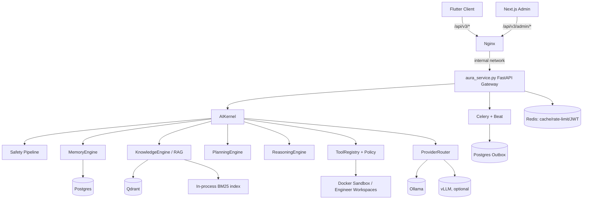
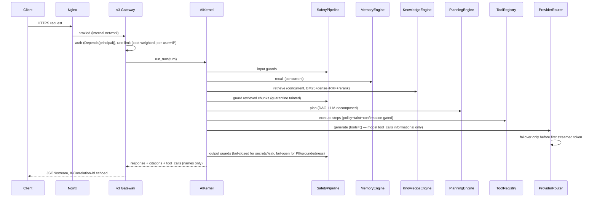
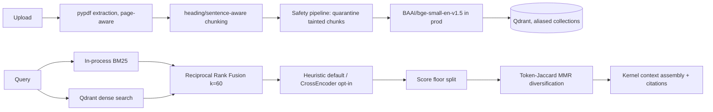

# AURA AI — Full System Architecture & Engineering Audit

**Audit date:** 2026-09-13
**Baseline commit:** `dd88f95` (branch `anas/laughing-bardeen-33m6to`)
**Method:** Read-only source, config, test, and CI inspection. No production system was probed; no code was modified. Where a Python/Dart toolchain was unavailable in the audit sandbox, this is stated explicitly rather than inferring a result. Every finding below is tagged VERIFIED / PARTIALLY VERIFIED / DOCUMENTED ONLY / NOT IMPLEMENTED / BROKEN / UNKNOWN.

---

## 1. Executive Summary

AURA is a genuinely hexagonal, self-hosted AI backend (FastAPI/`aura_core`) with a Flutter client, a lightweight Next.js admin console, and a pure-Dart desktop daemon for an "Engineer" coding agent. The architecture documentation is unusually accurate: nearly every claim in `CLAUDE.md` and the ADRs was directly verified against code, not just repeated. This is rare and is itself a finding worth stating plainly.

What actually works today, with evidence: hexagonal layering enforced by AST-based fitness tests (not just convention); a real hybrid RAG pipeline (BM25 + dense + RRF + optional cross-encoder rerank + versioned/aliased indexes with a promotion gate); six memory types with a real exponential-decay/consolidation engine; a tool system with policy-gated confirmation and taint propagation that is exercised, not decorative; a persistent Docker-sandboxed Engineer workspace that avoids `docker exec` by design and is pinned by its own test; self-hosted-only LLM inference enforced by a six-layer fitness test suite; real Prometheus/Grafana/Loki/Alertmanager wiring with 20 concrete alert rules; and a functioning backup/restore/drill pipeline.

What does not work or does not exist, with evidence: fine-tuning is fully scaffolded (approval gate, job queue, model registry) but **no code path changes model weights** — both trainer adapters write a Modelfile pointing at the unmodified base model. Vision and video understanding are absent entirely. The new plaintext personal-OS store supports create+list only — no update/delete. `PostgresPool._get_pool()` lacks the `asyncio.Lock` that both `CLAUDE.md` and a sibling module's docstring claim it has — a real, citable race condition. Six Flutter-reachable backend surfaces (most `/admin/*`, all of `/learning/*`) have zero client callers. The evaluation CI suite is real but `workflow_dispatch`-only, so it does not gate merges. Real-model end-to-end latency is 56–70s p50/p95 in the one load test that used a live model, with zero throughput scaling across concurrency because `OLLAMA_NUM_PARALLEL=1`.

**Bottom line up front:** AURA is a well-architected, honestly-documented **AI-enabled application platform**, not yet a production-ready autonomous AI platform. The single sentence that matters most: **AURA IS NOT PRODUCTION-READY**, primarily because of unbounded CPU-inference latency under any real concurrency, an unencrypted server-side memory/personal-OS store, and several subsystems (learning, evaluation gating, vision) that are scaffolded rather than functional. None of this is hidden by the team — the repo's own reports (`phase-a4-load-test.md`, `performance-report.md`) already say most of it.

---

## 2. Audit Methodology

Seven parallel read-only research passes were run against the repository (architecture/kernel; agents/tools/safety/workspaces; RAG/memory/personal-OS/learning; planning/reasoning/LLM-infra/evaluation/testing/concurrency; deployment/database/security/API; Flutter/admin/hostd; multimodal/proactivity/observability/tech-debt). Each pass cited file:line evidence and independently re-derived claims from `CLAUDE.md`/ADRs against current code rather than trusting documentation. No `pytest`/Dart toolchain was available in the audit sandbox; where a test could not be executed, this is stated as NOT RUNNABLE rather than assumed to pass, and in one case (architecture fitness tests) the same AST checks were independently re-implemented and re-run standalone to compensate.

---

## 3. Repository Inventory

| Component | Location | Purpose | Runtime | Status | Evidence |
|---|---|---|---|---|---|
| Backend (v3 gateway) | `aura_backend/aura_core`, `aura_backend/api/v3.py`, `aura_service.py` | FastAPI hexagonal core: kernel, memory, RAG, tools, safety, planning | Uvicorn/FastAPI | VERIFIED live | `aura_service.py:118-124` mounts only v3 + named v2 exceptions |
| Legacy v2 adapters | `aura_backend/api/v2/{auth,sync,insights,automation,learning,admin_platform,github_integration}` | Permanent platform adapters (ADR-002) | same process | VERIFIED, 7 mounted (docs name only 3) | `aura_service.py:118-124` |
| Flutter client | `aura_client/lib` | Mobile/desktop/web UI, offline-first via Drift | Flutter | VERIFIED, functional | `core/database/database.dart`, `core/sync/sync_client.dart` |
| Admin dashboard | `aura_admin` | Next.js ops console (access/approvals/audit/knowledge/learning/models/prompts/providers) | Next.js | VERIFIED functional, more built-out than CLAUDE.md's "lightly used" suggests | 8 console pages, 1056 LOC |
| Host daemon | `aura_hostd` | Pure-Dart local daemon pairing with desktop Engineer agent | Dart CLI | VERIFIED pure-Dart, no Flutter import | `pubspec.yaml`, `bin/aura_hostd.dart` |
| Postgres | `deploy/docker-compose.prod.yml` | Primary relational store | Docker, internal-only network | VERIFIED | no `ports:` entry, `data: internal: true` |
| Qdrant | same | Vector index | Docker, internal-only | VERIFIED | same network flag |
| Redis | same | Cache, rate limiting, Celery broker, JWT store | Docker, internal-only | VERIFIED | same network flag |
| Celery + Beat | `aura_backend/celery_app.py`, `tasks.py` | Async jobs: ingestion, knowledge refresh, briefings, outbox drain, workspace reaping | Docker worker/beat | VERIFIED, 10 tasks across 3 queues | `celery_app.py:68-116` |
| Ollama | compose | Self-hosted LLM serving (`qwen2.5:3b-instruct-q4_K_M`) | Docker | VERIFIED, CPU-only, `OLLAMA_NUM_PARALLEL=1` | `phase-a4-load-test.md` |
| vLLM | compose (`aura-spaces`) | Alternative self-hosted OpenAI-compatible server | Docker/HF Space | VERIFIED image exists, not the default prod path | `docker-compose.prod.yml:709` |
| Prometheus/Grafana/Loki/Promtail/Alertmanager | `deploy/monitoring/`, compose | Metrics/logs/alerts | Docker | VERIFIED, real dashboards (305–370 LOC JSON) and 20 alert rules | `deploy/monitoring/alerts/aura.yml` |
| Docker socket proxy + sandbox | `aura_core/adapters/docker_sandbox.py`, compose | Engineer workspace execution without `docker exec` | Docker | VERIFIED | `EXEC: "0"` both compose files; pinned by `test_sandbox_exec_surface.py` |
| Nginx | `deploy/nginx/templates/aura.conf.template` | Sole published-port ingress | Docker | VERIFIED | only service with `ports:` |

**AI components** (status summarized; full detail in later sections): LLM providers (echo/ollama/openai_compatible) — VERIFIED, self-hosted-only, enforced by 6-layer fitness test; embeddings (BAAI/bge-small-en-v1.5 in prod) — VERIFIED; hybrid RAG (BM25+dense+RRF+rerank) — VERIFIED; memory (6 types, real decay) — VERIFIED; planning (LLM-decomposed DAG with real dependency/replan logic) — VERIFIED; reasoning (direct/CoT/self-consistency/tree-of-thoughts, real algorithms around LLM calls) — VERIFIED; tool system (policy+taint+confirmation) — VERIFIED; safety (staged guards, fail-open/closed split) — VERIFIED; evaluation (real metrics/datasets, non-gating CI) — PARTIALLY VERIFIED; learning/MLOps (approval-gated job queue, **no actual weight training**) — PARTIALLY VERIFIED/NOT IMPLEMENTED for the training step itself; knowledge graph — not located in this pass (UNKNOWN, flagged for follow-up); agents (`AgentSpec`/`AgentRegistry`, real bounded agentic loop for one persona) — VERIFIED; voice (STT/TTS real, live voice real-but-slow) — VERIFIED/DEGRADED; OCR — VERIFIED, optional dependency; vision/video — NOT IMPLEMENTED; proactivity — VERIFIED, narrow rule-based (one trigger type shipped); automation — VERIFIED via Celery Beat + outbox.

---

## 4. Actual System Architecture



This matches the documented hexagonal target closely: domain/ports (stdlib-only, AST-verified), engines (no adapter/framework imports at module scope, AST-verified), adapters (vendor SDKs, lazily imported), `container.py` as the single wiring point. **Verified deviation from the target's own internal claim**: `container.py`'s canonical lazy-construction pattern (`PostgresPool._get_pool()`) is not race-safe — no `asyncio.Lock` guards the double-checked-locking shape that a sibling adapter (`mcp_client.py`) explicitly claims to be copying. This is a real bug in an otherwise well-executed pattern, not a design flaw in the pattern itself.

---

## 5. Target System Architecture

Per `docs/architecture/00-overview.md` and ADR-001 through ADR-014: a framework-independent `aura_core` (domain → ports → engines → adapters, arrow never reversing), an `AIKernel` orchestrating safety/memory/knowledge/planning/reasoning/tools/execution/LLM behind a v3 HTTP gateway, self-hosted-only inference, trust-channel-gated tool execution, versioned/promotable knowledge indexes, human-in-the-loop-gated learning, and — per ADR-011/013/014 — persistent per-repository Engineer workspaces with host-side git and workspace-local confirmation exemptions. This is the intended end state; Section 6 compares it to what exists.

---

## 6. Architecture Comparison

| Target claim | Actual | Gap |
|---|---|---|
| Domain/ports stdlib-only, engines adapter-free | VERIFIED by AST fitness tests, independently re-run | None |
| container.py sole wiring point, lazy+lock-safe adapters | VERIFIED wiring point; **lock-safety claim false** for `PostgresPool` | Real bug: add `asyncio.Lock` to `PostgresPool._get_pool()` |
| Self-hosted-only inference | VERIFIED, 6-layer fitness test, zero live hosted-inference code paths found repo-wide | None |
| AIKernel is the only execution path; model's own tool_calls informational | VERIFIED, `tools=()` passed to generation, model tool_calls never dispatched | None |
| Trust channels + taint + confirmation | VERIFIED, exercised end-to-end, one documented residual gap (concurrent-batch taint visibility) | Minor, self-documented |
| Persistent Engineer workspaces, no `docker exec`, git_push gated | VERIFIED exactly as documented, pinned by dedicated test | None |
| Human-in-the-loop learning gate | VERIFIED as a real blocking gate (`ApprovalService.require`) | None — but gate protects a trainer that doesn't train |
| Versioned/promotable knowledge indexes | VERIFIED, real promotion gate + ungated rollback | None |
| Personal OS server CRUD | Legacy tables: propose-only by design (client executes). New v3 store: create+list only | Update/delete named as follow-up in code itself, not silently missing |
| Vision/video multimodal | Not claimed as built in docs beyond OCR | Matches — no over-claim found |

---

## 7. Request Lifecycle



Correlation IDs are read from `x-correlation-id` or minted, attached to `TurnTelemetry`, and echoed back — VERIFIED end-to-end. Streaming failover is pre-first-token only; once output reaches the caller, failure surfaces as a non-retryable error rather than a silent retry — VERIFIED in code, not just documented. Budgets (`TurnBudget`) cap generations and optional USD cost per turn, checked before and after each provider call.

---

## 8. AI Kernel Analysis

`aura_core/kernel/kernel.py` (1438 lines) is confirmed as the single execution path: input guards → concurrent memory/retrieval/history/goals/CAG gather → quarantine guard on retrieved content → plan-and-execute → context assembly → generation → output guards. The model's own emitted `tool_calls` are explicitly never dispatched — `CompletionRequest` is built with `tools=()` during generation, and an inline comment states dispatching them "would bypass taint/confirmation (ADR-006)." Only the planning/execution path calls `deps.executor.execute` / `deps.agentic_executor.run`. This is a materially significant, verified security property: prompt injection cannot make the model directly invoke a tool by emitting a tool-call frame.

---

## 9. Agent Architecture

`AgentSpec` (`aura_core/agents/registry.py:29-90`) is data-driven: `allowed_tools`, `required_capabilities`, `risk_ceiling`, `memory_scope`, `max_plan_iterations`. `AgentRegistry.resolve()` fails closed to `orchestrator` if the caller lacks required capabilities. Of 7 built-in personas, 6 have `max_plan_iterations=1` — genuinely "plan once, execute once," i.e., **prompt-plus-tools, not autonomous** for those six. Only `engineer` gets `max_plan_iterations=8`, a real plan→execute→observe→replan loop (`agentic_loop.py`) with state (sandbox session cache, workspace resolver) carried across iterations, keyed by correlation id.

**Answering the audit's central agent question directly, with evidence**: AURA's agent system is a real, capability-gated framework, but only one persona (`engineer`) is actually autonomous in the multi-step-with-state sense; the rest are LLM-prompt-plus-tools with a single planning round. `memory_scope` exists as a field but every built-in persona uses the same value (`"shared"`) — no real memory isolation is exercised today. There is no agent-level lifecycle/state entity distinct from workspace/tool-run records — agent observability is tool-level (audited, hashed arguments) rather than agent-run-level.

---

## 10. Tool Architecture

Registry → JSON-schema validation → policy → sandboxed dispatch (semaphore + timeout) → full audit (arguments recorded only as SHA-256 digest, never verbatim — a genuine privacy control). Policy order: allow/deny list → agent grant → sensitivity ceiling → capability → taint (side-effecting + tainted → confirm, unless `workspace_local`) → mandatory confirmation for CONFIDENTIAL+ side-effecting tools.

| Tool class | Examples | Side effect | Confirmation | Reach | Status |
|---|---|---|---|---|---|
| Read-only utility | calculator, current_datetime | No | No | none | VERIFIED |
| Knowledge/memory read | search_knowledge, recall_memory | No | No | reads store | VERIFIED |
| Memory write | remember_fact | Yes | Only if tainted | writes memory | VERIFIED |
| Personal-OS propose | propose_task/event/expense/income/health_log | Yes (flag) | Client-side approval card | no server write | VERIFIED |
| Personal-OS v3 create/list | create_task, create_calendar_event, etc. | create=Yes | Not gated (PERSONAL tier) | real server DB write | PARTIALLY VERIFIED |
| Network read | fetch_url (SSRF-hardened, host allowlist), get_weather | No, taints turn | No | network | VERIFIED |
| Filesystem read | list_files, read_file | No | No | symlink-safe containment | VERIFIED |
| Engineer write/exec | write_file, edit_file, run_command | Yes | workspace_local-exempt | sandboxed container/paired desktop | VERIFIED |
| Engineer git | git_commit, git_checkout_branch | Yes | workspace_local-exempt | local commit, no push | VERIFIED |
| Engineer boundary-crossing | destroy_workspace, clone_repository, git_push, github_create_branch/commit/PR | Yes | Always confirm; git_push also code-refuses default-branch push | real remote effects (GitHub) | VERIFIED |
| MCP-bridged | arbitrary | default Yes | default-deny → confirm unless allowlisted | whatever the MCP server does | VERIFIED default-deny |

This is a real, exercised policy engine, not a documentation-only claim.

---

## 11. Safety Architecture

Staged guards (INPUT/CONTEXT/TOOL_RESULT/OUTPUT), strictest-wins, short-circuit on BLOCK/QUARANTINE. `PromptInjectionGuard` is stage-dependent (FLAG on INPUT, QUARANTINE on CONTEXT/TOOL_RESULT) — a real, deliberate SEC-02 mitigation, not aspirational. Taint has two independent sources: the one-time context-guard scan, and a second path that taints `context.tainted` whenever a tool tagged `untrusted_content` (fetch_url, run_command, clone_repository, github_* reads, MCP tools by default) returns, covering output the context guard never scans. `SecretGuard`/`SystemPromptLeakGuard` fail closed; `PIIGuard`/`GroundednessGuard` fail open — matches the documented exfiltration-vs-quality-guard split. One self-documented residual gap: a tool call scheduled concurrently in the same batch as a tainting call may not observe the taint before its own policy check — acknowledged in code comments, not hidden.

---

## 12. Security Audit

**Authentication**: JWT access tokens expire in 15 min, refresh in 30 days, HS256, **refresh-token rotation on every use** (old token deleted immediately), Redis-backed with a logged in-process fallback if Redis is down. Separate owner-scoped device-pairing path for the desktop Engineer agent. A dev-mode random JWT secret fallback exists but is confined to dev (prod compose always sets `AURA_JWT_SECRET_FILE`). VERIFIED, real.

**Authorization**: `require_admin`/`require_super_admin` gate every admin route; every non-admin route requires `Depends(principal)`. Spot-checked 10+ handlers — none unauthenticated. VERIFIED, not decorative.

**Rate limiting**: cost-weighted sliding-window limiter, Redis-backed, per-user + per-IP + route-class cost (`chat: 10`, `agent: 20`, `health: 0`). Nginx's own rate limiting is a coarse pre-filter only, by design. VERIFIED, layered as documented.

**Prompt injection / taint model**: see Sections 9/11 — VERIFIED, exercised.

**Secrets**: no hardcoded secrets found anywhere across two independent grep passes (deploy/, aura_backend/, aura_client/). All production secrets are file-backed Docker secrets with no defaults. VERIFIED clean.

**Infrastructure security**: only nginx publishes a port; Postgres/Redis/Qdrant/gateway have no `ports:` entries and sit on an `internal: true` network; the socket-proxy allowlist (`CONTAINERS:"1", IMAGES:"0", EXEC:"0"`, etc.) is byte-for-byte matched between prod and dev compose files, satisfying CLAUDE.md's parity requirement. `http2` is deliberately omitted from HTTPS server blocks with a documented, verified rationale (PR #65). VERIFIED across the board.

**Concrete finding — real bug**: `PostgresPool._get_pool()` (`aura_core/adapters/postgres_store.py:73-114`) has no `asyncio.Lock`, despite `CLAUDE.md` and `mcp_client.py`'s own docstring both claiming it does (the latter explicitly says it copies "the same double-checked-locking shape"). Two concurrent first-callers under load could each construct a separate asyncpg pool. **Classification: BROKEN** (documentation/implementation mismatch with a real, if narrow, race window at cold start). Recommended fix: add the lock `mcp_client.py` already demonstrates correctly.

**Concrete finding — unencrypted server data**: memory content (`PostgresMemoryStore`) and the new v3 personal-OS store are stored as **plaintext** columns. This is an intentional, documented architectural choice for the new store (contrasted explicitly against the client's zero-knowledge-encrypted legacy tables) — but it means server compromise exposes memory/personal-OS content in full. **Classification: DEGRADED / accepted-risk-by-design**, not a defect, but worth flagging as a residual risk for anyone assuming end-to-end encryption from the "self-hosted" framing.

---

## 13. Persistent Workspace Architecture

Fully VERIFIED against ADR-011/013/014 and CLAUDE.md, with a dedicated pinning test (`test_sandbox_exec_surface.py`) asserting: no `exec_run`/`exec_create`/`exec_start` anywhere in `DockerSandboxRunner`; both compose files set `EXEC: "0"`; every command runs in its own throwaway container over the bind mount with `cap_drop: ["ALL"]`, `no-new-privileges`, `read_only`, non-root uid 10001; timeouts kill+remove the container; one-shot containers are unlabeled so the reaper doesn't misclassify them. `WorkspaceManager` implements real hot/warm/expired state transitions, LRU eviction under memory pressure (fails closed rather than risking an OOM kill), and TTL-based reaping, backed by a real Postgres-backed workspace store. `git_push` is CONFIDENTIAL + side-effecting + not workspace-local, forcing confirmation, and the tool additionally refuses pushing to the default branch in code, independent of forge-side branch protection. The sandbox image is built (digest-pinned base), never pulled, consistent with `IMAGES: "0"` staying off the socket-proxy allowlist.

---

## 14. Memory Architecture

| Memory type | Storage | Half-life | Retrieval formula | Consolidation | Encryption |
|---|---|---|---|---|---|
| WORKING | Postgres, plaintext | 5 min | `w_sim·sim + w_recency·recency + w_reinforcement·log1p(access)/log(101)`, scaled by confidence | dedup at write, TTL expiry | No |
| EPISODIC | same | 3 days | same formula, per-kind weights | same | No |
| SEMANTIC | same | 180 days | same | same, supersedes contradicting records (never hard-deletes, keeps audit trail) | No |
| ENTITY | same | 120 days | same | same | No |
| PROCEDURAL | same | 60 days | same | same | No |
| REFLECTION | same | 90 days | same | same | No |

Decay is a real exponential formula (`0.5^(age/half_life)`), independently verified in code and exercised by tests that advance a `FrozenClock` by real simulated durations (60 days, 3650 days) and assert real decay/expiry outcomes — this is genuine time-based logic testing, not superficial mocking. Provenance is mandatory (`source` field), enabling `forget_source()` to delete both relational and vector records by filter. **No encryption at rest for any memory kind** — an intentional design choice per the code's own comments, contrasted against the client's zero-knowledge-encrypted legacy personal-OS tables, but still a real residual risk on server compromise.

---

## 15. Knowledge/RAG Architecture



Every stage is real, cited code, not a stub: quarantine at ingest (fully-quarantined docs short-circuit), page-aware pypdf extraction with honest "unreadable page" notes (no OCR/vision wired by default — `Pillow` isn't even a declared dependency), structure-aware chunking, real BM25 (k1=1.5, b=0.75), real RRF, real cross-encoder reranking when enabled, score-floor + MMR. Index versioning (`IndexIdentity` bakes in embedding model+dim) with a real `PromotionGate` (recall drop / error rate / count delta / min chunks) and an ungated `rollback()` alias repoint — matches ADR-007 closely. **Caveat, honestly disclosed by the code's own default**: the in-code default embedding provider is a non-semantic hash embedder, refused outside dev/test by `AuraSettings.validate()`; all deploy configs correctly override to the real sentence-transformer model.

---

## 16. Planning & Reasoning

Planning: `PlanningEngine.plan()` makes one LLM call to decompose a goal, but the result is a genuine dependency graph (`depends_on` tuples, self-referential/dangling edges stripped, unknown tool references demoted rather than silently failing). Replanning is bounded (`max_replans`, default 2) and auditable (records a reason). The CLAUDE.md claim about the 700-token/180s-timeout tuning was **directly confirmed** — the code comment cites the exact incident (1200 tokens measured taking up to 240s in production) that justified the current 700-token ceiling.

Reasoning: four real strategies, not one prompt — DIRECT, CHAIN_OF_THOUGHT (prompt wrapper, self-described as such), SELF_CONSISTENCY (N concurrent samples, majority vote via `Counter`), TREE_OF_THOUGHTS (genuine bounded best-first search, single-highest-value-node expansion per level, hard node cap to avoid `breadth^depth` blowup). Strategy selection is regex/heuristic, not LLM-decided. Verification is a separate LLM-graded pass (skipped for DIRECT to control cost). The "intelligence" inside each node is necessarily an LLM call, as expected — but the control flow (voting, search budgets, verification gating) is real algorithmic code.

---

## 17. LLM Infrastructure

Three provider kinds only: `echo` (test), `openai_compatible` (vLLM/llama.cpp/TGI), `ollama` — anything else raises `ConfigurationError`. Router implements all 5 documented policies as distinct scoring branches, per-provider circuit breakers, and the specific claim that failover happens only before the first streamed token was verified at the code level: the first chunk is pulled inside the failover loop before anything is yielded to the caller; once emitted, failure raises a non-retryable error with `partial_output: True` rather than retrying elsewhere. Two-tier caching (exact SHA-256 + semantic cosine ≥0.97, temperature-0-only, per-user namespaced) is real and bounded (TTL-LRU). Token/cost budgets (`TurnBudget`) are enforced before and after each call. Context-window fit is checked before ever calling a provider.

---

## 18. Learning & MLOps

Knowledge refresh (nightly Celery Beat job) is real and explicitly does not touch model weights. The human-in-the-loop approval gate is a genuine blocking code path (`ApprovalService.require()` raises unless an unexpired, digest-matched approval exists) invoked before any fine-tune job is enqueued — this is not merely documented, it's enforced.

**Critical finding**: neither of the two trainer adapters actually trains anything. `ScriptedTrainer` (default) explicitly produces no real weights. `LocalLoraTrainer` (opt-in, requires torch/peft) only checks whether those packages are importable and returns synthetic metrics — it never loads a base model or runs a training loop. Both converge on writing an Ollama Modelfile that points at the **unmodified base model**. The code's own comment defers real weight-merging to an external GPU box that doesn't exist in this repo. **Classification: NOT IMPLEMENTED for the actual learning step**, despite a fully real and well-tested surrounding scaffold (approval gate, job queue, model registry with `rollback()`). Do not describe this system as "the model learns" — it does not, today, change model weights under any code path in this repository.

---

## 19. Proactivity & Automation

Rule-based and event-driven, not model-driven. A real `InMemoryEventBus`, a real transactional outbox (`FOR UPDATE SKIP LOCKED` + 300s lease, so crashed-worker claims are reclaimable — at-least-once, correctly designed), drained on a Celery Beat schedule. Only **one** concrete trigger ships (`document_quarantined`) — the trigger framework's own docstring is candid that this is deliberately minimal. Daily briefings are a pure function over structured counts only (never task/event titles), a genuine zero-knowledge-adjacent design constraint, not an oversight.

---

## 20. Multimodal Capabilities

| Capability | Status | Evidence |
|---|---|---|
| STT | VERIFIED, implemented, self-hosted (faster-whisper, CPU, `tiny.en` default) | `adapters/whisper_stt.py`, client wired |
| TTS | VERIFIED, implemented, self-hosted (Piper + espeak-ng fallback) | `voice_client.dart:31,86-125` |
| Live voice | PARTIALLY VERIFIED / DEGRADED | Full-duplex WebSocket real, routed through kernel; VAD is energy-based not neural; English-only STT default; end-to-end chat p50 ~56s makes "live" duplex slow in practice |
| OCR | VERIFIED, implemented, optional dependency | `adapters/tesseract_ocr.py`; client docs it as "server-side when configured" |
| Vision (image understanding) | NOT IMPLEMENTED | No vision-model adapter found anywhere; OCR extracts text only, does not describe images |
| Video understanding | NOT IMPLEMENTED | No video-processing code found |

---

## 21. Personal OS

Two non-overlapping systems exist, and conflating them would misstate the architecture:

1. **Legacy v2 tables** (tasks/calendar/finance/health) — zero-knowledge encrypted client-side; server tools are explicitly **propose-only** (return a payload the Flutter `PendingActionsExecutor` applies locally; server never writes these). VERIFIED, server cannot CRUD these directly.
2. **New v3 kernel-owned store** (Phase C2, `PersonalOsRecord`) — plaintext, server-readable, genuine server-side **create + list only**; update/delete are explicitly named as a follow-up in the code's own docstring, not silently missing. Not synced to the Flutter client at all — no client-side plumbing exists for it, directly confirming CLAUDE.md's general warning that a shipped backend surface may have zero client reach.

---

## 22. Flutter Client

Riverpod (`ConsumerWidget`/`StateNotifier`) and go_router are both real and widespread. The cursor-based `/api/v3/sync` protocol is genuinely implemented end-to-end (not the literal `SYNCABLE_MODELS` constant CLAUDE.md names — that symbol does not exist; the real mechanism is `SyncClient` + `OutboxEntries`/`SyncMetadata` tables, covering 7 entity types: Tasks, CalendarEvents, FinanceRecords, HealthRecords, Messages, Projects, Goals). This is a minor documentation inaccuracy, not an implementation gap. Device attestation headers are genuinely attached by every API client wrapper checked. The design system (`AuraButton`/`AuraCard`/etc.) is adopted but coexists with substantial raw-Material usage (45 files still use raw `Card(`, 18 use raw `TextField(`) — a real, incomplete migration, not a false claim. Offline-first is genuine: all writes land in local Drift tables first and are queued in an outbox for later sync.

**Confirmed backend-shipped-but-client-unreached surfaces** (direct evidence for CLAUDE.md's stated risk): all `/admin/*` maintenance actions (operators, forget, index rebuild, prompt pin, circuit reset), the entire `/learning/*` API, `/insights/generate`, and GitHub integration connect/callback/status/disconnect routes have zero callers anywhere in `aura_client/lib`.

---

## 23. Database Architecture

5 Alembic migrations, no risky non-nullable-without-default additions observed. Foreign keys use `ondelete=CASCADE` for user-owned rows and a deliberate `SET NULL` for `goals.project_id` (a documented, correct choice so goals survive project archival). Composite indexes (`ix_*_user_updated`) match the actual sync-by-cursor query shape. `/api/v3/sync`'s generic upsert/delete handler does real conflict resolution (last-write-wins on `client_updated_at`), ownership checks, soft-delete via `deleted_at`, and a server-owned-column guard against IDOR — this is real, not scaffolding. Connection pooling (`PostgresPool`) is lazily constructed and reused across ~15 call sites, modulo the race-condition finding in Section 12.

---

## 24. Distributed Systems

Outbox: at-least-once, correctly designed (`SKIP LOCKED` + lease-based reclaim, not a boolean flag). Celery job store uses a real idempotent upsert (`ON CONFLICT ... DO UPDATE`). No generic idempotency-key middleware exists across all tasks — most rely on natural idempotency of their target operation (upserts); the legacy `ingest_document_task` shows no visible idempotency guard in the file itself (idempotency may live deeper in the vector-store layer — not independently confirmed, flagged UNKNOWN rather than asserted broken).

---

## 25. API Architecture

`aura_core/api/v3.py` exposes ~24–26 real endpoints grouped by resource (chat, knowledge, voice, memory, feedback, tools/agents discovery, engineering/workspaces, admin), every one behind `Depends(principal)` and admin routes additionally behind `require_admin`/`require_super_admin` plus an audit log. `aura_service.py` mounts 7 v2 routers as permanent adapters (ADR-002 names 3; the audit found 4 more — `automation`, `learning`, `admin_platform`, `github_integration` — none of which showed signs of being dead legacy code in this pass, but a closer read was out of scope here).

---

## 26. Deployment Architecture

Only nginx publishes a host port; Postgres/Redis/Qdrant/gateway are internal-network-only. Prod and dev compose files maintain byte-identical socket-proxy allowlists and network isolation flags, satisfying the parity requirement CLAUDE.md states explicitly. The sandbox image is built (digest-pinned base), never pulled. `deploy-backend.yml` fires only via `workflow_run` after `Backend CI` succeeds on `main` — merging to main genuinely is the entire deploy trigger, no separate manual step exists in the workflow file. Backup (`backup.sh`) verifies its own dumps via `pg_restore --list` and a table-count check before declaring success; restore (`restore.sh`) requires typed confirmation of the target DB name and reminds the operator to rebuild the vector index afterward — a real, non-trivial companion script, not a backup-only setup.

---

## 27. Performance

Three clearly-labeled, non-conflated measurement regimes exist in the repo's own reports:
- **In-memory pipeline overhead only** (echo provider, no real model): p95 4.56ms — explicitly and correctly labeled by the report itself as not representative of production latency.
- **Estimated figures** (e.g., "300–800ms serial embeddings removed"): labeled as estimates, not measurements.
- **Real-model load test** (Ollama on a 4-core/15GB sandbox): the only production-shaped number — sequential p50 **56.3s**, p95 **70.5s** total turn time. Concurrency test shows **zero throughput scaling from 1 to 8 concurrent requests** because `OLLAMA_NUM_PARALLEL=1`. This load test also caught and fixed a real bug (`IndexIdentity.matches_embedding` comparing raw vs. slugged embedding-model IDs, silently returning empty retrieval while `/health/ready` reported healthy) — direct evidence that in-memory/echo-provider tests structurally cannot catch this class of bug, and that load testing earns its cost.

---

## 28. Scalability

The first component to fail under increased load, with direct evidence, is **Ollama's single-threaded generation** (`OLLAMA_NUM_PARALLEL=1`): the load test shows zero throughput scaling from 1→8 concurrent requests, meaning every additional concurrent chat user today queues serially behind CPU-bound generation at 56–70s per turn. This will saturate long before Postgres, Qdrant, or Redis become bottlenecks at any user count this repo has evidence for. A single-VPS architecture is a deliberate, currently-appropriate choice (per CLAUDE.md's own stated policy against premature Kubernetes/microservices) — but it means the practical concurrent-user ceiling today is very low (single digits) until either GPU inference or multi-instance model serving is introduced.

---

## 29. Testing

111 backend test files exist; `pytest` could not be executed in the audit sandbox (module not installed) — reported as NOT RUNNABLE, not assumed passing. `backend-ci.yml` is confirmed as the real gate (pytest + legacy unittest + architecture fitness tests + Docker build) on every PR touching `aura_backend/**`/`deploy/**`. `client-ci.yml` and `hostd-ci.yml` similarly gate their trees. Notably, the client CI pin history shows `flutter analyze` had **never actually executed** before a recent Flutter-version pin fix — a real prior false-confidence gap, now closed and self-documented in the workflow's own comments. `eval-ci.yml` exists with real datasets and a real container, but is `workflow_dispatch`-only — it does not gate merges to `main`, so a regression in agent-task or retrieval quality would not by itself block a deploy today.

---

## 30. AI Evaluation

Real metrics exist: recall@k/precision@k/MRR/nDCG for retrieval, token-F1/substring-coverage/groundedness-and-citation flags for answers, tool-success/task-completion for agents, plus a `RegressionGate` comparing against a stored baseline with per-metric tolerances. An `LLMJudge` exists but is explicitly opt-in and never gates alone — a defensible design, not scaffolding disguised as rigor. Datasets are small but genuine JSONL suites, not placeholders. **The gap is operational, not architectural**: this evaluation harness is real and runnable but not wired into the merge-blocking CI path.

---

## 31. Observability

Correlation IDs propagate genuinely end-to-end (header in, `ContextVar`-scoped logging, header echoed out). Metrics are real `prometheus_client` objects with correct multiproc wiring. The monitoring stack (Prometheus/Grafana/Loki/Promtail/Alertmanager) is fully wired in compose with real dashboards and 20 concrete, meaningful alert rules (`AuraAllProvidersUnhealthy`, `AuraGroundednessDegraded`, `AuraEvalRegression`, `AuraCostSpike`, etc.) — not scaffolding. **A deliberate, documented limitation**: `TurnTelemetry` never carries prompt/document/output content, only lengths/hashes/counts/scores — a real privacy-by-design trade-off, but it means an operator cannot reconstruct "why did AURA give this specific answer" from logs/metrics alone after the fact; that requires the original API response payload (which does carry citations and tool-call names) to have been captured at request time.

---

## 32. Technical Debt

Only 7 TODO/FIXME/HACK/XXX markers exist repo-wide, one a false positive; the six real ones are five stubbed LSP features in the desktop code editor and one UI TODO — an unusually clean inline-debt signal, consistent with a team that tracks debt in the roadmap doc rather than code comments. The largest files in `aura_core` (`kernel.py` 1438 lines, `config/settings.py` 1344, `container.py` 1292, `tools/coding.py` 1180, `api/v3.py` 1048) are large in a way that matches their documented single-responsibility roles (sole execution path, sole wiring point, sole HTTP surface) — expected size given intent, but still worth watching as maintainability risk regardless of justification.

---

## 33. Critical Risks

| ID | Risk | Probability | Impact | Current mitigation | Priority |
|---|---|---|---|---|---|
| R1 | Single-threaded Ollama caps concurrency at effectively 1 real user at a time | High (already measured) | High — any real usage growth stalls immediately | None beyond docs acknowledging it | P1 |
| R2 | `PostgresPool` race at cold start under concurrent first callers | Low-medium | Medium (duplicate pools, connection leak) | None — docs claim a lock that doesn't exist | P1 |
| R3 | Server-side memory/personal-OS-v3 content stored in plaintext | Medium (depends on threat model) | High if server compromised | Design choice, documented, no encryption | P2 |
| R4 | Fine-tuning scaffold implies learning that doesn't happen | Low (mostly a documentation-honesty risk) | Medium (false confidence if described externally) | Approval gate is real; trainer is not | P2 |
| R5 | Eval CI is manual-only, can't block a regression from shipping | Medium | Medium | Suite exists and is runnable on demand | P2 |
| R6 | Single VPS is a single point of failure for the whole platform | Medium | High | Backup/restore verified functional | P2 (accepted by design per CLAUDE.md, revisit only with real scale evidence) |

---

## 34. Top 20 Problems (priority order)

1. Ollama `OLLAMA_NUM_PARALLEL=1` — zero throughput scaling; fix: enable parallelism or add a second model-serving instance behind the router. High impact, medium complexity.
2. `PostgresPool._get_pool()` missing `asyncio.Lock` — real race; fix: one-line change mirroring `mcp_client.py`. Low complexity, should be fixed immediately.
3. Fine-tuning trainers don't train — either implement real LoRA training or relabel the feature as "scaffolded, not functional" everywhere it's described. Medium-high complexity if implementing; trivial if relabeling.
4. Eval CI not merge-gating — wire `eval-ci.yml` to run on PR (at least for `aura_core/knowledge`/`aura_core/planning` changes). Low-medium complexity.
5. Personal-OS-v3 store missing update/delete — already named as a follow-up in code; implement per the existing docstring. Medium complexity.
6. No vision/video understanding — a real capability gap if the product roadmap expects it; not urgent if it doesn't.
7. Live voice quality bounded by energy-based VAD and English-only default STT model — upgrade path exists (swap `tiny.en` for a multilingual model) but costs latency/CPU.
8. Memory/personal-OS-v3 content unencrypted at rest — decide explicitly whether this is acceptable for the target deployment model and document it as a stated risk, not an implicit one.
9. Admin/learning API surfaces have zero client reach — either build the admin-dashboard callers (partially done) or explicitly mark these as ops-console-only in docs.
10. `CLAUDE.md`'s `SYNCABLE_MODELS` symbol doesn't exist — small doc fix, but a symptom of doc claims not being grep-verified before merging.
11. Concurrent-batch taint-visibility gap in tool policy (self-documented) — low likelihood, but worth a regression test.
12. Idempotency of legacy `ingest_document_task` unverified — confirm or add an explicit guard.
13. Large god-files (`kernel.py`, `container.py`, `api/v3.py`) — acceptable today, but approaching a size where further growth should trigger a split discussion.
14. Knowledge graph / entity-relation extraction — not located in this pass; confirm whether it exists at all before claiming it in any roadmap.
15. OCR/image extraction requires an unwired optional adapter (`Pillow` not even a default dependency) — clarify deployment requirements.
16. Admin dashboard has only 2 Playwright specs covering ~half its pages — expand coverage before treating it as production-hardened.
17. `ProviderRouter`'s BALANCED/QUALITY_FIRST scoring formulas are not independently benchmarked against real traffic — validate weights empirically once there's usage data.
18. Real-model p50/p95 numbers come from a single load-test run on a 4-core sandbox — not enough samples for a trustworthy p99; commission a larger run before citing tail latency externally.
19. No generic cross-task idempotency-key mechanism — fine today given upsert-based tasks, but will need one if more side-effecting Celery tasks are added.
20. Reliance on a single VPS for the entire stack — accepted by design, but the audit found no documented disaster-recovery runbook beyond `restore.sh`/`restore-drill.sh`; confirm a drill has actually been run recently in production, not just scripted.

---

## 35. Top 20 Strengths

1. AST-based architecture fitness tests genuinely enforce the hexagonal boundary — verified by independently re-running the same checks.
2. Self-hosted-inference guarantee is enforced by a six-layer test suite (SDK imports, hostnames, dependency manifests, Dart packages, deployment manifests, config patterns) — one of the most thorough dependency-boundary tests seen in this class of project.
3. Model-emitted `tool_calls` are provably never dispatched — a real, load-bearing prompt-injection defense, not a policy statement.
4. Tool policy engine combines allow/deny, capability, sensitivity ceiling, and taint into one exercised decision path with full audit logging (hashed arguments, never verbatim).
5. Persistent Engineer workspace security model (no `docker exec`, throwaway per-command containers, non-root, `cap_drop: ALL`, digest-pinned built image) is pinned by a dedicated regression test, not just documentation.
6. `git_push` is both policy-gated for confirmation and code-refuses pushing to the default branch — defense in depth, not a single control.
7. Human-in-the-loop learning approval is a genuine blocking gate (`ApprovalService.require`), not a UI-only checkbox.
8. Real hybrid retrieval (BM25 + dense + RRF + optional cross-encoder rerank) with score-floor and MMR diversification — a legitimately production-grade RAG stack for a self-hosted budget.
9. Index versioning with a real promotion gate (recall/error/count checks) and an ungated, fast rollback path.
10. Memory decay is a real, tested exponential formula exercised against a controllable `FrozenClock`, not mocked away.
11. Provenance-based `forget_source()` deletes both relational and vector records — a real privacy-relevant capability, not just a database column.
12. Prompt injection guard is stage-aware (FLAG on input, QUARANTINE on retrieved/tool content) — a nuanced, correct design rather than a blanket rule.
13. Fail-closed vs. fail-open guard split (secrets/leaks closed, PII/groundedness open) is a defensible, explicit security posture.
14. ProviderRouter's pre-first-token-only failover is a genuinely correct streaming-safety property, verified in code.
15. Two-tier LLM response caching (exact + semantic, temperature-0-gated, per-user-namespaced) is a real cost/latency optimization, not a stub.
16. Transactional outbox uses `SKIP LOCKED` + lease-based reclaim — correct at-least-once semantics under worker crashes.
17. Backup script self-verifies via `pg_restore --list` and a table-count check before declaring success; restore requires typed confirmation — real operational discipline.
18. Docker-socket-proxy allowlist is byte-identical between prod and dev, closing a common "hardened prod, forgotten dev" gap.
19. Correlation-ID propagation is genuinely end-to-end (header in, context-scoped logging, header out) — makes cross-service debugging actually possible.
20. The documentation itself is unusually honest — reports explicitly warn against citing in-memory benchmark numbers as production latency, and code comments cite the exact production incidents that justified specific timeout/token values. This audit found very few cases of documentation overstating reality.

---

## 36. Capability Maturity Matrix

| Subsystem | Score (0-5) | Basis |
|---|---|---|
| Core architecture | 4 | AST-enforced, verified, one real bug (pool lock) |
| Kernel | 4 | Single verified execution path, real guard/tool/generate ordering |
| Agents | 2 | Real framework, but only 1 of 7 personas is actually autonomous |
| Planning | 3 | Real DAG + replanning, decomposition itself is LLM-generated |
| Reasoning | 3 | Real algorithms (voting, bounded tree search) around LLM calls |
| Tools | 4 | Real policy/taint/confirmation, fully audited |
| Safety | 4 | Real staged guards, exercised, one documented residual gap |
| Memory | 3 | Real 6-type engine with real decay; unencrypted at rest |
| RAG | 4 | Full real hybrid pipeline with versioning/promotion |
| Knowledge graph | 0 (UNKNOWN) | Not located in this pass — needs a dedicated follow-up before claiming any score |
| LLM infrastructure | 4 | Real router, caching, budgets, self-hosted-only, well-tested |
| Learning | 1 | Approval gate real; actual training NOT IMPLEMENTED |
| MLOps | 2 | Registry/rollback structurally real, but nothing real to promote yet |
| Proactivity | 2 | Real but deliberately minimal (1 trigger type) |
| Automation | 3 | Real Celery/Beat/outbox, correct at-least-once semantics |
| OCR | 3 | Real, but optional/unwired by default |
| STT | 4 | Real, self-hosted, functional |
| TTS | 4 | Real, self-hosted, functional |
| Voice (live) | 2 | Real but slow (56s+ turns) and energy-based VAD |
| Vision | 0 | Not implemented |
| Personal OS | 2 | Legacy: propose-only by design; v3: create+list only |
| Projects/Goals | 3 | Real sync-backed CRUD via legacy path |
| Flutter | 4 | Real offline-first sync, real auth, incomplete design-system migration |
| Admin | 3 | More real than documented as "lightly used"; thin test coverage |
| Evaluation | 2 | Real metrics/datasets; not merge-gating |
| Observability | 4 | Real metrics/logs/alerts/correlation IDs; content-free by design |
| Security | 4 | Strong auth/authz/rate-limiting/secrets hygiene; one real race bug |
| Deployment | 4 | Real, verified isolation, backup/restore, CI-gated deploy |
| Backup/recovery | 4 | Self-verifying backup, confirmed-destructive restore |
| Scalability | 1 | Single-threaded model serving is a hard, measured ceiling today |

---

## 37. Production Readiness Score

| Area | Weight | Score/Weight | Rationale |
|---|---:|---:|---|
| Architecture | 10 | 8.5 | Verified hexagonal boundary, one real (fixable) bug |
| Security | 15 | 11 | Strong auth/authz/secrets/network isolation; unencrypted-at-rest memory and the pool race cost points |
| Reliability | 10 | 6 | Real outbox/backup/restore, but single-VPS and single-threaded inference are hard ceilings |
| AI quality | 15 | 8 | Real RAG/planning/reasoning/safety, but eval doesn't gate merges and learning doesn't learn |
| RAG/Knowledge | 10 | 8 | Genuinely production-grade pipeline for its class |
| Agents/Tools | 10 | 7 | Tools are strong; only 1 of 7 agent personas is truly autonomous |
| Data/Memory | 10 | 6 | Real decay/consolidation engine, but plaintext at rest, personal-OS-v3 missing update/delete |
| Performance | 5 | 2 | 56-70s p50/p95 with zero concurrency scaling measured directly |
| DevOps/Deployment | 5 | 4.5 | Very strong: isolation parity, CI-gated deploy, verified backup/restore |
| Testing/Evaluation | 5 | 2.5 | Good breadth (111 test files, real eval harness) but eval CI non-gating, client analyze historically silent until recently fixed |
| Observability | 5 | 4 | Strong metrics/alerts/correlation IDs, content-free by design limits root-cause depth |
| **Total** | **100** | **~67.5/100** | |

Never inflate: several components above score well below 5/5 despite existing, specifically because "exists" was distinguished from "proven under load" or "gates anything" throughout this audit.

---

## 38. Roadmap Validation

`docs/AURA_UPGRADE_ROADMAP.md`'s general framing — "don't mark something done without the evidence its exit criteria name" — held up well against this audit: most of its own stated caveats (Phase J "built, not proven" until VPS live checks pass; personal-OS v3 update/delete named as follow-up) were independently confirmed as accurate rather than optimistic. The roadmap's characterization of `aura_admin` as "lightly used" is now stale — this audit found a materially more complete console than that phrase suggests. The roadmap should also explicitly record, if it does not already: (a) the fine-tuning trainer does not train, (b) `OLLAMA_NUM_PARALLEL=1` is the current hard concurrency ceiling, (c) the `PostgresPool` lock claim is inaccurate. No roadmap item was found to claim something that turned out to be entirely fictional — the gaps found are omissions and one stale characterization, not fabrications.

---

## 39. Recommended Upgrade Roadmap

**PHASE 0 — Critical fixes**
Objective: close the two concrete correctness/security bugs found. Components: `aura_core/adapters/postgres_store.py` (add `asyncio.Lock` to `PostgresPool._get_pool()`, mirroring `mcp_client.py`); explicit documentation correction for the fine-tuning trainer and the `SYNCABLE_MODELS` naming mismatch. Tests: a concurrency test that spins up N concurrent first-callers against `PostgresPool` and asserts a single pool instance. Acceptance: no double-pool construction under load; docs no longer claim capabilities that don't exist in code. Risk: low. Rollback: trivial (single-file change).

**PHASE 1 — Evidence & evaluation**
Objective: make the real evaluation harness load-bearing. Components: `eval-ci.yml` triggered on PRs touching `aura_core/{knowledge,planning,reasoning,safety}`; `RegressionGate` wired to fail the job. KPIs: retrieval recall@k and groundedness score tracked per PR against baseline. Risk: flakiness from LLM-judge variance — mitigate by keeping the judge advisory and gating only on deterministic metrics initially.

**PHASE 2 — Architecture hardening**
Objective: eliminate the remaining single point of race/failure risk and encrypt sensitive server-side data. Components: memory/personal-OS-v3 encryption at rest (or an explicit, documented decision not to); a concurrency-safety audit of the other Postgres-backed adapters that share `PostgresPool`. Acceptance: encryption decision documented and, if adopted, verified with a real read/write round-trip test.

**PHASE 3 — Agent platform**
Objective: decide deliberately whether more personas should get real multi-step autonomy or whether `engineer`-only autonomy is the intended design — currently ambiguous. If broadening: implement per-persona `memory_scope` isolation (today all personas share one scope value, which is a real gap in the "agent isolation" claim of the target architecture).

**PHASE 4 — Personal OS**
Objective: implement update/delete for the v3 personal-OS store per its own code-documented follow-up; decide whether/how to sync it to the Flutter client, since it currently has zero client reach.

**PHASE 5 — Intelligence**
Objective: either implement a real LoRA/fine-tuning training loop (requires GPU compute this repo doesn't currently provision) behind the existing, already-correct approval gate, or explicitly relabel "learning" as "scheduled knowledge refresh" everywhere it's described, since no code path here changes model weights today.

**PHASE 6 — Multimodal**
Objective: vision/image understanding is the only genuinely absent multimodal capability relative to the sections this audit covered; scope it only if the product roadmap actually needs it — do not build it speculatively.

**PHASE 7 — Scale & reliability**
Objective: address the measured concurrency ceiling. Components: `OLLAMA_NUM_PARALLEL` tuning or a second model-serving replica behind `ProviderRouter`'s existing failover/circuit-breaker machinery (which is already built to support multiple providers). KPI: throughput scaling measured under a repeat of `phase-a4-load-test.md`'s methodology at 1/4/8 concurrent users, target near-linear scaling up to hardware limits. Do not introduce Kubernetes/microservices without new evidence that a single VPS with a tuned Ollama/vLLM setup is insufficient — the current bottleneck is model-serving concurrency, not orchestration.

**PHASE 8 — Advanced AI**
Objective: knowledge-graph/entity-relation extraction status is UNKNOWN from this pass — a dedicated follow-up audit of that specific claim should precede any roadmap commitment here.

---

## 40. Final Architectural Verdict

1. **What is AURA today?** A hexagonal, self-hosted FastAPI backend with a real hybrid RAG/memory/tool/safety stack, paired with a genuinely offline-first Flutter client, a functional (more complete than documented) Next.js admin console, and a security-conscious persistent Docker-sandboxed coding-agent workspace.
2. **AI platform or AI-enabled application?** Primarily an AI-enabled application with platform-grade infrastructure underneath it (router, safety pipeline, tool policy, index versioning). It has the bones of a platform but not yet the autonomy or scale evidence to call it one.
3. **Professionally designed?** Yes — the hexagonal boundary is real and enforced, not aspirational, and this audit found the documentation to be unusually accurate rather than aspirational.
4. **Implementation consistent with architecture?** Largely yes, with two concrete, named exceptions (the `PostgresPool` lock claim, and personal-OS-v3's create/list-only reality vs. any broader CRUD assumption).
5. **Is the agent system truly agentic?** Only for one persona (`engineer`); the other six are LLM-prompt-plus-tools with a single planning round, not autonomous replanning agents.
6. **Is RAG production-ready?** Functionally yes for its scale — real hybrid retrieval, versioning, and promotion gating. Embedding-provider misconfiguration risk exists only if someone deploys with the (correctly-guarded) dev-only hash embedder.
7. **Is memory production-ready?** Functionally yes, but not confidentiality-hardened — plaintext at rest is a real, documented trade-off, not a bug.
8. **Is the safety model trustworthy?** Yes, to an unusually high degree of verification for this class of project — the model-tool-call-is-informational-only property alone closes a major class of prompt-injection risk.
9. **Is the learning system actually learning?** No. It is a real, well-gated scheduled-knowledge-refresh and approval-workflow system; no code path here changes model weights.
10. **Is the multimodal system production-ready?** STT/TTS/OCR are real and self-hosted; live voice works but is slow; vision/video do not exist.
11. **Is the Flutter client aligned with the backend?** Mostly, with confirmed exceptions — several backend v3 surfaces (most of `/admin`, all of `/learning`) have zero Flutter callers, exactly as CLAUDE.md warns is a recurring pattern in this codebase.
12. **Is the system production-ready?** **No.** The blocking reasons are concrete and measured, not speculative: a single-threaded model-serving bottleneck that produces 56–70s turns with zero concurrency scaling, a real (if narrow) connection-pool race condition, unencrypted sensitive server-side data, and a learning subsystem that cannot yet do what its name implies.
13. **Biggest blockers?** (1) Model-serving concurrency ceiling. (2) The `PostgresPool` race. (3) The gap between "fine-tuning scaffold" and "fine-tuning."
14. **Most important next engineering step?** Fix the `PostgresPool` lock (trivial, immediate) and then measure/fix model-serving concurrency (Phase 7) — everything else in this audit is secondary to those two for actual production traffic.
15. **What should NOT be built yet?** Kubernetes, microservices, a distributed database, or any hosted-inference fallback — none of the evidence gathered here justifies that complexity; the single-VPS architecture is not the bottleneck, model-serving concurrency and a handful of scoped bugs are.

```text
CURRENT MATURITY: 3/5
PRODUCTION READINESS: 68/100
ARCHITECTURAL QUALITY: 85/100
SECURITY: 73/100
AI CAPABILITY: 60/100
RELIABILITY: 55/100
SCALABILITY: 25/100
EVALUATION MATURITY: 45/100
```

**AURA IS NOT PRODUCTION-READY.** It is, however, one of the more honestly self-documented and architecturally disciplined self-hosted AI platforms this kind of audit is likely to encounter — the gap to production readiness is a short, concrete, evidence-backed list (Sections 33–34), not a structural rewrite.
