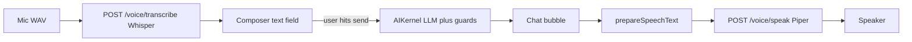
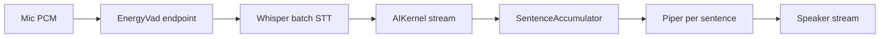

# Voice System and NLP — Analysis

Cross-checked against the current tree and
[`docs/plans/phase-h-live-voice-chat.md`](../plans/phase-h-live-voice-chat.md)
(Phase H: planned, not started). This report records what voice does today, where
NLP-like processing actually lives, and what Phase H changes — without implementing
live voice.

## Verdict

**Voice does not use classical NLP today.** There is no spaCy, NLTK, Stanza,
langdetect, TextBlob, lingua, or fastText in `aura_backend/requirements.txt`, the
lockfile, or the Flutter `pubspec`. The voice path is ASR + TTS plus lightweight
regex/script heuristics for speakable text. Chat-side “understanding” is the local
LLM via `AIKernel`, not a classical NLP stack.

| Layer | What it is | Classical NLP? |
| --- | --- | --- |
| Faster-Whisper (`tiny.en`) | Speech → text (ASR) | No — recognition, not understanding |
| Piper / espeak-ng | Text → speech (TTS) | No |
| `prepare_spoken_text` / client `prepareSpeechText` | Regex: strip markdown, punctuate structure, expand `$`/dates/abbrevs | Lightweight text prep only |
| `detect_speech_language` | Count Arabic vs Latin letters | Script heuristic, not an LID library |
| `AIKernel` + local LLM | NLU/NLG after the user sends chat | Broad sense yes — **LLM**, not classical NLP |
| Knowledge/safety (chunking, BM25 tokenize, `RuleEntityExtractor`, safety regex) | Homegrown text rules | Shallow IE / IR / security — **not on `/voice/*` routes** |

---

## What voice uses today

Push-to-talk, turn-shaped HTTP. Speech ports are reached **directly** from
`/voice/*` and **bypass the kernel**:

```226:229:aura_backend/aura_core/container.py
        # Phase F2: neither speech port feeds an engine constructor either -- both are reached
        # directly from `api/v3.py`'s `/voice/*` routes.
        self.stt_engine = self._build_stt_engine()
        self.tts_engine = self._build_tts_engine()
```

### ASR — Faster-Whisper

- Dependency: `faster-whisper>=1.0.0` (`aura_backend/requirements.txt:42`).
- Default model: `tiny.en` (`aura_backend/aura_core/config/settings.py:718`).
- HTTP: `POST /api/v3/voice/transcribe` returns joined segment text with no
  linguistic post-process (`aura_backend/aura_core/api/v3.py:473-492`).
- Engine joins Whisper segments as-is:

```74:77:aura_backend/aura_core/adapters/whisper_stt.py
    def _transcribe(self, model, audio: bytes, language: str | None) -> str:
        try:
            segments, _info = model.transcribe(io.BytesIO(audio), language=language)
            return " ".join(segment.text.strip() for segment in segments).strip()
```

### Client capture → composer (no auto-send)

`VoiceRecorderButton` records WAV (≤60s), calls transcribe, and drops the transcript
into the composer; the user must review and hit send
(`aura_client/lib/features/chat/presentation/widgets/voice_recorder_button.dart:15-18`).

### TTS — Piper / espeak-ng + language-aware routing

- `POST /api/v3/voice/speak` synthesizes WAV via `container.tts_engine`
  (`aura_backend/aura_core/api/v3.py:494-514`).
- `LanguageAwareTtsEngine` picks Piper EN/AR or espeak from script detection
  (`aura_backend/aura_core/adapters/language_aware_tts.py:99-138`).
- Piper and espeak both call `prepare_spoken_text` before synthesis
  (`piper_tts.py:171`, `espeak_tts.py:122`).

### Speakable-text regex (not NLP)

`prepare_spoken_text` strips markup, punctuates structure, and (for English)
expands currency/dates/abbreviations
(`aura_backend/aura_core/adapters/spoken_text.py:206-230`). The Flutter client
mirrors structure prep in `prepareSpeechText`
(`aura_client/lib/core/ai/voice/speech_text.dart:1-22`).

### Script language detect (not LID)

```22:34:aura_backend/aura_core/adapters/speech_language.py
def detect_speech_language(text: str) -> str:
    """Return ``"ar"`` or ``"en"`` from letter-script counts.
    ...
    """
```

Client mirror: `aura_client/lib/core/ai/voice/speech_language.dart:14-19`.

### Not present on voice routes

No VAD, no duplex session, no `aura_core/voice/` package, no spaCy/NLTK, no
entity/intent pipeline on the transcript before chat send.

---

## Where NLP-like processing actually lives

These run on the **chat / knowledge** path — not on `/voice/transcribe` or
`/voice/speak`:

| Mechanism | Location | Role |
| --- | --- | --- |
| LLM NLU/NLG | `aura_core/kernel/kernel.py` (`AIKernel`) | Understanding + generation after send |
| Safety guards | `aura_core/safety/` | Regex/unicode/size filters on kernel turns |
| Sentence chunking | `knowledge/chunking.py` `split_sentences` (~L108) | Document ingest |
| BM25 `tokenize` | `knowledge/retrieval.py:44-54` | Lexical retrieval |
| `RuleEntityExtractor` | `knowledge/extraction.py:5-8, ~103` | Pattern NER for graph ingest |
| Optional `LLMEntityExtractor` | same file | Selective LLM IE |
| `sentence-transformers` | `requirements.txt:12` | Embeddings / CrossEncoder rerank for RAG |

Kernel turn stages (input guards → memory/retrieval/history → …) start at
`kernel.py:209-226`. That path is reached only after the user sends a normal chat
message (or, under Phase H, a live `TurnRequest`).

**`/voice/*` bypasses the kernel today** — transcribe returns raw Whisper text;
speak only rewrites for the synthesizer. Memory, RAG, tools, and safety do not
touch those routes.

---

## What Phase H changes

Source: [`docs/plans/phase-h-live-voice-chat.md`](../plans/phase-h-live-voice-chat.md)
— **planned, not started**. Reuses existing batch Whisper + Piper/espeak; live
turns go through `AIKernel.stream()` (`TurnRequest(route="voice_live")`).

| Phase H piece | Classical NLP? |
| --- | --- |
| `EnergyVad` (RMS + ZCR) | No — signal processing |
| `EndpointDetector` / barge-in | No — state machine |
| `SentenceAccumulator` (`.!?` + Arabic `؟ ۔`) | Shallow punctuation splitting |
| Language policy (`tiny.en` → English-only live STT) | Config gate, not LID |
| Kernel-through live turns | LLM path (same as chat), not spaCy/NLTK |

Phase H does **not** add spaCy, NLTK, or transformers-for-NLU. Sentence splitting
for early TTS is the same *kind* of heuristic already used in speakable-text prep
and knowledge `split_sentences`.

End-to-end under Phase H:

1. Mic PCM → energy VAD → WAV wrap → batch Whisper → final transcript (still no
   classical NLP on the string).
2. Transcript → `AIKernel.stream()` — guards, memory, retrieval, tools, LLM.
3. Assistant tokens → `SentenceAccumulator` → per-sentence TTS (still
   `prepare_spoken_text` inside Piper/espeak) → streamed PCM.
4. Confirmation / revision may hold TTS until `done` so spoken audio does not
   bypass ADR-006 or post-hoc guards.

Default STT remains `tiny.en`; Arabic live STT is not claimed until a
multilingual model is configured (Phase H language policy).

---

## Practical consequences

| Topic | Effect |
| --- | --- |
| Understanding | Live turns get memory, RAG, tools, safety — today voice skips that until send |
| Latency | Still dominated by LLM (Phase A4 chat p50 ~56 s); sentence TTS only helps time-to-first-audio |
| Arabic | Piper can speak AR; default STT `tiny.en` cannot claim Arabic live recognition |
| Transcript quality | Raw Whisper → kernel; bad ASR becomes bad LLM input with no user review buffer |
| Classical NLP | Still absent unless deliberately added (out of Phase H scope) |

---

## Paths (current vs Phase H)

### Current voice path (no NLP on speech)



### Phase H live path (kernel-through, still no spaCy/NLTK)



---

## Bottom line

1. **Today:** Voice = ASR + TTS + speakable-text regex/script heuristics. **No classical NLP stack on voice.**
2. **Elsewhere:** Homegrown regex IE, chunking, BM25 tokenize, safety patterns, plus LLM for NLU/NLG — **unused by `/voice/*`**.
3. **Phase H:** Duplex orchestration + energy VAD + punctuation sentence splitting + **kernel-through** turns; **still no spaCy/NLTK**. The meaningful change is conversation through the LLM kernel, not a new NLP engine.

True classical NLP on transcripts (intent, NER, normalization before the LLM)
would be a **separate design** on top of Phase H — not what the current Phase H
plan builds.
