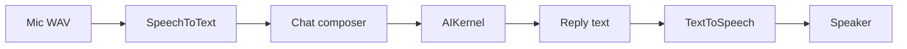
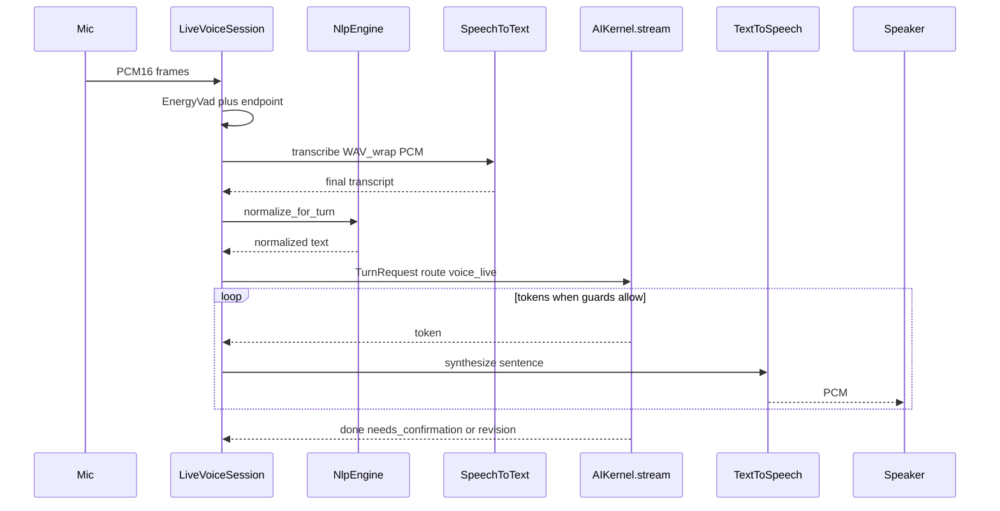
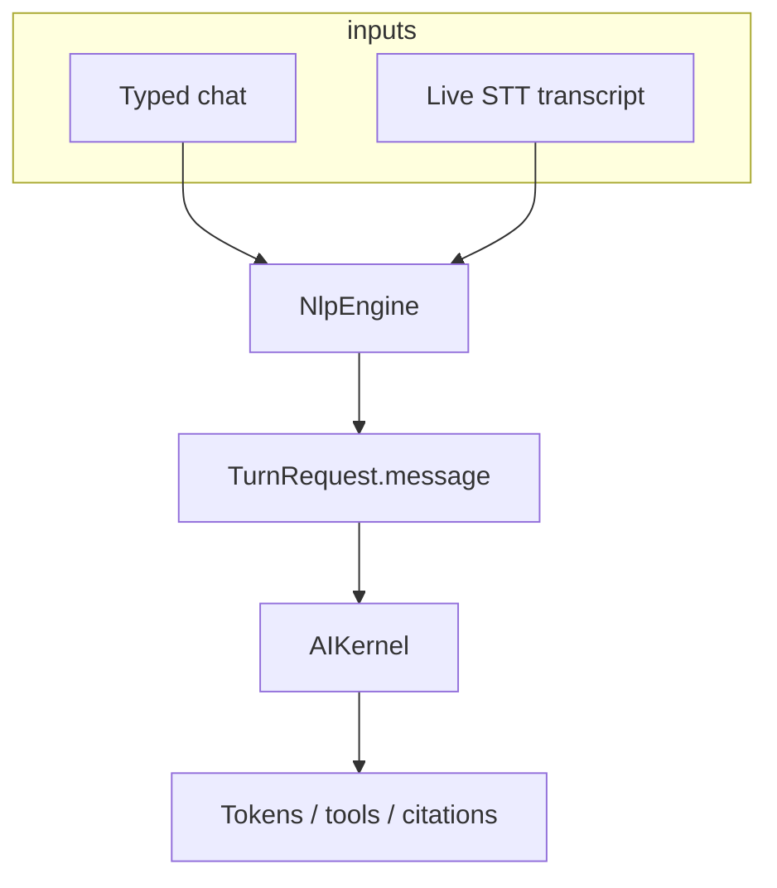

# Voice vs NLP analysis

**Verdict:** Today's AURA "voice" is **ASR + TTS**, not classical NLP. Live duplex (Phase H) is
orchestration through `AIKernel`. A separate **Phase I** text-NLP layer owns transcript
normalization and optional shallow intent/entity hooks. Neither phase is "done" from unit tests
alone.

Source plans: [phase-h-live-voice-chat.md](../plans/phase-h-live-voice-chat.md),
[phase-i-nlp.md](../plans/phase-i-nlp.md). Analysis baseline also reflected in the internal
Phase H plan review (audio formats, confirmation, `tiny.en`, in-memory speech adapters).

---

## What voice is today

Push-to-talk HTTP:

1. Client records WAV → `POST /api/v3/voice/transcribe` → Whisper transcript into the composer.
2. User sends chat → `AIKernel`.
3. Speaker on the bubble → `POST /api/v3/voice/speak` → Piper/espeak WAV playback.

Speech ports (`aura_core/ports/speech.py`) are batch `transcribe(bytes) -> str` and
`synthesize(text) -> bytes`. `container.py` documents that `/voice/*` reaches those ports
**directly** and bypasses the kernel — correct for "read this bubble aloud," wrong for a live
conversation turn.

Speakable-text shaping (`adapters/spoken_text.py`) is **output** hygiene for TTS, not input NLP.

---

## Phase H — live voice (kernel-through)

Full-duplex session over WebSocket `/api/v3/voice/live`: VAD endpointing, PCM→WAV wrap for
batch STT, `TurnRequest(route="voice_live")` into `AIKernel.stream()`, sentence-level TTS with
confirmation / post-hoc-guard buffering, barge-in via task cancel.

**Citations (design anchors):**

- Kernel-through rule: roadmap L68; ADR-006.
- Batch speech ports: `aura_core/ports/speech.py`.
- Confirmation today: `done.needs_confirmation` + HTTP `confirmed_tools` (`api/v3.py`).
- Self-hosting fitness: `tests/architecture/test_no_external_inference.py`.

---

## Phase I — NLP as its own layer

Phase I is **not** Whisper and **not** the live WebSocket. It is text processing that both
typed chat and live transcripts share:

| Concern | Owner |
| --- | --- |
| Audio → text | Phase F2 / H (`SpeechToText`) |
| Text normalize / shallow intent / entity metadata | Phase I (`aura_core/nlp/`) |
| Plan / tools / memory / safety | `AIKernel` |
| Text → audio | Phase F2 / H (`TextToSpeech` + speakable-text) |

---

## Product honesty

Measured chat p50 on the production-shaped host remains ~56 s (Phase A4). Sentence TTS improves
time-to-first-audio, not time-to-full-answer. Energy VAD is testable v1, not commercial neural
VAD. Default STT `tiny.en` means live Arabic STT is out of scope until a multilingual model is
configured and proven.

See Phase H and Phase I **Will not claim** sections before marking either phase done.
